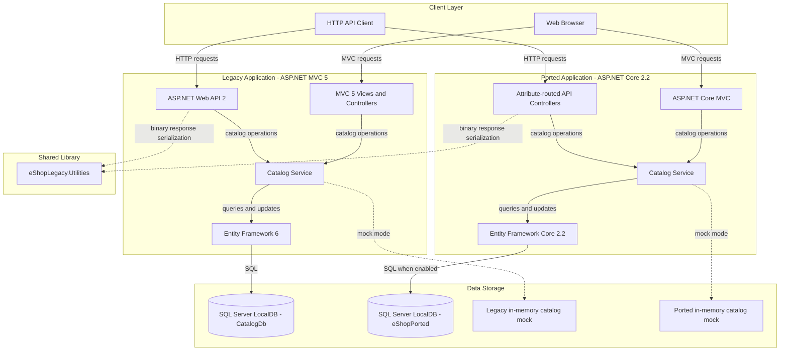
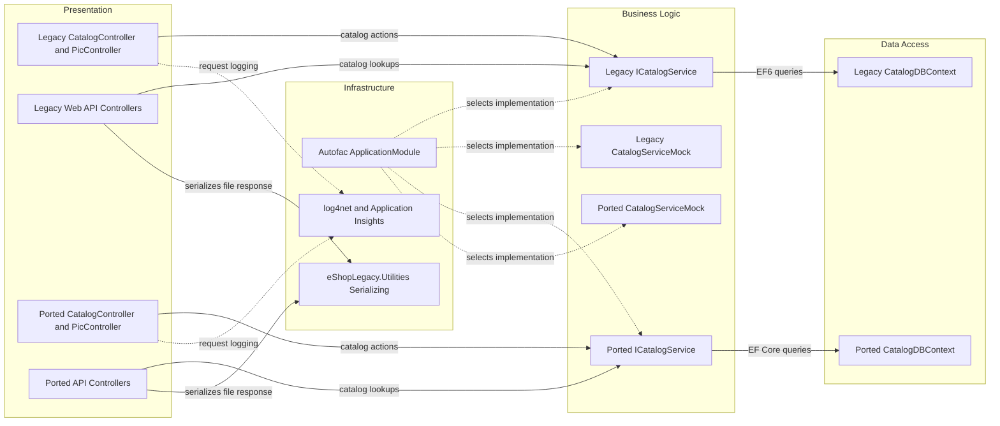

# Architecture Diagram

The solution contains a legacy ASP.NET MVC application and a separately hosted ported MVC application, backed by a shared catalog domain. Each application can use its own SQL Server persistence implementation or an in-memory mock service.

## Application Architecture

### Technology Stack Summary

| Layer | Technology | Version | Purpose |
|---|---|---|---|
| Legacy presentation/API | ASP.NET MVC and ASP.NET Web API | MVC 5.2.7; Web API 5.2.7 | Server-rendered catalog pages and HTTP endpoints |
| Legacy data | Entity Framework 6 | 6.2.0 | SQL Server access and catalog persistence |
| Ported presentation/API | ASP.NET Core MVC | 2.2.0 | Ported server-rendered pages and attribute-routed endpoints |
| Ported data | Entity Framework Core with SQL Server provider | 2.2.6 | SQL Server access and migrations |
| Dependency injection | Autofac | 6.1.0 (legacy); 4.9.1 (ported) | Service registration and lifetime management |
| Shared utilities | eShopLegacy.Utilities | .NET Framework 4.6.1 | Binary serialization helper |
| Logging/telemetry | log4net; Application Insights | 2.0.10; 2.9.1 (legacy) | Application logging and telemetry |

### Data Storage & External Services

The legacy application is configured for SQL Server LocalDB and Entity Framework 6. The ported application has a separate LocalDB connection and EF Core model, but its checked-in settings enable mock data by default. No external APIs, message brokers, caches, or service-discovery systems were identified.

### Key Architectural Decisions

- Both applications expose the same catalog domain through separate MVC/API and persistence stacks; they are not a distributed service system.
- Autofac selects either a per-application mock catalog service or a database-backed service through the `UseMockData` setting.
- The mock implementation is a singleton with mutable in-memory catalog state when enabled.

## Component Relationships

### Component Inventory

| Component | Layer | Type | Responsibility |
|---|---|---|---|
| Legacy `CatalogController` | Presentation | MVC controller | Catalog browse, create, update, and delete pages |
| Legacy `PicController` | Presentation | MVC controller | Reads catalog image files |
| Legacy Web API controllers | Presentation | API controllers | Expose brands, files, and a sample catalog response |
| Ported `CatalogController` | Presentation | MVC controller | Ported catalog page and CRUD flow |
| Ported `BrandsController` and `FilesController` | Presentation | API controllers | Expose brand data and serialized brand data |
| `ICatalogService` implementations | Business Logic | Service | Catalog queries and changes, backed by EF or mock data |
| `CatalogDBContext` | Data Access | EF context | Maps catalog items, brands, and types |
| `ApplicationModule` | Infrastructure | DI module | Selects mock or database-backed catalog services |
| `eShopLegacy.Utilities.Serializing` | Infrastructure | Utility | Serializes brand DTO collections using `BinaryFormatter` |
