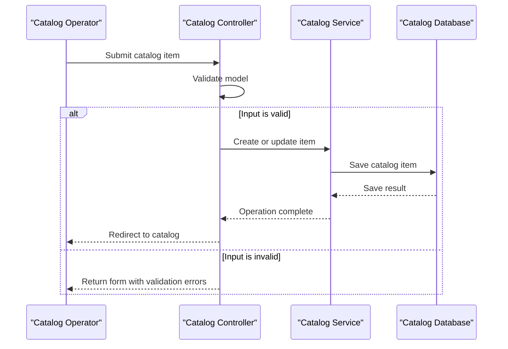

# Core Business Workflows

The application supports browsing and maintaining a product catalog for an online shop. Catalog items are categorized by brand and product type and can be displayed with an associated image.

## Domain Entities

| Entity | Service / Bounded Context | Description | Key Relationships |
|---|---|---|---|
| `CatalogItem` | Catalog | A sellable catalog entry with price, stock, and image metadata | Belongs to one brand and one product type |
| `CatalogBrand` | Catalog | Brand identity used to group catalog products | Can be associated with multiple catalog items |
| `CatalogType` | Catalog | Product classification such as mug or shirt | Can be associated with multiple catalog items |

## Service-to-Domain Mapping

| Service | Domain Context | Owned Entities | External Dependencies |
|---|---|---|---|
| `eShopLegacyMVC` | Product Catalog | Catalog items, brands, and types | Local SQL Server database or in-memory mock |
| `eShopPorted` | Product Catalog | Catalog items, brands, and types | Separate LocalDB database or in-memory mock |

The two applications implement the same catalog context independently. There is no cross-context data exchange or service-to-service ownership boundary.

## Primary Workflows

### Workflow 1: Browse the catalog

1. A client requests the catalog page with optional pagination values.
2. The controller delegates to `ICatalogService`.
3. The service retrieves a page of catalog items and attaches brand/type data, using EF or the configured mock implementation.
4. The controller supplies image URI placeholders and renders a paginated view.

### Workflow 2: Maintain catalog items

1. An operator submits catalog item details through the create or edit form.
2. Model binding and data annotations validate the submitted model.
3. The controller calls `CreateCatalogItem` or `UpdateCatalogItem`; the service persists the change or updates the mock list.
4. The application redirects to the catalog listing. Delete follows a similar controller/service path.

### Workflow 3: Display a catalog image

1. The client requests an image by catalog item identifier.
2. `PicController` resolves the item through the catalog service.
3. The controller reads the file named by the item's `PictureFileName` and returns it with an image MIME type.

## Cross-Service Data Flows

No cross-service composition occurs. Each application obtains catalog items and related brand/type data from its own service implementation. In mock mode, data is supplied from in-memory preconfigured collections; in database mode, the application queries its own SQL database. The image flow is local to the same application and file system.

## Business Workflow Sequence

## Business Rules & Decision Logic

- Catalog items require a name and a valid price; price and stock fields have range/format validation in the model.
- Items reference one brand and one product type; the EF mappings persist these relationships.
- Database-backed create operations generate catalog item IDs through the hi-lo sequence helper; the mock service assigns the next ID from the current list.
- Catalog reads are ordered by item ID and paginated using the supplied page size and index.
- MVC form submissions use anti-forgery validation; no role-based or resource-ownership checks were found.
- Database changes are saved through the EF context. No cross-service transaction, saga, or audit trail was identified.
