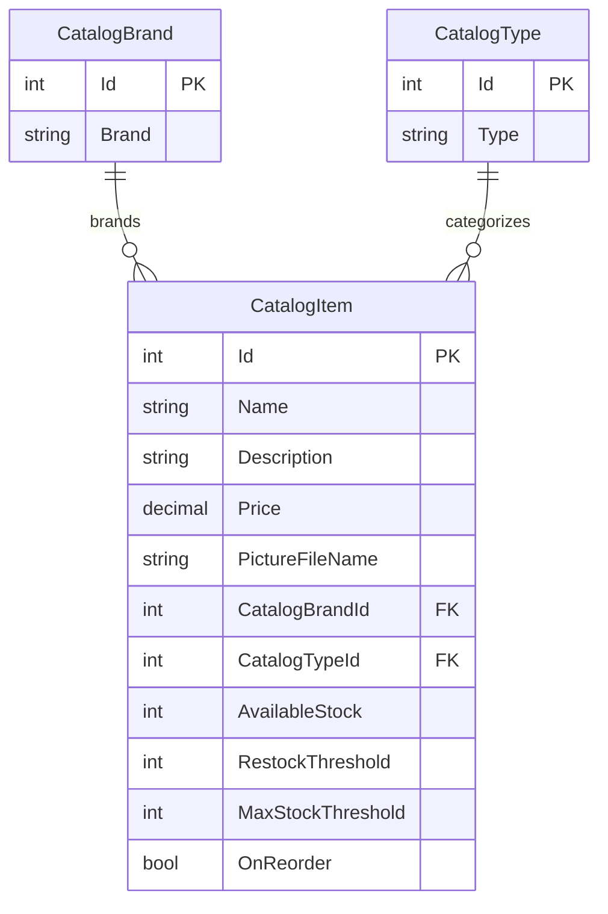

# Data Architecture & Persistence Layer

The catalog domain contains three entities and is persisted to SQL Server through either Entity Framework 6 or Entity Framework Core. The two web applications maintain separate database configurations and can instead run with in-memory mock catalog services.

## Database Configuration

| Service/Module | DB Type | Profile | Driver | Connection | Migration Tool |
|---|---|---|---|---|---|
| `eShopLegacyMVC` | SQL Server LocalDB | Default (`UseMockData=false`) | `System.Data.SqlClient` | LocalDB catalog connection with integrated security | EF6 database initializer and SQL sequence scripts |
| `eShopPorted` | SQL Server LocalDB | Database mode (`UseMockData=false`) | EF Core SQL Server provider | LocalDB connection in `appsettings.json` | EF Core migrations |
| `eShopPorted` | In-memory mock | Checked-in default (`UseMockData=true`) | — | No database connection opened | — |

Legacy initialization seeds catalog types, brands, and items from preconfigured data or CSV customization files. The ported EF Core model uses migrations and `HasData` seed data. No separate cache or additional database type was found.

## Data Ownership per Service

| Service | Tables Owned | ORM Framework | Caching | Notes |
|---|---|---|---|---|
| `eShopLegacyMVC` | `Catalog`, `CatalogBrand`, `CatalogType` | Entity Framework 6 | None; optional singleton in-memory mock | One catalog context owns the three entity sets |
| `eShopPorted` | `Catalog`, `CatalogBrand`, `CatalogType` | Entity Framework Core 2.2 | None; singleton in-memory mock by default | Separate application database/schema and EF Core migrations |

## Entity Model

The same catalog relationships are represented by both applications; the diagram shows the shared logical model.

The source entities are `src/eShopLegacyMVC/Models/CatalogBrand.cs`, `CatalogType.cs`, and `CatalogItem.cs`; equivalent types are in `eShopPorted/Models`. `CatalogItem` has required many-to-one relationships to brand and type. Database writes are made by the catalog service and saved through the EF context.

## Key Repository Methods

| Service | Repository | Notable Methods | Purpose |
|---|---|---|---|
| `eShopLegacyMVC` | `CatalogService` (`Services/CatalogService.cs`) | `GetCatalogItemsPaginated(pageSize, pageIndex)` | Counts, orders, and returns a page with brand and type |
| `eShopLegacyMVC` | `CatalogService` | `FindCatalogItem(id)`, `GetCatalogBrands()`, `GetCatalogTypes()` | Loads catalog and lookup data |
| `eShopLegacyMVC` | `CatalogService` | `CreateCatalogItem`, `UpdateCatalogItem`, `RemoveCatalogItem` | Persists catalog changes |
| `eShopPorted` | `CatalogService` (`eShopPorted/Services/CatalogService.cs`) | `GetCatalogItemsPaginated`, `FindCatalogItem` | Queries catalog data and related lookups |
| `eShopPorted` | `CatalogService` | `GetCatalogBrands()`, `GetCatalogTypes()`, `CreateCatalogItem`, `UpdateCatalogItem`, `RemoveCatalogItem` | Lookup and catalog CRUD operations |

There are no repository interfaces; `CatalogService` accesses the EF context directly. No notable bulk cross-service queries were identified.

## Caching Strategy

No cache provider, cache API, or cache invalidation strategy was found. `CatalogServiceMock` holds catalog data in memory when mock mode is enabled, but this is the selected data implementation rather than a cache. In both applications the mock service is registered as a singleton and its mutable list is shared across requests.

## Data Ownership Boundaries

Each application has its own EF context and connection configuration; neither calls the other or shares data through an API. The logical catalog schema is repeated in both applications. The database-backed service is the source of truth in database mode; the mock service uses preconfigured data when enabled.

### Data Classification & Sensitivity

| Entity | Sensitive Fields | Classification (PII/PHI/PCI/None) | Controls in Place |
|---|---|---|---|
| `CatalogItem` | Product name, description, price, inventory and image filename | None | Not applicable |
| `CatalogBrand` | Brand name | None | Not applicable |
| `CatalogType` | Product type name | None | Not applicable |

No PII, PHI, or PCI data was identified in the catalog entity model.
