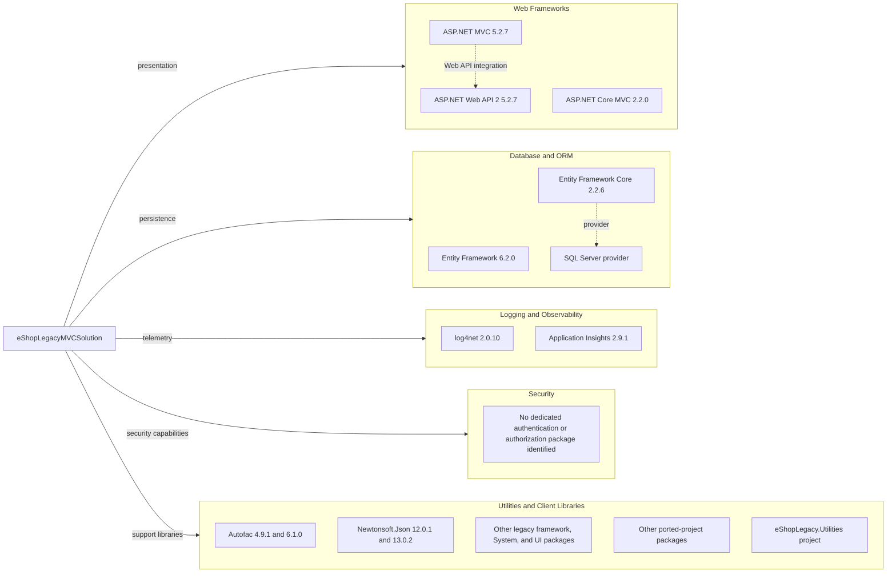

# Dependency Map

The solution has three projects and 59 unique direct NuGet package/version coordinates across its application projects and legacy package manifest. The two web applications use separate generations of the ASP.NET and Entity Framework stacks.

## Dependencies

### Dependency Summary

| Category | Count | Key Libraries | Notes |
|---|---:|---|---|
| Web Frameworks | 3 | ASP.NET MVC 5, Web API 2, ASP.NET Core MVC 2.2 | Separate legacy and ported web stacks |
| Database / ORM | 3 | Entity Framework 6, EF Core 2.2, SQL Server provider | Separate data-access generations |
| Logging / Observability | 2 | log4net, Application Insights | Both declared for the legacy app |
| Security | 0 | — | No dedicated authentication/authorization package identified |
| Utilities | 51 | Autofac, Newtonsoft.Json, System libraries, UI packages | Grouped for readability; includes multiple package versions and legacy web assets |

### Version & Compatibility Risks

The application targets .NET Framework 4.6.1 and 4.7.2, while the ported app targets `net461` and depends on ASP.NET Core 2.2 and EF Core 2.2. These frameworks and packages are out of support. The legacy MVC project declares Newtonsoft.Json 12.0.1, which is affected by CVE-2024-21907; the ported project declares 13.0.2.

### Notable Observations

- Two projects carry different Autofac versions and separate MVC/EF generations.
- `eShopLegacy.Utilities` uses `BinaryFormatter`, which is obsolete in modern .NET.
- The legacy MVC project declares packages both in its project file and `packages.config`.

## Test Dependencies

| Framework | Version | Notes |
|---|---|---|
| None detected | — | No test-scoped packages or test project were found in the solution. |

Total test-scope dependencies: 0

No test project or test framework was detected in the solution.
