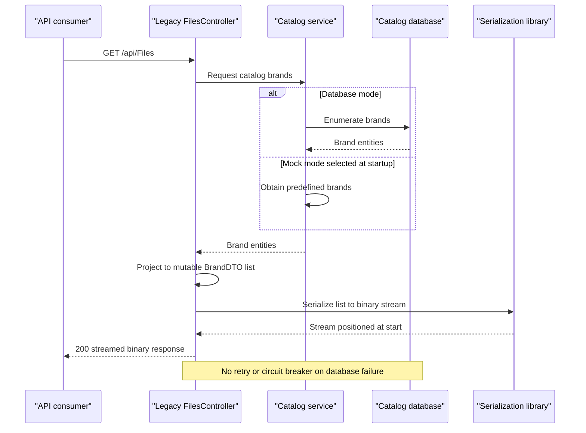

# API & Service Communication Contracts

The scoped source declares catalog HTML/form actions, brand APIs, and binary-export actions in two alternative applications. Inventory below contains **26 action declarations** (14 legacy, 12 ported), including two explicitly caveated declarations; excluding those leaves 24 candidate actions, not runtime-verified endpoints. Application-to-service calls are synchronous and in-process, not microservice traffic.

Scope: `D:\a\eShopModernizing\eShopModernizing\eShopLegacyMVCSolution` only. Route aliases and framework-generated responses are not counted as additional endpoints. No runtime requests were executed.

## Service Catalog

| Service | Port | Category | Purpose |
|---|---|---|---|
| eShopLegacyMVC | IIS Express URL 52429; alternate development metadata 53134 | API Layer / Business | Catalog UI and APIs; MVC/Web API 5.2.7, EF6 6.2.0 |
| eShopPorted | Project profile HTTP 5000 / HTTPS 5001; IIS Express 52637 / SSL 44337 | API Layer / Business | Alternative catalog port; ASP.NET Core MVC 2.2.0, EF Core 2.2.6 |
| eShopLegacy.Utilities | None | Infrastructure library, not independently hosted | Shared framework binary serialization |

All three projects are solution members; **no extra projects** exist under the assessed folder. No scoped Compose/Kubernetes service definitions were found. Ports are development declarations, not observed production bindings. [P1–P3]

## API Endpoints Inventory

`L` = eShopLegacyMVC; `P` = eShopPorted. The two catalog controllers each declare eight actions. Unconstrained MVC actions are **not GET-only**: GET is their intended UI use, but source does not apply an HTTP verb restriction. No API versioning scheme is declared.

| Service | Method | Path | Request Type | Response Type |
|---|---|---|---|---|
| L, P | Unrestricted; intended GET | `/`, `/Catalog`, `/Catalog/Index` | Query `pageSize=10`, `pageIndex=0` | HTML with `PaginatedItemsViewModel<CatalogItem>` |
| L, P | Unrestricted; intended GET | `/Catalog/Details/{id?}` | Nullable integer path/query ID | HTML `CatalogItem`; 400 missing ID, 404 absent item |
| L, P | Unrestricted; intended GET | `/Catalog/Create` | None | HTML `CatalogItem` and reference lists |
| L, P | POST | `/Catalog/Create` | Form-bound `CatalogItem`, antiforgery token | 302 Index on success; redisplayed HTML when invalid |
| L, P | Unrestricted; intended GET | `/Catalog/Edit/{id?}` | Nullable integer path/query ID | HTML `CatalogItem`; 400/404 |
| L, P | POST | `/Catalog/Edit/{id?}` | Form-bound `CatalogItem`, antiforgery token | 302 Index on success; invalid form redisplayed |
| L, P | Unrestricted; intended GET | `/Catalog/Delete/{id?}` | Nullable integer path/query ID | Confirmation HTML `CatalogItem`; 400/404 |
| L, P | POST | `/Catalog/Delete/{id?}` | Integer ID, antiforgery token | 302 Index; missing entity not explicitly handled here |
| L | GET | `/items/{catalogItemId:int}/pic` | Integer route ID | File bytes with selected MIME type; 400 nonpositive, 404 absent item |
| L | GET | `/api/Brands` | None | Content-negotiated `IEnumerable<CatalogBrand>` |
| L | GET | `/api/Brands/{id}` | Integer route ID | `CatalogBrand`; 200/404 |
| L | DELETE | `/api/Brands/{id}` | Integer route ID | 200 existing / 404 absent; **does not delete** |
| L | GET | `/api/Files` | None | 200 `StreamContent` containing binary-serialized brand DTO list |
| P | Unrestricted | `/api/Brands` | None | 200 `Ok(IEnumerable<CatalogBrand>)` |
| P | DELETE | `/api/Brands/{id}` | Integer route ID | 200 existing / 404 absent; **does not delete** |
| P | Unrestricted | `/api/Files` | None | `Ok(Stream)` object result; not an explicit binary file response |
| L, caveated declaration | GET attribute | Intended `/api` on `CatalogController2.Index` | None | Anonymous greeting via `Json`; discoverability and GET JSON behavior caveated below |
| P, caveated declaration | Legacy GET attribute | Intended `/items/{catalogItemId:int}/pic` | Integer route ID | Legacy MVC `ActionResult` and attributes retained; not a verified Core route |

Catalog routes/actions: [P4–P6]. Brand/export/picture contracts: [P7–P11].

**Routing and compatibility caveats**

- `CatalogController2` ends in `Controller2`, not the conventional `Controller` suffix; its MVC route attribute is not proof that MVC discovers it. It also calls legacy `Json` without `AllowGet`, so even discovery would not establish a working GET response. [P11]
- The port's picture controller still uses `System.Web.Mvc` attributes/results and an empty picture-root string. Core MVC registration does not make these legacy attributes equivalent to Core routing/results. Catalog pages instead generate `/Pics/{id}.png` URLs for static images. [P10], [P6]
- Ported brand/file `Index` actions have a controller route but **no HttpGet restriction**; ported brand-by-ID GET is absent. API parity with legacy is incomplete. [P9]
- Export response parity is not established: legacy explicitly builds `StreamContent`, while the port returns an object result around a stream. [P8], [P9]

## Management & Observability Endpoints

| Service | Endpoint | Custom Metrics (if any) |
|---|---|---|
| Legacy | No dedicated health, metrics, or OpenAPI endpoint found | Application Insights auto-collection configured; no custom metric registration found |
| Ported | No dedicated health, metrics, or OpenAPI endpoint found | No metrics exporter registration found |
| Utility | Not hosted | None |

Legacy telemetry SDK collectors are not management endpoints. Startup evidence: [P12].

## DTOs & Contracts

- `CatalogItem` is a mutable service-level entity also used as MVC form input and view model; `CatalogBrand` is a mutable domain response. Their persistence fields belong in `data-architecture.md`. No gateway-level composition DTO exists. [P4], [P7]
- Each `FilesController` defines its own mutable, `[Serializable]` nested `BrandDTO` for export. The similarly named DTOs are different CLR types in different assemblies/namespaces; a stable interoperable binary schema is not demonstrated. [P8], [P9]
- `PaginatedItemsViewModel<TEntity>` carries paging/view results and is not immutable (`TotalPages` has a public setter). [P13]
- Shared `Serializing` uses framework `BinaryFormatter`. No endpoint accepting uploaded serialized data or calling its deserializer was found; do not infer such an ingestion contract. Legacy brand APIs use Web API content negotiation; Core uses MVC object results with no custom serializer setup visible. [P8], [P9], [P14]
- No scoped OpenAPI, protobuf, GraphQL schema, custom API versioning, or contract-testing artifact was found.

## Communication Patterns

All controller-to-service and service-to-context operations are synchronous local calls. The utility is invoked directly in-process. No gateway, inter-application HTTP client, event broker, service discovery, load-balancer client, circuit breaker, retry policy, bulkhead, fallback-on-database-error, or explicit application timeout value was found. Mock selection is a startup option, **not an automatic outage fallback**. [P12], [P15]

Legacy startup configures its database initializer; ported startup registers the context only in database mode and does not apply migrations. Database availability can affect first data access; see `configuration-inventory.md` for startup details. No service-to-service boot ordering is declared.

**Security posture:** inspected controllers have no authentication/role/resource-ownership authorization attributes; legacy global filters contain only `HandleError`. Core startup does not register authentication/authorization middleware. Catalog POST forms have antiforgery protection, not identity authorization. Core development launch profiles offer HTTPS as well as HTTP and enable anonymous IIS access; no HTTPS redirection/TLS enforcement is present in Startup. Production IIS/proxy security policy is outside the scope and cannot be inferred. [P4], [P6], [P12], [P16], [P3]

## Service Technology Matrix

| Service | Web | Data Access | Discovery | Gateway | Actuator | Cache | Metrics |
|---|---|---|---|---|---|---|---|
| Legacy | MVC5 / Web API2 | EF6 or mock | None found | None | None found | No application cache; process session | Application Insights collectors, key unprovisioned in file |
| Ported | Core MVC2.2 plus incomplete legacy controller | EF Core2.2 or mock | None found | None | None found | No application cache; singleton mock | None configured in Startup |
| Utility | None | None | None | None | None | None | None |

## Service Communication Sequence

### Source Evidence

- [P1] `D:\a\eShopModernizing\eShopModernizing\eShopLegacyMVCSolution\eShopLegacyMVC.sln:6-11`.
- [P2] `D:\a\eShopModernizing\eShopModernizing\eShopLegacyMVCSolution\src\eShopLegacyMVC\eShopLegacyMVC.csproj:449-452`.
- [P3] `D:\a\eShopModernizing\eShopModernizing\eShopLegacyMVCSolution\eShopPorted\Properties\launchSettings.json:2-24`.
- [P4] `D:\a\eShopModernizing\eShopModernizing\eShopLegacyMVCSolution\src\eShopLegacyMVC\Controllers\CatalogController.cs:21-139`.
- [P5] `D:\a\eShopModernizing\eShopModernizing\eShopLegacyMVCSolution\src\eShopLegacyMVC\App_Start\RouteConfig.cs:10-16`; `D:\a\eShopModernizing\eShopModernizing\eShopLegacyMVCSolution\src\eShopLegacyMVC\App_Start\WebApiConfig.cs:10-15`.
- [P6] `D:\a\eShopModernizing\eShopModernizing\eShopLegacyMVCSolution\eShopPorted\Controllers\CatalogController.cs:22-140,161-164`; `D:\a\eShopModernizing\eShopModernizing\eShopLegacyMVCSolution\eShopPorted\Startup.cs:60-65`.
- [P7] `D:\a\eShopModernizing\eShopModernizing\eShopLegacyMVCSolution\src\eShopLegacyMVC\Controllers\WebApi\BrandsController.cs:21-49`.
- [P8] `D:\a\eShopModernizing\eShopModernizing\eShopLegacyMVCSolution\src\eShopLegacyMVC\Controllers\WebApi\FilesController.cs:20-43`.
- [P9] `D:\a\eShopModernizing\eShopModernizing\eShopLegacyMVCSolution\eShopPorted\Controllers\Api\BrandsController.cs:7-34`; `D:\a\eShopModernizing\eShopModernizing\eShopLegacyMVCSolution\eShopPorted\Controllers\Api\FilesController.cs:9-39`.
- [P10] `D:\a\eShopModernizing\eShopModernizing\eShopLegacyMVCSolution\src\eShopLegacyMVC\Controllers\PicController.cs:22-49`; `D:\a\eShopModernizing\eShopModernizing\eShopLegacyMVCSolution\eShopPorted\Controllers\PicController.cs:5-9,22-50`.
- [P11] `D:\a\eShopModernizing\eShopModernizing\eShopLegacyMVCSolution\src\eShopLegacyMVC\Controllers\Api\CatalogController.cs:5-11`.
- [P12] `D:\a\eShopModernizing\eShopModernizing\eShopLegacyMVCSolution\src\eShopLegacyMVC\Global.asax.cs:27-35,83-90`; `D:\a\eShopModernizing\eShopModernizing\eShopLegacyMVCSolution\eShopPorted\Startup.cs:25-65`; `D:\a\eShopModernizing\eShopModernizing\eShopLegacyMVCSolution\src\eShopLegacyMVC\ApplicationInsights.config:22-139`.
- [P13] `D:\a\eShopModernizing\eShopModernizing\eShopLegacyMVCSolution\src\eShopLegacyMVC\ViewModel\PaginatedItemsViewModel.cs:6-24`; `D:\a\eShopModernizing\eShopModernizing\eShopLegacyMVCSolution\eShopPorted\ViewModel\PaginatedItemsViewModel.cs:6-24`.
- [P14] `D:\a\eShopModernizing\eShopModernizing\eShopLegacyMVCSolution\eShopLegacy.Utilities\Serializing.cs:8-21`.
- [P15] `D:\a\eShopModernizing\eShopModernizing\eShopLegacyMVCSolution\src\eShopLegacyMVC\Services\CatalogService.cs:21-67`; `D:\a\eShopModernizing\eShopModernizing\eShopLegacyMVCSolution\eShopPorted\Services\CatalogService.cs:18-66`.
- [P16] `D:\a\eShopModernizing\eShopModernizing\eShopLegacyMVCSolution\src\eShopLegacyMVC\App_Start\FilterConfig.cs:8-10`.
