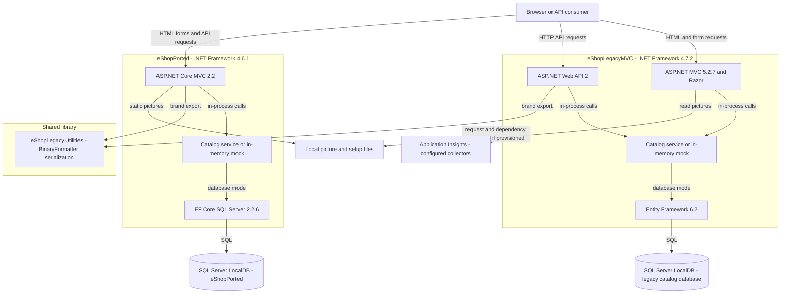
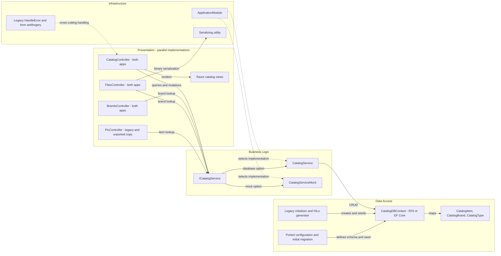

# Architecture Diagram

Static assessment of **only** `D:\a\eShopModernizing\eShopModernizing\eShopLegacyMVCSolution`. The solution contains two alternative catalog web applications and one shared utility library; no extra project files were found under this scope.

## Application Architecture

### Technology Stack Summary

| Layer | Technology | Version | Purpose |
|---|---|---|---|
| Legacy presentation | ASP.NET MVC, Web API, Razor | 5.2.7, 5.2.7, 3.2.7 | HTML administration and brand/export endpoints |
| Ported presentation | ASP.NET Core MVC | 2.2.0 | Alternative port, not a modern .NET runtime application |
| Runtime | .NET Framework | legacy 4.7.2; ported and utility 4.6.1 | Windows-oriented runtime targets |
| Composition | Autofac | legacy 6.1.0; ported 4.9.1 | Select database-backed versus singleton mock services |
| Persistence | EF6 / EF Core SQL Server | 6.2.0 / 2.2.6 | Catalog persistence |
| Diagnostics | log4net; legacy Application Insights | 2.0.10; 2.9.1 family | File logging and optional telemetry |
| Shared library | Framework BinaryFormatter | framework supplied | Binary brand export |

Evidence: [A1], [A2], [A3], [A4].

### Data Storage & External Services

The applications configure **different LocalDB database names**, not a proven shared live database. Legacy defaults to database mode; the port defaults to an in-process mock. Images are local files. Legacy Application Insights collectors are configured, but no active instrumentation key is present in its configuration, so a functioning remote telemetry integration is not established. No message broker, cache server, gateway, or outbound business API integration was found in the scoped source. See `data-architecture.md` and `configuration-inventory.md`. [A4–A7]

### Key Architectural Decisions

- Both web applications implement the same catalog context independently; the utility is a library, not a third deployable service. All three are solution members; extra projects: **none**. [A1]
- Controllers delegate directly to `ICatalogService`; implementations query their own DbContext rather than a separate repository layer. Mock services are singleton mutable lists, not caches. [A5], [A8]
- The port is incomplete: its picture controller still derives from `System.Web.Mvc.Controller`, and binary export returns `Ok(Stream)` rather than the legacy streamed response. These are source-level compatibility caveats, not runtime-verified behavior. [A9]

## Component Relationships

### Component Inventory

| Component | Layer | Type | Responsibility |
|---|---|---|---|
| CatalogController, both apps | Presentation | MVC controller | Browse, details, create, edit, delete |
| BrandsController, both apps | Presentation | HTTP controller | List brands; demo delete without mutation |
| FilesController, both apps | Presentation | HTTP controller | Project brands to export contracts |
| PicController | Presentation | MVC controller | Legacy file response; port retains incompatible framework references |
| CatalogController2 | Presentation | Legacy diagnostic source | Intended greeting; nonstandard controller name makes discovery uncertain |
| ICatalogService / CatalogService | Business | Interface / implementation | Paging, lookup and item persistence |
| CatalogServiceMock | Business | Singleton alternative | Mutable process-local demo data |
| CatalogDBContext and entity classes | Data access | EF context / models | Three catalog tables and relationships |
| CatalogDBInitializer / CatalogItemHiLoGenerator | Data access | Legacy initialization / ID allocation | Optional CSV seeds and SQL sequences |
| Config classes / Initial migration | Data access | Ported EF Core mapping | Schema, identities and seeded reference data |
| ApplicationModule | Infrastructure | Autofac module | DI lifetimes and mock selection |
| Serializing | Infrastructure | Shared library class | Framework binary serialization and deserialization |
| Global.asax / Startup | Infrastructure | Startup composition | Routes, filters, telemetry and environment error handling |

Evidence: [A5], [A8–A10].

### Source Evidence

- [A1] `D:\a\eShopModernizing\eShopModernizing\eShopLegacyMVCSolution\eShopLegacyMVC.sln:6-11` — three solution project entries.
- [A2] `D:\a\eShopModernizing\eShopModernizing\eShopLegacyMVCSolution\src\eShopLegacyMVC\eShopLegacyMVC.csproj:19,53-67,90-104,242-259,473-565` — legacy target and packages.
- [A3] `D:\a\eShopModernizing\eShopModernizing\eShopLegacyMVCSolution\eShopPorted\eShopPorted.csproj:1-32`; `D:\a\eShopModernizing\eShopModernizing\eShopLegacyMVCSolution\eShopLegacy.Utilities\eShopLegacy.Utilities.csproj:8-12` — port and library targets/references.
- [A4] `D:\a\eShopModernizing\eShopModernizing\eShopLegacyMVCSolution\src\eShopLegacyMVC\Web.config:11-20`; `D:\a\eShopModernizing\eShopModernizing\eShopLegacyMVCSolution\eShopPorted\appsettings.json:2-12` — database selection and flags.
- [A5] `D:\a\eShopModernizing\eShopModernizing\eShopLegacyMVCSolution\src\eShopLegacyMVC\Modules\ApplicationModule.cs:16-38`; `D:\a\eShopModernizing\eShopModernizing\eShopLegacyMVCSolution\eShopPorted\Startup.cs:25-65` — service composition.
- [A6] `D:\a\eShopModernizing\eShopModernizing\eShopLegacyMVCSolution\src\eShopLegacyMVC\Controllers\PicController.cs:34-46` — local image reads.
- [A7] `D:\a\eShopModernizing\eShopModernizing\eShopLegacyMVCSolution\src\eShopLegacyMVC\ApplicationInsights.config:118-139` — telemetry processors and key provisioning comment.
- [A8] `D:\a\eShopModernizing\eShopModernizing\eShopLegacyMVCSolution\src\eShopLegacyMVC\Services\CatalogService.cs:15-67`; `D:\a\eShopModernizing\eShopModernizing\eShopLegacyMVCSolution\eShopPorted\Services\CatalogService.cs:13-66` — direct context access.
- [A9] `D:\a\eShopModernizing\eShopModernizing\eShopLegacyMVCSolution\eShopPorted\Controllers\PicController.cs:5-9,38-47`; `D:\a\eShopModernizing\eShopModernizing\eShopLegacyMVCSolution\eShopPorted\Controllers\Api\FilesController.cs:20-32` — partial port behavior.
- [A10] `D:\a\eShopModernizing\eShopModernizing\eShopLegacyMVCSolution\src\eShopLegacyMVC\Global.asax.cs:27-35,60-90`; `D:\a\eShopModernizing\eShopModernizing\eShopLegacyMVCSolution\src\eShopLegacyMVC\Controllers\Api\CatalogController.cs:5-11` — startup and diagnostic source.
