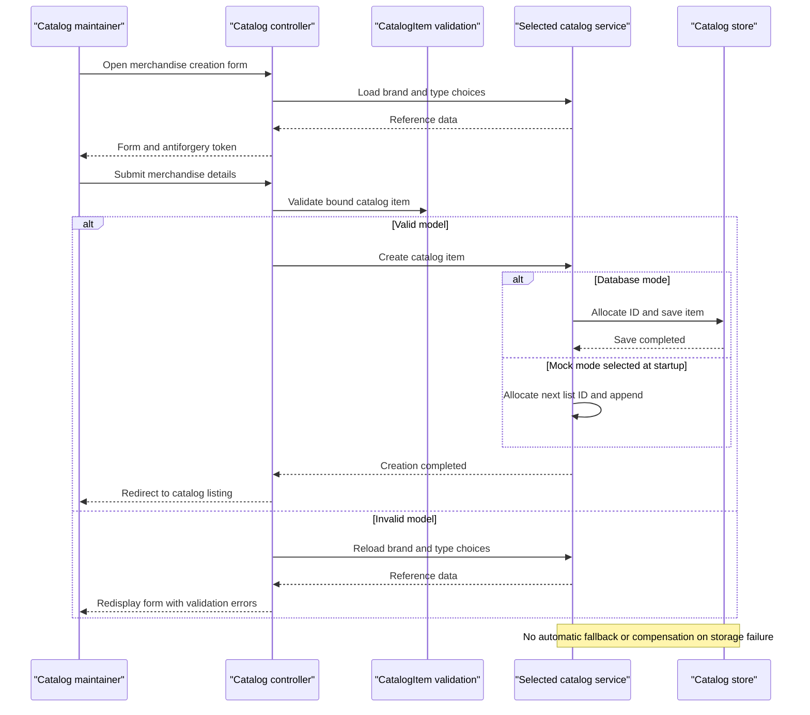

# Core Business Workflows

Users browse and maintain a merchandise catalog, classify products by brand/type, inspect product pictures, and export brand data. Stock thresholds are editable catalog metadata; no checkout, ordering, payment, automated replenishment, or shipment workflow is implemented in the inspected source.

Scope: `D:\a\eShopModernizing\eShopModernizing\eShopLegacyMVCSolution` only; both web applications and their shared library are solution members, and no extra scoped projects were found.

## Domain Entities

| Entity | Service / Bounded Context | Description | Key Relationships |
|---|---|---|---|
| CatalogItem | Catalog management, separately implemented by both apps | Merchandise listing with descriptive, price, picture and stock information | Belongs to one brand and one product type |
| CatalogBrand | Catalog management | Brand reference data | Classifies multiple merchandise items |
| CatalogType | Catalog management | Product category/type reference data | Classifies multiple merchandise items |
| BrandDTO | Export projection, not a persisted aggregate | Export-specific representation of a brand | Derived from a brand |
| PaginatedItemsViewModel | Catalog presentation | One page of catalog listings and paging metadata | Contains catalog items |

Sources: [B1–B3]. Persistence field lists and mappings are documented in `data-architecture.md`.

## Service-to-Domain Mapping

| Service | Domain Context | Owned Entities | External Dependencies |
|---|---|---|---|
| eShopLegacyMVC | Catalog management and optional customized initialization | CatalogItem, CatalogBrand, CatalogType | Own configured database and local picture/setup files |
| eShopPorted | Alternative catalog implementation | Separate copies of the same three entity concepts | Own configured database if enabled; otherwise process-local demo data |
| eShopLegacy.Utilities | Technical export support; not an independent business service | None | Framework binary serializer |

There is one conceptual catalog context, not separate brand, stock, and catalog microservices. Neither application calls the other or synchronizes its edits. [B3–B5]

## Primary Workflows

### Workflow 1: Browse catalog and view an item

1. User enters the catalog page with optional paging inputs.
2. The selected catalog service counts items and orders the requested page by item ID. Database implementations also load brand/type relationships; mock implementations compose references from predefined lists.
3. The controller adds a presentation picture URI and renders the page. Item details lookups return a missing-input or not-found result where appropriate.
4. Legacy picture delivery looks up the item and reads its configured local picture file. The ported catalog instead emits static picture URLs; its legacy-style picture controller is not an equivalent verified Core endpoint.

Sources: [B6–B8]. Paging input is not bounded by the controller; see rule R3 below.

### Workflow 2: Create or edit merchandise

1. User opens the create/edit form; the controller loads available brands and product types.
2. User submits a catalog item and antiforgery token.
3. MVC checks **CatalogItem validation** (R1), then the controller branches on ModelState validity.
4. Valid creation invokes the selected service. Legacy database mode allocates an item ID from its HiLo generator, while ported database mode relies on database identity; mock mode assigns one above the current maximum.
5. The database service saves the item, or mock mode mutates its in-process list. Success redirects to the catalog; invalid forms redisplay the item and refreshed dropdown choices.
6. Editing marks the bound item modified in database mode; the mock replaces the matching list item.

Sources: [B6], [B7], [B9], [B10]. No inventory reservation or external notification is emitted.

### Workflow 3: Confirm deletion, inspect brands, and export brands

1. Item deletion has a read-only confirmation view followed by a token-protected form submission; the service removes the item and the controller redirects.
2. Brand lookup returns the known brands or a not-found response for a missing legacy brand ID.
3. The brand DELETE action in **both apps is deliberately demo-only**: it checks existence but never removes the brand.
4. Export fetches brands, projects a `BrandDTO` list, and invokes the shared binary serializer. Legacy streams the serialized data; the port wraps the stream in an object result, so equivalent download behavior is not established.

Sources: [B6], [B7], [B11]. This is brand export only, not a product import/export round trip.

### Workflow 4: Initialize a customized legacy catalog

1. In database mode, startup installs the create-if-missing initializer.
2. When initialization is triggered, it executes sequence scripts and seeds product types, brands, then items.
3. If customization is enabled, it attempts to read setup CSV files; missing individual CSVs fall back to predefined data. **CSV schema/type/brand resolution rules** (R4) validate parsing.
4. Types, brands and items are saved in separate stages.
5. Customized pictures are provisioned by deleting current picture files and extracting the setup ZIP. Unlike missing CSV files, a missing/bad ZIP has no corresponding fallback branch.
6. The port has model/migration seed declarations but no equivalent custom CSV/ZIP initialization call in Startup.

Sources: [B12–B14]. This process has filesystem effects and is not one atomic import transaction.

## Cross-Service Data Flows

No cross-service composition, gateway aggregation, remote business API call, asynchronous business event, or distributed transaction was found. Catalog items and their brand/type labels are joined **within the selected application's own DbContext** or mock list, not across separately hosted services. The shared utility receives an in-process export projection and owns no business state. [B3], [B5], [B9–B11]

Database failure does not switch automatically to mock data. Mock selection is fixed by startup configuration and has process-local lifetime; it cannot provide coherent shared state across replicas. No circuit-breaker degradation or compensating business workflow is implemented. [B4], [B10], [B14]

## Business Workflow Sequence

## Business Rules & Decision Logic

| Rule | Implemented decision or constraint | Evidence |
|---|---|---|
| R1 — CatalogItem validation | Name required. Price uses a numeric regular expression and inclusive range 0–1,000,000; its error text says positive, but the range permits zero. Available stock, restock threshold and maximum stock each have an independent inclusive range 0–10,000,000. | Both entity files [B1] |
| R2 — Catalog relationships and defaults | New items default picture filename to `dummy.png`. Brand/type choices are loaded for forms; required foreign-key relationships and ORM text lengths are enforced at persistence rather than fully mirrored by input annotations. No rule enforces stock below maximum or threshold ordering. | [B1], [B6], [B7], [B15] |
| R3 — Pagination | Page count is ceiling(total/pageSize); pageSize/pageIndex are accepted without explicit range validation. A zero page size can cause division by zero; there is no configured maximum page size. | [B2], [B6], [B7] |
| R4 — CSV validation | Headers are normalized and checked; row/header widths must agree; type lookup must exist; price must parse using invariant culture; optional stock values parse as integers and reorder as Boolean. Empty brand/type labels are rejected. The brand-existence branch mistakenly checks the type dictionary with the brand name, so it is not a correct brand-validation guarantee. | [B12], especially lines 192-224 |
| R5 — Item identity | Legacy allocates blocks of ten IDs from SQL sequence under a process lock; port uses SQL identity; mock creation chooses current max plus one and assumes a nonempty list. | [B9], [B10], [B16] |
| R6 — Lifecycle semantics | Items are created, directly edited, or removed. `OnReorder` is editable metadata; no automatic stock/reorder state machine, uniqueness check, pricing promotion, or ordering lifecycle is present. | [B1], [B9] |
| R7 — Demo brand deletion | Existing brand returns success without mutation; absent brand returns not found. | [B11] |

**Transactions:** each database mutation uses one SaveChanges; no explicit cross-operation transaction, saga, or outbox is present. Legacy seed stages use multiple saves and file operations outside SQL atomicity. **Errors:** invalid forms are redisplayed, read actions handle missing IDs/items, but POST deletion does not explicitly guard a disappeared item; persistence/file errors have no business retry/compensation. The port configures a nondevelopment error handler referencing a Home error action, but no matching scoped Home controller was found. [B6], [B7], [B9], [B12], [B14]

**Audit and authorization:** controllers log reads and mutations, but no immutable business audit store/change history is implemented. Legacy request logging includes URL/user-agent context. Catalog writes require antiforgery tokens, but no business identity, role, or resource-ownership checks were found on these controllers; external hosting restrictions remain unknown. [B6], [B7], [B17]

### Source Evidence

- [B1] `D:\a\eShopModernizing\eShopModernizing\eShopLegacyMVCSolution\src\eShopLegacyMVC\Models\CatalogItem.cs:8-62`; `D:\a\eShopModernizing\eShopModernizing\eShopLegacyMVCSolution\eShopPorted\Models\CatalogItem.cs:8-62`.
- [B2] `D:\a\eShopModernizing\eShopModernizing\eShopLegacyMVCSolution\src\eShopLegacyMVC\ViewModel\PaginatedItemsViewModel.cs:6-24`; `D:\a\eShopModernizing\eShopModernizing\eShopLegacyMVCSolution\eShopPorted\ViewModel\PaginatedItemsViewModel.cs:6-24`.
- [B3] `D:\a\eShopModernizing\eShopModernizing\eShopLegacyMVCSolution\eShopLegacyMVC.sln:6-11`; `D:\a\eShopModernizing\eShopModernizing\eShopLegacyMVCSolution\eShopLegacy.Utilities\Serializing.cs:6-21`.
- [B4] `D:\a\eShopModernizing\eShopModernizing\eShopLegacyMVCSolution\src\eShopLegacyMVC\Modules\ApplicationModule.cs:16-38`; `D:\a\eShopModernizing\eShopModernizing\eShopLegacyMVCSolution\eShopPorted\Modules\ApplicationModule.cs:16-28`.
- [B5] `D:\a\eShopModernizing\eShopModernizing\eShopLegacyMVCSolution\src\eShopLegacyMVC\Web.config:11-20`; `D:\a\eShopModernizing\eShopModernizing\eShopLegacyMVCSolution\eShopPorted\appsettings.json:2-12`.
- [B6] `D:\a\eShopModernizing\eShopModernizing\eShopLegacyMVCSolution\src\eShopLegacyMVC\Controllers\CatalogController.cs:21-139,160-163`.
- [B7] `D:\a\eShopModernizing\eShopModernizing\eShopLegacyMVCSolution\eShopPorted\Controllers\CatalogController.cs:22-140,161-164`.
- [B8] `D:\a\eShopModernizing\eShopModernizing\eShopLegacyMVCSolution\src\eShopLegacyMVC\Controllers\PicController.cs:29-49`; `D:\a\eShopModernizing\eShopModernizing\eShopLegacyMVCSolution\eShopPorted\Controllers\PicController.cs:5-9,38-47`.
- [B9] `D:\a\eShopModernizing\eShopModernizing\eShopLegacyMVCSolution\src\eShopLegacyMVC\Services\CatalogService.cs:21-67`; `D:\a\eShopModernizing\eShopModernizing\eShopLegacyMVCSolution\eShopPorted\Services\CatalogService.cs:18-66`.
- [B10] `D:\a\eShopModernizing\eShopModernizing\eShopLegacyMVCSolution\src\eShopLegacyMVC\Services\CatalogServiceMock.cs:14-78`; `D:\a\eShopModernizing\eShopModernizing\eShopLegacyMVCSolution\eShopPorted\Services\CatalogServiceMock.cs:14-78`.
- [B11] `D:\a\eShopModernizing\eShopModernizing\eShopLegacyMVCSolution\src\eShopLegacyMVC\Controllers\WebApi\BrandsController.cs:22-49`; `D:\a\eShopModernizing\eShopModernizing\eShopLegacyMVCSolution\eShopPorted\Controllers\Api\BrandsController.cs:18-34`; `D:\a\eShopModernizing\eShopModernizing\eShopLegacyMVCSolution\src\eShopLegacyMVC\Controllers\WebApi\FilesController.cs:21-43`; `D:\a\eShopModernizing\eShopModernizing\eShopLegacyMVCSolution\eShopPorted\Controllers\Api\FilesController.cs:20-39`.
- [B12] `D:\a\eShopModernizing\eShopModernizing\eShopLegacyMVCSolution\src\eShopLegacyMVC\Models\Infrastructure\CatalogDBInitializer.cs:32-112,131-224,227-323,339-353`.
- [B13] `D:\a\eShopModernizing\eShopModernizing\eShopLegacyMVCSolution\src\eShopLegacyMVC\Global.asax.cs:83-90`.
- [B14] `D:\a\eShopModernizing\eShopModernizing\eShopLegacyMVCSolution\eShopPorted\Startup.cs:25-65`.
- [B15] `D:\a\eShopModernizing\eShopModernizing\eShopLegacyMVCSolution\src\eShopLegacyMVC\Models\CatalogDBContext.cs:57-85`; `D:\a\eShopModernizing\eShopModernizing\eShopLegacyMVCSolution\eShopPorted\Models\Config\CatalogItemConfig.cs:11-36`.
- [B16] `D:\a\eShopModernizing\eShopModernizing\eShopLegacyMVCSolution\src\eShopLegacyMVC\Models\CatalogItemHiLoGenerator.cs:11-30`; `D:\a\eShopModernizing\eShopModernizing\eShopLegacyMVCSolution\eShopPorted\Migrations\20201130044339_Initial.cs:36-67`.
- [B17] `D:\a\eShopModernizing\eShopModernizing\eShopLegacyMVCSolution\src\eShopLegacyMVC\Global.asax.cs:47-54,108-112`; `D:\a\eShopModernizing\eShopModernizing\eShopLegacyMVCSolution\src\eShopLegacyMVC\App_Start\FilterConfig.cs:8-10`.
