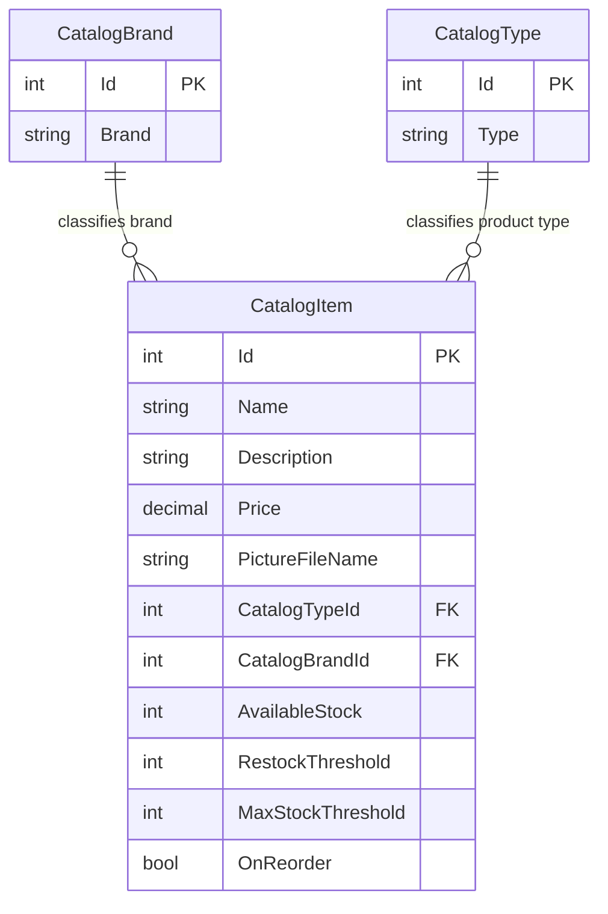

# Data Architecture & Persistence Layer

Three catalog entity concepts are independently implemented in each web project, using EF6 or EF Core with SQL Server; mock mode substitutes mutable process-local data. This assessment covers only `D:\a\eShopModernizing\eShopModernizing\eShopLegacyMVCSolution`, whose three projects are all solution members, with no extra scoped projects.

## Database Configuration

| Service/Module | DB Type | Profile | Driver | Connection | Migration Tool |
|---|---|---|---|---|---|
| Legacy | SQL Server LocalDB | Default; mock disabled | System.Data.SqlClient / EF6 SQL provider | Local integrated-identity catalog database; MARS enabled | `CreateDatabaseIfNotExists` initializer; sequence scripts and seed code, not versioned EF migrations |
| Legacy | None | Optional mock flag | None | No durable store | Preconfigured list initialized per process |
| Ported | None | Default; mock enabled | None | No durable store | Preconfigured list initialized per process |
| Ported | SQL Server LocalDB | Optional database mode; no different development DB override | EF Core SqlServer 2.2.6 | Separate integrated-identity `eShopPorted` database; MARS enabled | Initial EF Core migration and HasData seeds; no startup migration application found |
| Utility | None | Not hosted | None | None | None |

Sources: [E1–E4]. See `configuration-inventory.md` for actual property keys and connection settings. Explicit pool-size, retry, and connection-timeout tuning is absent. Database server version and deployed schema state were not observed.

## Data Ownership per Service

| Service | Tables Owned | ORM Framework | Caching | Notes |
|---|---|---|---|---|
| Legacy | Catalog, CatalogBrand, CatalogType | EF 6.2.0 | No application/query cache found | HiLo allocation for item IDs; initialization creates three sequences |
| Ported | Catalog, CatalogBrand, CatalogType | EF Core 2.2.6 | No application/query cache found | SQL identity IDs; initial migration includes seed rows and FK indexes |
| Utility | None | None | None | Serialization-only library |

Sources: [E3–E6].

## Entity Model

The diagram represents the **common conceptual model**, not cross-database relationships. Every entity is separately defined in each web project.

| Entity | Source / persisted fields | Persistence characteristics |
|---|---|---|
| CatalogItem | Both `Models\CatalogItem.cs:14-62` [E7] | Diagram shows persisted scalar fields; `PictureUri` is computed for presentation and explicitly ignored by both mappings |
| CatalogBrand | Both `Models\CatalogBrand.cs`, legacy lines 8-11 [E8] | Integer PK and required brand text, maximum 100 characters |
| CatalogType | Both `Models\CatalogType.cs`, legacy lines 8-11 [E8] | Integer PK and required type text, maximum 100 characters |

Item name is required and limited to 50 characters by both ORM mappings; price and picture filename are required. Description is optional. Integer foreign keys require a brand and type; navigation is unidirectional from item, with no inverse collections. Legacy explicitly disables database-generated item IDs, while the port's initial migration creates SQL identity columns. Ported foreign keys have cascade deletion and separate indexes; legacy required relationships rely on EF conventions rather than an explicit cascade override. No row-version/concurrency-token mapping was found. [E3], [E5], [E6]

Business input validation belongs in `business-workflows.md`; ORM length limits are not automatically equivalent to UI validation. Entity comments describe price precision, but neither mapping explicitly sets precision; the ported migration declares a decimal column without a type override. [E6], [E7]

Legacy initialization executes sequence SQL then saves types, brands, and items separately, and optionally extracts pictures from an archive. It is not a single atomic database-and-filesystem transaction. The ported migration seeds five brands, four types, and twelve items; mappings use `HasData`. No automatic migration call is visible in Startup/Program. [E4–E6], [E9]

## Key Repository Methods

There is **no separate repository interface**. Each `ICatalogService` acts as the application data-access boundary; its concrete service queries a scoped DbContext. [E10]

| Service | Repository | Notable Methods | Purpose |
|---|---|---|---|
| Both | ICatalogService / CatalogService | `PaginatedItemsViewModel<CatalogItem> GetCatalogItemsPaginated(int pageSize, int pageIndex)` | Count rows; include brand/type; order by ID; skip/take page |
| Both | ICatalogService / CatalogService | `CatalogItem FindCatalogItem(int id)` | Eager-load brand/type and find first matching ID |
| Both | ICatalogService / CatalogService | `IEnumerable<CatalogBrand> GetCatalogBrands()`; `IEnumerable<CatalogType> GetCatalogTypes()` | Return reference entity queryables through enumerable contracts |
| Legacy | CatalogItemHiLoGenerator | `int GetNextSequenceValue(CatalogDBContext db)` | Raw SQL `SELECT NEXT VALUE FOR catalog_hilo`; process lock and blocks of ten IDs |
| Legacy | CatalogDBInitializer | Sequence lookup and script execution | Raw SQL sequence selection plus ExecuteSqlCommand during database initialization |
| Both | CatalogService mutation boundary | Create/update/remove each call SaveChanges | No additional explicit transaction scope, saga, or outbox |

Sources: legacy `Services\CatalogService.cs:21-67`, ported equivalent `:18-66` [E10]; generator [E11]; initializer [E9]. Standard DbSet CRUD is not a custom repository framework. No bulk cross-service aggregation finder or stored-procedure dependency was identified.

## Caching Strategy

No Redis, MemoryCache, distributed cache, explicit cache-aside/query cache, TTL, eviction policy, or second-level cache registration was found. The singleton `CatalogServiceMock` holds mutable demo data and composes brand/type references from predefined collections; it is an alternative source of truth for the process, **not a cache of SQL data**. Changes are lost on restart and not coordinated across instances. [E12]

Legacy sessions use InProc and record machine name/session start time. This is session state, not catalog caching, and no external session provider is configured. No ported session middleware registration was found. [E13], [E4]

## Data Ownership Boundaries

These are parallel implementations of the same catalog context, not independently cooperating domain microservices. Default connections use **different database names**; no shared-database topology, cross-application SQL access, replication, or synchronization mechanism is established. Both serve reads and writes through one service/context model; no CQRS read model, event sourcing, or gateway aggregation exists in the inspected implementation. [E1], [E2], [E10]

The library owns no persistent data. Filesystem images and optional legacy setup CSV/ZIP assets are outside SQL transaction boundaries. Export DTOs are separate projections of catalog brand data, not another database-owning service. [E9], [E14]

### Data Classification & Sensitivity

| Entity | Sensitive Fields | Classification (PII/PHI/PCI/None) | Controls in Place |
|---|---|---|---|
| CatalogItem | None intrinsically; name/description are free text | None detected in intended domain | No field encryption/masking or per-field access controls found |
| CatalogBrand / CatalogType | None intrinsically | None detected | No field encryption/masking found |
| Brand export DTO | Brand identification only | None detected | Binary serialization is not encryption |
| Session / operational telemetry, outside entity model | Session identifiers, client/network/user metadata may be collected | Potential personal/operational metadata | Telemetry initializers configured; no assessment of backend retention or masking possible |

No customer names, addresses, health records, or payment-card fields were found in the entity model. Encryption-at-rest cannot be established from the checked-in LocalDB connection settings; no explicit at-rest or column-level encryption configuration is present. Integrated authentication is a connection identity mechanism, not proof of data encryption. [E1], [E2], [E7], [E13], [E15]

### Source Evidence

- [E1] `D:\a\eShopModernizing\eShopModernizing\eShopLegacyMVCSolution\src\eShopLegacyMVC\Web.config:11-20,103-111`.
- [E2] `D:\a\eShopModernizing\eShopModernizing\eShopLegacyMVCSolution\eShopPorted\appsettings.json:2-12`.
- [E3] `D:\a\eShopModernizing\eShopModernizing\eShopLegacyMVCSolution\src\eShopLegacyMVC\Models\CatalogDBContext.cs:8-85`.
- [E4] `D:\a\eShopModernizing\eShopModernizing\eShopLegacyMVCSolution\eShopPorted\Startup.cs:25-65`; `D:\a\eShopModernizing\eShopModernizing\eShopLegacyMVCSolution\eShopPorted\Program.cs:8-15`; `D:\a\eShopModernizing\eShopModernizing\eShopLegacyMVCSolution\src\eShopLegacyMVC\Global.asax.cs:83-90`.
- [E5] `D:\a\eShopModernizing\eShopModernizing\eShopLegacyMVCSolution\eShopPorted\Models\CatalogDBContext.cs:6-20`; `D:\a\eShopModernizing\eShopModernizing\eShopLegacyMVCSolution\eShopPorted\Models\Config\CatalogItemConfig.cs:11-36`; `D:\a\eShopModernizing\eShopModernizing\eShopLegacyMVCSolution\eShopPorted\Models\Config\CatalogBrandConfig.cs:11-23`; `D:\a\eShopModernizing\eShopModernizing\eShopLegacyMVCSolution\eShopPorted\Models\Config\CatalogTypeConfig.cs:10-25`.
- [E6] `D:\a\eShopModernizing\eShopModernizing\eShopLegacyMVCSolution\eShopPorted\Migrations\20201130044339_Initial.cs:10-120`.
- [E7] `D:\a\eShopModernizing\eShopModernizing\eShopLegacyMVCSolution\src\eShopLegacyMVC\Models\CatalogItem.cs:14-62`; `D:\a\eShopModernizing\eShopModernizing\eShopLegacyMVCSolution\eShopPorted\Models\CatalogItem.cs:14-62`.
- [E8] `D:\a\eShopModernizing\eShopModernizing\eShopLegacyMVCSolution\src\eShopLegacyMVC\Models\CatalogBrand.cs:8-11`; `D:\a\eShopModernizing\eShopModernizing\eShopLegacyMVCSolution\src\eShopLegacyMVC\Models\CatalogType.cs:8-11`.
- [E9] `D:\a\eShopModernizing\eShopModernizing\eShopLegacyMVCSolution\src\eShopLegacyMVC\Models\Infrastructure\CatalogDBInitializer.cs:15-92,326-353`.
- [E10] `D:\a\eShopModernizing\eShopModernizing\eShopLegacyMVCSolution\src\eShopLegacyMVC\Services\CatalogService.cs:15-67`; `D:\a\eShopModernizing\eShopModernizing\eShopLegacyMVCSolution\eShopPorted\Services\CatalogService.cs:13-66`.
- [E11] `D:\a\eShopModernizing\eShopModernizing\eShopLegacyMVCSolution\src\eShopLegacyMVC\Models\CatalogItemHiLoGenerator.cs:11-30`.
- [E12] `D:\a\eShopModernizing\eShopModernizing\eShopLegacyMVCSolution\src\eShopLegacyMVC\Modules\ApplicationModule.cs:18-38`; `D:\a\eShopModernizing\eShopModernizing\eShopLegacyMVCSolution\eShopPorted\Modules\ApplicationModule.cs:18-28`; `D:\a\eShopModernizing\eShopModernizing\eShopLegacyMVCSolution\eShopPorted\Services\CatalogServiceMock.cs:12-78`.
- [E13] `D:\a\eShopModernizing\eShopModernizing\eShopLegacyMVCSolution\src\eShopLegacyMVC\Web.config:33`; `D:\a\eShopModernizing\eShopModernizing\eShopLegacyMVCSolution\src\eShopLegacyMVC\Global.asax.cs:41-44`.
- [E14] `D:\a\eShopModernizing\eShopModernizing\eShopLegacyMVCSolution\eShopLegacy.Utilities\Serializing.cs:6-21`; `D:\a\eShopModernizing\eShopModernizing\eShopLegacyMVCSolution\src\eShopLegacyMVC\Controllers\WebApi\FilesController.cs:21-43`.
- [E15] `D:\a\eShopModernizing\eShopModernizing\eShopLegacyMVCSolution\src\eShopLegacyMVC\ApplicationInsights.config:14-20`.
