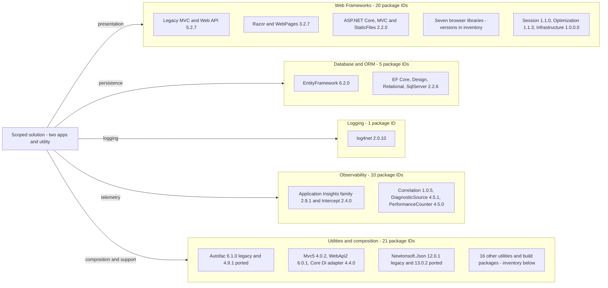

# Dependency Map

Build-manifest-only inventory for `D:\a\eShopModernizing\eShopModernizing\eShopLegacyMVCSolution`: **63 PackageReference declarations, 57 distinct package IDs, 59 ID/version pairs** across three projects. Legacy has 48 references, ported has 15, and the utility has none; the 42-entry legacy `packages.config` duplicates older package metadata and is not added again to these totals. [D1–D4]

## Dependencies

### Dependency Summary

Counts are unique IDs across projects; all are unconditioned PackageReferences, not inferred resolved transitive dependencies.

| Category | Count | Key Libraries | Notes |
|---|---:|---|---|
| Web Frameworks | 20 | MVC/Web API 5.2.7; Core 2.2.0 | Includes seven browser packages and server infrastructure |
| Database / ORM | 5 | EF 6.2.0; EF Core family 2.2.6 | Core Design is tooling rather than production logic |
| Logging | 1 | log4net 2.0.10 | Shared declaration |
| Observability | 10 | Application Insights family; telemetry correlation | Legacy-only declarations |
| Utilities | 21 | Autofac families; Json.NET; System support libraries | Includes build tools, not just runtime libraries |
| **Total** | **57** | **63 declarations** | Framework assembly references excluded from package count |

#### Complete Declared Package Inventory

`L` = legacy application; `P` = ported application. Utility uses framework assembly references only. Versions below come from `.csproj` rather than the stale legacy `packages.config`. Source ranges: [D1–D3].

| Category | Package IDs and declared versions | Projects / scope |
|---|---|---|
| Web | Microsoft.AspNet.Mvc 5.2.7; Microsoft.AspNet.Razor 3.2.7; Microsoft.AspNet.WebPages 3.2.7 | L / application |
| Web | Microsoft.AspNet.WebApi 5.2.7; Microsoft.AspNet.WebApi.Client 5.2.7; Microsoft.AspNet.WebApi.Core 5.2.7; Microsoft.AspNet.WebApi.WebHost 5.2.7 | L / application |
| Web | Microsoft.AspNetCore 2.2.0; Microsoft.AspNetCore.Mvc 2.2.0; Microsoft.AspNetCore.StaticFiles 2.2.0 | P / application |
| Web | Microsoft.AspNet.SessionState.SessionStateModule 1.1.0; Microsoft.AspNet.Web.Optimization 1.1.3; Microsoft.Web.Infrastructure 1.0.0.0 | L / application |
| Web | bootstrap 4.3.1; jQuery 3.5.0; jQuery.Validation 1.19.4; Microsoft.jQuery.Unobtrusive.Validation 3.2.11; Modernizr 2.8.3; popper.js 1.14.3; Respond 1.4.2 | L / browser assets |
| Database | EntityFramework 6.2.0 | L / application |
| Database | Microsoft.EntityFrameworkCore 2.2.6; Microsoft.EntityFrameworkCore.Relational 2.2.6; Microsoft.EntityFrameworkCore.SqlServer 2.2.6 | P / application |
| Database | Microsoft.EntityFrameworkCore.Design 2.2.6 | P / design tooling; no explicit PrivateAssets |
| Logging | log4net 2.0.10 | L, P / application |
| Observability | Microsoft.ApplicationInsights 2.9.1; Microsoft.ApplicationInsights.Agent.Intercept 2.4.0; Microsoft.ApplicationInsights.DependencyCollector 2.9.1; Microsoft.ApplicationInsights.PerfCounterCollector 2.9.1; Microsoft.ApplicationInsights.Web 2.9.1; Microsoft.ApplicationInsights.WindowsServer 2.9.1; Microsoft.ApplicationInsights.WindowsServer.TelemetryChannel 2.9.1 | L / application telemetry |
| Observability | Microsoft.AspNet.TelemetryCorrelation 1.0.5; System.Diagnostics.DiagnosticSource 4.5.1; System.Diagnostics.PerformanceCounter 4.5.0 | L / application telemetry |
| Utilities | Autofac 6.1.0 L / 4.9.1 P; Autofac.Mvc5 4.0.2 L,P; autofac.webapi2 6.0.1 L; Autofac.Extensions.DependencyInjection 4.4.0 P | Composition |
| Utilities | Newtonsoft.Json 12.0.1 L / 13.0.2 P; Antlr 3.5.0.2 L,P; WebGrease 1.6.0 L,P | Serialization and web support |
| Utilities | Microsoft.CSharp 4.7.0 | P / application support; L uses framework reference |
| Utilities | Microsoft.CodeDom.Providers.DotNetCompilerPlatform 2.0.1; Microsoft.Net.Compilers 2.10.0 | L / build and compilation |
| Utilities | Pipelines.Sockets.Unofficial 1.0.7; System.Buffers 4.4.0; System.IO.Compression 4.3.0; System.IO.Compression.ZipFile 4.3.0; System.IO.Pipelines 4.5.1; System.Memory 4.5.1; System.Net.Http 4.3.4; System.Numerics.Vectors 4.4.0; System.Runtime.CompilerServices.Unsafe 4.5.0; System.Threading.Channels 4.5.0; System.Threading.Tasks.Extensions 4.5.1 | L / platform support |

### Version & Compatibility Risks

The port targets **net461**, not .NET Core, despite ASP.NET Core 2.2 packages; ASP.NET Core/EF Core 2.2 and .NET Framework 4.6.1 are out-of-support technology lines. Legacy targets .NET Framework 4.7.2, whose support depends on its Windows host. Mixed legacy assembly HintPaths, packages.config, and PackageReference declarations require restore/build compatibility work; package declarations alone do not prove which assemblies load. This document does not assert CVEs or perform advisory resolution. [D1–D4]

### Notable Observations

- Legacy `.csproj` pins Autofac **6.1.0**, while `packages.config` still lists **4.9.1**; retain the discrepancy rather than treating the latter as authoritative. [D1], [D4]
- Newtonsoft.Json differs across applications (12.0.1 versus 13.0.2); framework assemblies also appear as ordinary references and are not separate NuGet packages. [D1–D3]
- No lockfiles, central package manifests, or test projects were found **under the assessed folder**. No transitive dependency tree was resolved.
- All three projects are solution members; no extra scoped projects. Both apps reference the utility. Files above the scope were deliberately not inspected, so inherited repository-wide build settings are not established. [D5]

## Test Dependencies

| Framework | Version | Notes |
|---|---|---|
| None detected | Not applicable | No declared test packages or test projects in scope |

Total test-scope dependencies: **0**. Mock catalog implementations are application options, not test-framework declarations. No build, restore, or tests were run.

### Source Evidence

- [D1] `D:\a\eShopModernizing\eShopModernizing\eShopLegacyMVCSolution\src\eShopLegacyMVC\eShopLegacyMVC.csproj:2-69,90-191,233-259,473-565` — 48 PackageReferences and retained HintPaths/imports.
- [D2] `D:\a\eShopModernizing\eShopModernizing\eShopLegacyMVCSolution\eShopPorted\eShopPorted.csproj:1-32` — 15 PackageReferences, target and utility reference.
- [D3] `D:\a\eShopModernizing\eShopModernizing\eShopLegacyMVCSolution\eShopLegacy.Utilities\eShopLegacy.Utilities.csproj:12,33-47` — target and framework references.
- [D4] `D:\a\eShopModernizing\eShopModernizing\eShopLegacyMVCSolution\src\eShopLegacyMVC\packages.config:3-44` — 42 historical entries.
- [D5] `D:\a\eShopModernizing\eShopModernizing\eShopLegacyMVCSolution\eShopLegacyMVC.sln:6-11`; `D:\a\eShopModernizing\eShopModernizing\eShopLegacyMVCSolution\src\eShopLegacyMVC\eShopLegacyMVC.csproj:568-571` — project membership and library reference.
