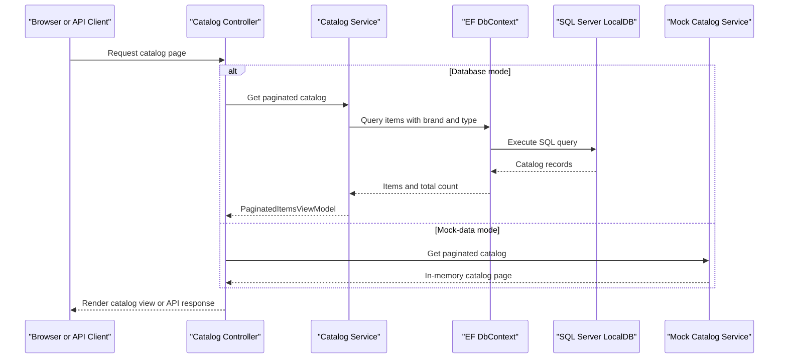

# API & Service Communication Contracts

The solution exposes catalog-management MVC routes and small HTTP APIs from two separate application implementations. Requests are handled synchronously in-process; no inter-service or asynchronous messaging contracts were found.

## Service Catalog

| Service | Port | Category | Purpose |
|---|---|---|---|
| eShopLegacyMVC | IIS/IIS Express configured port | API and UI | Legacy MVC catalog management and Web API endpoints |
| eShopPorted | 5000 HTTP; 5001 HTTPS in the project launch profile | API and UI | ASP.NET Core port of the catalog application |
| eShopLegacy.Utilities | Not independently hosted | Utility | Shared binary brand DTO serialization |

## API Endpoints Inventory

| Service | Method | Path | Request Type | Response Type |
|---|---|---|---|---|
| eShopLegacyMVC | GET | `/Catalog/Index?pageSize={pageSize}&pageIndex={pageIndex}` | Query parameters | Catalog page view model |
| eShopLegacyMVC | GET | `/Catalog/Details/{id}` | Route/query ID | CatalogItem view |
| eShopLegacyMVC | GET | `/Catalog/Create` | None | CatalogItem form |
| eShopLegacyMVC | POST | `/Catalog/Create` | CatalogItem form | Redirect or validation view |
| eShopLegacyMVC | GET | `/Catalog/Edit/{id}` | Route/query ID | CatalogItem form |
| eShopLegacyMVC | POST | `/Catalog/Edit/{id}` | CatalogItem form | Redirect or validation view |
| eShopLegacyMVC | GET | `/Catalog/Delete/{id}` | Route/query ID | CatalogItem confirmation view |
| eShopLegacyMVC | POST | `/Catalog/Delete/{id}` | ID | Redirect |
| eShopLegacyMVC | GET | `/items/{catalogItemId}/pic` | Integer route ID | Image bytes |
| eShopLegacyMVC | GET | `/api/brands` | None | CatalogBrand collection |
| eShopLegacyMVC | GET | `/api/brands/{id}` | Integer route ID | CatalogBrand or 404 |
| eShopLegacyMVC | DELETE | `/api/brands/{id}` | Integer route ID | 200 or 404; demo route does not delete |
| eShopLegacyMVC | GET | `/api/files` | None | Binary serialized BrandDTO collection |
| eShopLegacyMVC | GET | `/api` | None | JSON greeting |
| eShopPorted | GET | `/Catalog/Index?pageSize={pageSize}&pageIndex={pageIndex}` | Query parameters | Catalog page view model |
| eShopPorted | GET | `/Catalog/Details/{id}` | Route/query ID | CatalogItem view |
| eShopPorted | GET | `/Catalog/Create` | None | CatalogItem form |
| eShopPorted | POST | `/Catalog/Create` | CatalogItem form | Redirect or validation view |
| eShopPorted | GET | `/Catalog/Edit/{id}` | Route/query ID | CatalogItem form |
| eShopPorted | POST | `/Catalog/Edit/{id}` | CatalogItem form | Redirect or validation view |
| eShopPorted | GET | `/Catalog/Delete/{id}` | Route/query ID | CatalogItem confirmation view |
| eShopPorted | POST | `/Catalog/Delete/{id}` | ID | Redirect |
| eShopPorted | GET | `/items/{catalogItemId}/pic` | Integer route ID | Image bytes |
| eShopPorted | GET | `/api/brands` | None | CatalogBrand collection |
| eShopPorted | DELETE | `/api/brands/{id}` | Integer route ID | 200 or 404; demo route does not delete |
| eShopPorted | GET | `/api/files` | None | Binary serialized BrandDTO collection |

The default MVC route supplies controller/action/ID segments. API paths follow the Web API route or controller attribute routes.

## Management & Observability Endpoints

| Service | Endpoint | Custom Metrics |
|---|---|---|
| eShopLegacyMVC | None identified | No custom metrics endpoint identified |
| eShopPorted | None identified | No custom metrics endpoint identified |

No health-check, Swagger/OpenAPI, Actuator, or Prometheus endpoint is configured.

## DTOs & Contracts

`CatalogItem`, `CatalogBrand`, and `CatalogType` are domain entities also used in MVC model binding and API responses. `PaginatedItemsViewModel<CatalogItem>` is the catalog-list response model. Each Files API projects brands to a `BrandDTO` (`Id`, `Brand`) and serializes the collection to a binary stream; no immutable request/response record types or OpenAPI/protobuf/GraphQL definitions were found. MVC JSON uses framework defaults; no custom JSON serializer settings were identified.

## Communication Patterns

Controller-to-service and service-to-EF interactions are synchronous method calls. EF6 and EF Core issue queries and updates to their respective SQL Server LocalDB databases; there is no cross-application HTTP call, message queue, event stream, retry policy, circuit breaker, or service discovery. `UseMockData` switches a project to an in-memory service. No application authentication or authorization filter/middleware is configured; the IIS Express profile enables anonymous access, and local launch URLs include HTTP and HTTPS without an application-wide TLS enforcement policy.

## Service Technology Matrix

| Service | Web | Data Access | Discovery | Gateway | Health | Cache | Metrics |
|---|---|---|---|---|---|---|---|
| eShopLegacyMVC | ASP.NET MVC 5 and Web API 5 | EF6 | None | None | None | None | Application Insights integration |
| eShopPorted | ASP.NET Core MVC 2.2 | EF Core 2.2 | None | None | None | None | None identified |
| eShopLegacy.Utilities | None | None | None | None | None | None | None |

## Service Communication Sequence

