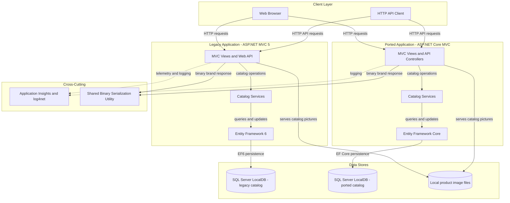
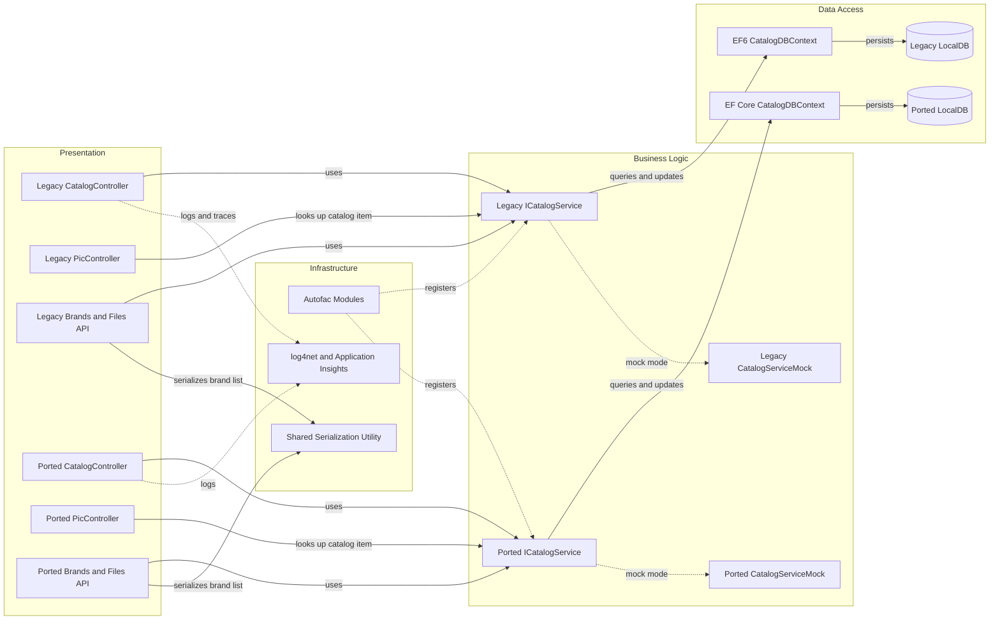

# Architecture Diagram

The solution contains two catalog web applications and a shared serialization utility. The legacy MVC application and its ASP.NET Core port are separate deployables with their own persistence configuration.

## Application Architecture

### Technology Stack Summary

| Layer | Technology | Version | Purpose |
|---|---|---:|---|
| Legacy presentation | ASP.NET MVC and Web API | MVC 5.2.7; Web API 5.2.7 | Server-rendered catalog pages and HTTP API |
| Legacy runtime | .NET Framework | 4.7.2 | Hosts the legacy MVC application |
| Ported presentation | ASP.NET Core MVC | 2.2.0 | Ported catalog pages and API controllers |
| Ported runtime | .NET Framework | 4.6.1 | Target framework declared by the ported project |
| Dependency injection | Autofac | 6.1.0 legacy; 4.9.1 ported | Registers catalog services and application dependencies |
| Legacy persistence | Entity Framework 6 | 6.2.0 | Maps catalog entities to SQL Server |
| Ported persistence | Entity Framework Core | 2.2.6 | Maps catalog entities and migrations to SQL Server |
| Observability | Application Insights, log4net | 2.9.1; 2.0.10 | Legacy telemetry and application logging |
| Shared utility | BinaryFormatter serialization | Framework API | Serializes brand DTO collections for the files API |

### Data Storage & External Services

Both applications are configured for SQL Server LocalDB with integrated Windows authentication, but use separate database names and persistence frameworks. Catalog pictures are read from local image files. No message broker, cache, external business API, or service-discovery component was identified; Application Insights and log4net provide telemetry/logging integration.

### Key Architectural Decisions

- The ported application is a parallel implementation rather than a downstream service; there is no cross-application API or shared database access path.
- `ICatalogService` isolates MVC and API controllers from either EF-backed catalog operations or the optional mock implementation.
- Autofac provides module-based dependency registration; `UseMockData` selects the in-memory service mode.

## Component Relationships

### Component Inventory

| Component | Layer | Type | Responsibility |
|---|---|---|---|
| Legacy CatalogController | Presentation | MVC Controller | Lists and manages catalog items |
| Legacy PicController | Presentation | MVC Controller | Returns an image for a catalog item |
| Legacy BrandsController | Presentation | Web API Controller | Reads catalog brands and handles a demo delete route |
| Legacy FilesController | Presentation | Web API Controller | Returns serialized brand DTOs |
| Ported CatalogController | Presentation | MVC Controller | Ported catalog page and CRUD flow |
| Ported BrandsController | Presentation | API Controller | Returns brands and handles a demo delete route |
| Ported FilesController | Presentation | API Controller | Returns serialized brand DTOs |
| ICatalogService | Business Logic | Service Interface | Defines catalog item, brand, and type operations |
| CatalogService | Business Logic | EF-backed Service | Executes catalog queries and updates |
| CatalogServiceMock | Business Logic | In-memory Service | Provides catalog operations over a mutable in-memory list |
| CatalogDBContext | Data Access | EF DbContext | Maps catalog item, brand, and type data |
| ApplicationModule | Infrastructure | Autofac Module | Selects and registers services based on mock-data configuration |
| Serializing | Infrastructure | Utility | Serializes brand DTOs with BinaryFormatter |
| CatalogDBInitializer | Infrastructure | EF6 Initializer | Initializes legacy catalog sequences and optional seed data |
