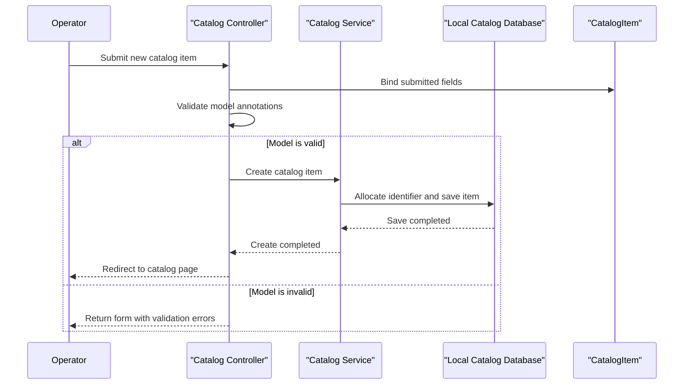

# Core Business Workflows

The application supports maintaining and browsing a product catalog, including product images, brands, types, stock values, and prices. It does not implement shopping carts, checkout, payment processing, or customer accounts.

## Domain Entities

| Entity | Service / Bounded Context | Description | Key Relationships |
|---|---|---|---|
| CatalogItem | Catalog Management | Product offered in the catalog, with price, stock, and image reference | Belongs to one CatalogBrand and one CatalogType |
| CatalogBrand | Catalog Management | Product brand lookup value | Groups catalog items |
| CatalogType | Catalog Management | Product type/category lookup value | Groups catalog items |

## Service-to-Domain Mapping

| Service | Domain Context | Owned Entities | External Dependencies |
|---|---|---|---|
| eShopLegacyMVC | Catalog Management | CatalogItem, CatalogBrand, CatalogType | Its EF6 LocalDB database and local picture files |
| eShopPorted | Catalog Management | CatalogItem, CatalogBrand, CatalogType | Its EF Core LocalDB database and local picture files |

The applications are parallel implementations. They do not exchange catalog entities or call one another; each owns its own catalog copy.

## Primary Workflows

### Workflow 1: Browse the Catalog

1. A visitor opens the catalog page with optional `pageSize` and `pageIndex`.
2. The CatalogController asks `ICatalogService` for a page of catalog items.
3. In database mode, CatalogService queries items with their brand and type. In mock mode, CatalogServiceMock reads the in-memory list and joins the preconfigured lookup values.
4. The application returns a paginated view model and renders the catalog. Picture URIs link to the picture route.

### Workflow 2: Create or Edit a Catalog Item

1. A catalog operator submits the create or edit form.
2. MVC model binding constructs a CatalogItem. `ModelState.IsValid` checks annotations before saving.
3. Create assigns an identifier through the legacy HiLo sequence generator, ported EF Core identity generation, or the mock implementation's next identifier.
4. The service persists the catalog item and its brand/type references, then the controller redirects to the catalog page. The edit flow updates the selected item.

### Workflow 3: Delete a Catalog Item or View Its Picture

The delete form submits an item ID and removes the corresponding catalog item. A picture request resolves the selected catalog record and reads its configured image file. The brands API's demo DELETE action reports success for an existing brand but intentionally does not delete it.

## Cross-Service Data Flows

No cross-service composition or data synchronization flow was identified. Each application queries its own catalog database or mock list. Brand and type records are joined locally by EF navigation properties or by the mock service. Product-image responses are read from local files, not from an external image service.

## Business Workflow Sequence

## Business Rules & Decision Logic

- Catalog item names are required. Prices must match the decimal format and fall within the configured range; stock, restock, and maximum-stock values have nonnegative bounded ranges.
- Catalog items require brand and type relationships in the EF mappings. Their default image filename is `dummy.png`.
- The legacy database initializer uses SQL sequence scripts and CSV customization data when enabled; the ported implementation uses EF Core migrations and configured seed rows.
- Create, edit, and delete operations have no multi-step business state transition. There is no order lifecycle or payment workflow.
- MVC create/edit/delete POST handlers use anti-forgery validation. No application-level role or resource-ownership policy was identified.
- Errors flow through the MVC error handling configuration; no domain audit trail or compensating transaction was found.
