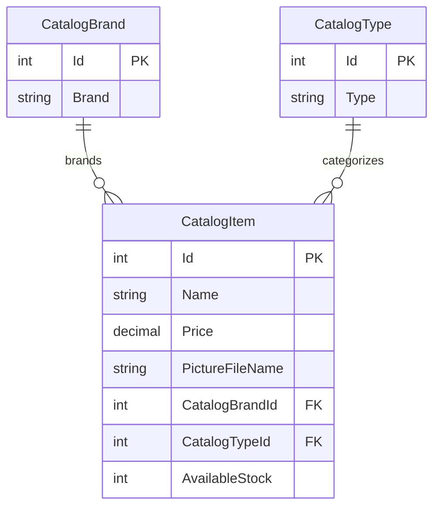

# Data Architecture & Persistence Layer

The solution models a product catalog with three EF entities and SQL Server persistence in both application variants. The legacy and ported projects own separate LocalDB databases and use EF6 and EF Core respectively.

## Database Configuration

| Service/Module | DB Type | Profile | Driver | Connection | Migration Tool |
|---|---|---|---|---|---|
| eShopLegacyMVC | SQL Server LocalDB | Default; EF initializer enabled when mock mode is false | System.Data.SqlClient | `CatalogDBContext` uses local LocalDB and integrated Windows authentication | `CatalogDBInitializer`, sequence SQL scripts, CSV/ZIP seed data |
| eShopPorted | SQL Server LocalDB | Default connection; context registered only when mock mode is false | EF Core SQL Server provider 2.2.6 | LocalDB database configured as `eShopPorted`, integrated Windows authentication | EF Core migrations |
| eShopLegacy.Utilities | None | — | — | — | — |

The ported appsettings default enables mock and customization data, so its normal default startup does not register the EF Core context. The legacy Web.config defaults both toggles to false.

## Data Ownership per Service

| Service | Tables Owned | ORM Framework | Caching | Notes |
|---|---|---|---|---|
| eShopLegacyMVC | Catalog, CatalogBrand, CatalogType | Entity Framework 6.2.0 | None identified | Uses HiLo sequence scripts for catalog IDs and an initializer for configured seed data |
| eShopPorted | Catalog, CatalogBrand, CatalogType | Entity Framework Core 2.2.6 | None identified | Database schema and seed rows are represented by EF Core migrations/configurations |
| eShopLegacy.Utilities | None | None | None | Serialization-only utility |

## Entity Model

The legacy and ported entity definitions are parallel. `CatalogItem` requires a brand and type relationship; the legacy mapping marks both relationships required, and the ported migration creates foreign keys to the corresponding lookup tables.

## Key Repository Methods

| Service | Repository | Notable Methods | Purpose |
|---|---|---|---|
| eShopLegacyMVC | No repository interface; `CatalogService` accesses `CatalogDBContext` directly | `GetCatalogItemsPaginated`, `FindCatalogItem`, `CreateCatalogItem`, `UpdateCatalogItem`, `RemoveCatalogItem` | Queries catalog data, includes brand/type, and persists CRUD operations |
| eShopLegacyMVC | `CatalogItemHiLoGenerator` | `GetNextSequenceValue` | Retrieves and allocates catalog identifiers using a database sequence |
| eShopPorted | No repository interface; `CatalogService` accesses `CatalogDBContext` directly | `GetCatalogItemsPaginated`, `FindCatalogItem`, `CreateCatalogItem`, `UpdateCatalogItem`, `RemoveCatalogItem` | Queries catalog data and persists CRUD operations |

The ported implementation relies on EF Core identity generation. Neither project declares custom repository query interfaces or batch cross-service lookup methods.

## Caching Strategy

No distributed or provider-backed cache, EF second-level cache, cache annotations, or explicit cache TTL was identified. The optional mock service keeps catalog state in an in-memory list; this is application data mode, not a cache.

## Data Ownership Boundaries

The two applications implement the same catalog domain but use distinct databases and have no cross-service API or direct database exchange. The legacy and ported services are each the source of truth for their own catalog copy. Catalog items reference their own application's brand and type tables; no CQRS, outbox, or event-driven synchronization mechanism was found.

### Data Classification & Sensitivity

| Entity | Sensitive Fields | Classification (PII/PHI/PCI/None) | Controls in Place |
|---|---|---|---|
| CatalogItem | Product description, price, image filename, stock values | None | No customer or payment information identified |
| CatalogBrand | Brand name | None | No sensitive data identified |
| CatalogType | Product type name | None | No sensitive data identified |

No PII, PHI, or PCI data was detected in the catalog entity model.
