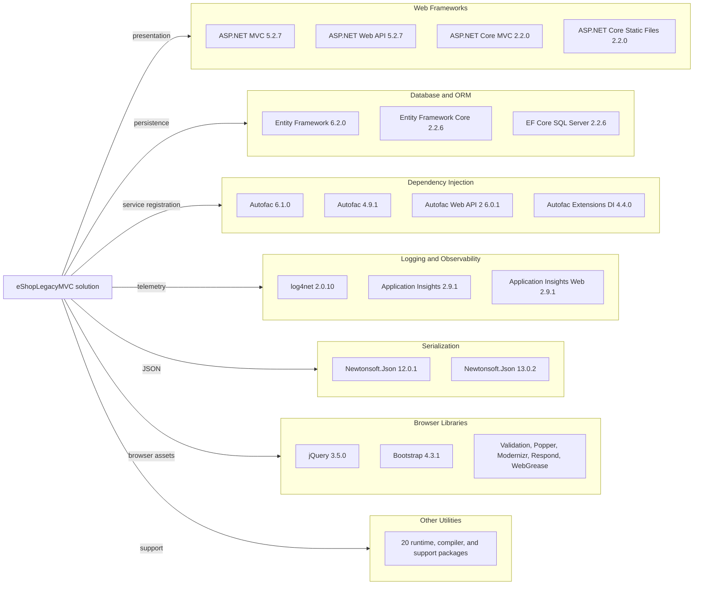

# Dependency Map

The solution declares 59 distinct NuGet package/version coordinates across its three projects. The diagram highlights core frameworks and groups the remaining utilities for readability.

## Dependencies

### Dependency Summary

| Category | Count | Key Libraries | Notes |
|---|---:|---|---|
| Web Frameworks | 11 | ASP.NET MVC 5, Web API 5, ASP.NET Core MVC 2.2 | Includes MVC/Razor/Web API packages for both application variants |
| Database / ORM | 5 | Entity Framework 6, EF Core 2.2, EF Core SQL Server | Separate persistence stacks for the legacy and ported projects |
| Dependency Injection | 5 | Autofac, Autofac.Mvc5, Autofac.WebApi2 | Different Autofac versions are declared by the application projects |
| Logging / Observability | 8 | log4net, Application Insights | Legacy telemetry packages and log4net |
| JSON Serialization | 2 | Newtonsoft.Json 12.0.1 and 13.0.2 | Version varies between legacy and ported projects |
| Browser Libraries | 8 | jQuery, Bootstrap, jQuery Validation, Popper.js | MVC presentation assets and validation |
| Runtime and Build Utilities | 20 | System.Memory, System.Buffers, CodeDom, compiler tooling | Aggregated minor runtime/support dependencies |

### Version & Compatibility Risks

The ported project targets ASP.NET Core and EF Core 2.2, which are out of support; it also targets .NET Framework 4.6.1. The legacy project targets .NET Framework 4.7.2 and Entity Framework 6.2.0. Newtonsoft.Json 12.0.1 is affected by CVE-2024-21907; the ported project declares 13.0.2.

### Notable Observations

- The solution contains parallel legacy and ported web applications with overlapping functionality and distinct dependency versions.
- The legacy project declares Newtonsoft.Json 12.0.1 while the ported project declares 13.0.2.
- The legacy project uses BinaryFormatter through a shared serialization utility.
- No test-scoped package dependencies or dedicated test project were detected in the solution.

## Test Dependencies

| Framework | Version | Notes |
|---|---|---|
| None detected | — | No test-scoped NuGet dependencies or test project are declared in the solution. |

Total test-scope dependencies: 0

No test dependencies were detected; the solution has no identified automated test infrastructure.
