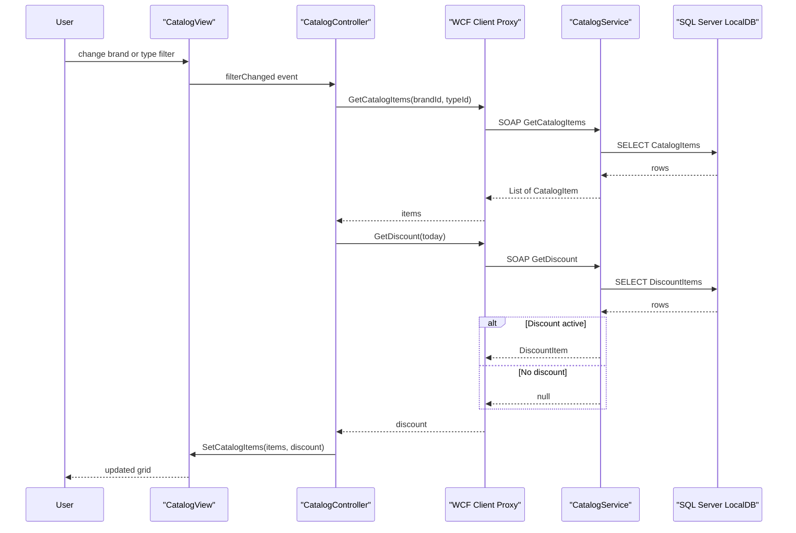

# API & Service Communication Contracts

The solution exposes one SOAP/WCF service with 10 operations over `basicHttpBinding`, consumed synchronously by a Windows Forms client.

## Service Catalog

| Service | Port | Category | Purpose |
|---------|------|----------|---------|
| eShopWCFService (CatalogService.svc) | 62314 (client endpoint default) | Business | Catalog, stock and discount operations |
| eShopWinForms | n/a | API Layer (consumer) | Desktop client calling the WCF service |

## API Endpoints Inventory

| Service | Method (WCF operation) | Path | Request Type | Response Type |
|---------|------------------------|------|--------------|---------------|
| CatalogService | FindCatalogItem | /CatalogService.svc | int id | CatalogItem |
| CatalogService | GetCatalogBrands | /CatalogService.svc | none | List of CatalogBrand |
| CatalogService | GetCatalogTypes | /CatalogService.svc | none | List of CatalogType |
| CatalogService | GetCatalogItems | /CatalogService.svc | int brandIdFilter, int typeIdFilter | List of CatalogItem |
| CatalogService | CreateCatalogItem | /CatalogService.svc | CatalogItem | void |
| CatalogService | UpdateCatalogItem | /CatalogService.svc | CatalogItem | void |
| CatalogService | RemoveCatalogItem | /CatalogService.svc | CatalogItem | void |
| CatalogService | GetAvailableStock | /CatalogService.svc | DateTime date, int catalogItemId | int |
| CatalogService | CreateAvailableStock | /CatalogService.svc | CatalogItemsStock | void |
| CatalogService | GetDiscount | /CatalogService.svc | DateTime day | DiscountItem |
| CatalogService | MEX (IMetadataExchange) | /CatalogService.svc/mex | WS-MetadataExchange | WSDL |

All operations are SOAP; there is no URL-based API versioning.

## Management & Observability Endpoints

| Service | Endpoint | Custom Metrics (if any) |
|---------|----------|-------------------------|
| CatalogService | /CatalogService.svc?wsdl and /mex (metadata, `httpGetEnabled`) | None |

No health checks or metrics endpoints exist.

## DTOs & Contracts

Service-level data contracts (`[DataContract]`) are shared with the entity model: CatalogItem, CatalogBrand, CatalogType, CatalogItemsStock and DiscountItem. There are no separate gateway DTOs; entities are serialized directly. All are mutable classes. Contracts are published through WSDL/XSD, and the client consumes a generated service reference (`Connected Services/eShopServiceReference`). Serialization uses WCF DataContractSerializer. Entity details are in `data-architecture.md`.

## Communication Patterns

- **Synchronous**: SOAP over HTTP via `basicHttpBinding`; no asynchronous or message-based communication.
- **Resilience**: none; no retry, circuit breaker or custom timeouts (WCF defaults apply).
- **Service discovery**: hard-coded endpoint address `http://localhost:62314/CatalogService.svc` in the client App.config.
- **Gateway / aggregation**: none; the client composes brand, type, item and discount calls itself.
- **Security posture**: no authentication, authorization or transport security is configured on the client endpoint; the service allows anonymous access. An HTTPS mapping (`basicHttpsBinding`) exists server-side but the client uses plain HTTP.
- **Startup order**: the WCF service must be running before the client loads its view.

## Service Technology Matrix

| Service | Web | Data Access | Discovery | Gateway | Actuator | Cache | Metrics |
|---------|-----|-------------|-----------|---------|----------|-------|---------|
| CatalogService | WCF on IIS | EF6 | none | no | no | no | no |
| eShopWinForms | WinForms | none (via service) | static URL | no | no | no | no |

## Service Communication Sequence

