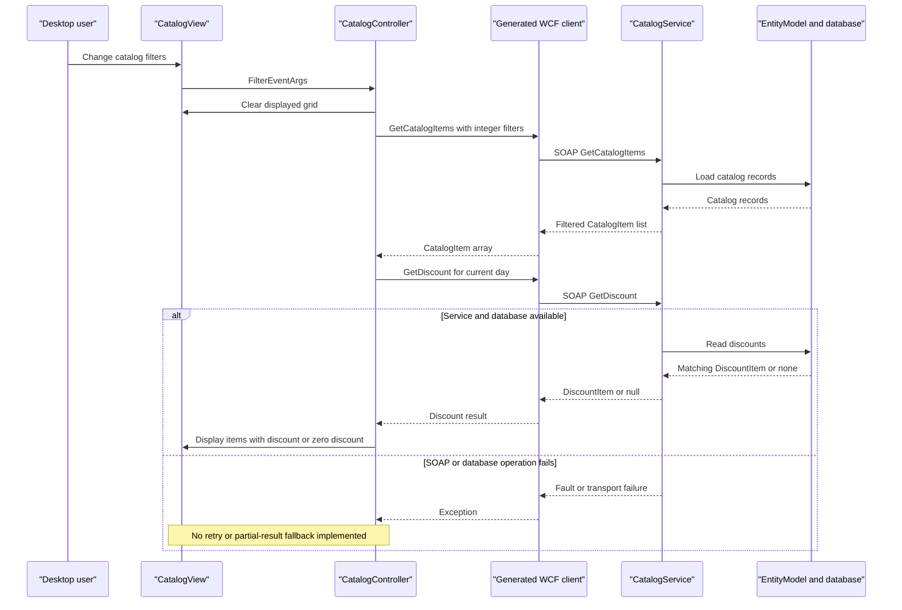

# API & Service Communication Contracts

One SOAP service exposes ten request/reply operations at a shared service address; the desktop invokes them synchronously. These are WCF contracts, not REST routes; all references are relative to the assessed `eShopLegacyNTier` workspace.

## Service Catalog

| Service | Port | Category | Purpose |
|---|---|---|---|
| eShopWCFService project / CatalogService | 62314, local development HTTP only | Business | Catalog, brand/type lookup, dated stock and discounts. WCF and EF6; `src\eShopWCFService\eShopWCFService.csproj:15,45-49,64-68,118-123`; `src\eShopWCFService\ICatalogService.cs:12-34`. |
| eShopWinForms project | No listening port | API consumer / desktop presentation | Uses generated WCF client; WinForms and WCF framework references, plus declared Web API Client/JSON packages. `src\eShopWinForms\Program.cs:22-27`; `src\eShopWinForms\eShopWinForms.csproj:73-85`. |

No source-built gateway, independently hosted data module, Compose service or Kubernetes deployment is present inside the scoped workspace. The service project assembly is named `WcfService1`, despite the project/CLR service names (`src\eShopWCFService\eShopWCFService.csproj:13-14`).

## API Endpoints Inventory

Every row belongs to `CatalogService` and uses SOAP 1.1 document/literal HTTP POST to `/CatalogService.svc`; the operation is selected by SOAPAction, not a distinct URL. Base development address: `http://localhost:62314`. Evidence: `src\eShopWinForms\App.config:26-28`; `src\eShopWinForms\Connected Services\eShopServiceReference\CatalogService.wsdl:114-205`.

| Service | Method | Path | Request Type | Response Type |
|---|---|---|---|---|
| CatalogService.FindCatalogItem | POST (SOAP) | /CatalogService.svc | int id | CatalogItem, or null |
| CatalogService.GetCatalogBrands | POST (SOAP) | /CatalogService.svc | Empty operation body | List of CatalogBrand |
| CatalogService.GetCatalogItems | POST (SOAP) | /CatalogService.svc | int brandIdFilter, int typeIdFilter | List of CatalogItem |
| CatalogService.GetCatalogTypes | POST (SOAP) | /CatalogService.svc | Empty operation body | List of CatalogType |
| CatalogService.GetAvailableStock | POST (SOAP) | /CatalogService.svc | DateTime date, int catalogItemId | int; zero when no match |
| CatalogService.CreateAvailableStock | POST (SOAP) | /CatalogService.svc | CatalogItemsStock | Empty operation response (void) |
| CatalogService.CreateCatalogItem | POST (SOAP) | /CatalogService.svc | CatalogItem | Empty operation response (void) |
| CatalogService.UpdateCatalogItem | POST (SOAP) | /CatalogService.svc | CatalogItem | Empty operation response (void) |
| CatalogService.RemoveCatalogItem | POST (SOAP) | /CatalogService.svc | CatalogItem | Empty operation response (void) |
| CatalogService.GetDiscount | POST (SOAP) | /CatalogService.svc | DateTime day | DiscountItem, or null |

Authoritative signatures: `src\eShopWCFService\ICatalogService.cs:15-34`. Null/zero behavior: `src\eShopWCFService\CatalogService.svc.cs:28-44,90-96`. SOAPAction is `http://tempuri.org/ICatalogService/<OperationName>` with corresponding `<OperationName>Response`; generated declarations are at `src\eShopWinForms\Connected Services\eShopServiceReference\Reference.cs:501-559`. There is no explicit API versioning or typed FaultContract. Standard SOAP success/fault transport semantics apply, but no application-specific HTTP status contract is declared or runtime-verified.

## Management & Observability Endpoints

| Service | Endpoint | Custom Metrics (if any) |
|---|---|---|
| CatalogService | /CatalogService.svc?wsdl (HTTP metadata enabled) | None declared |
| CatalogService | /CatalogService.svc/mex (mexHttpBinding) | None declared |

Metadata evidence: `src\eShopWCFService\Web.config:27-29,38-40`; checked-in metadata location `src\eShopWinForms\Connected Services\eShopServiceReference\Reference.svcmap:21-30`. HTTPS metadata is enabled in configuration but no actual TLS listener/certificate is established by that setting. No health-check, Swagger, metrics exporter or custom management endpoint is declared in the scoped host.

## DTOs & Contracts

| Class | Contract role | Mutability |
|---|---|---|
| CatalogItem | Find/list response and create/update/remove request | Mutable data contract |
| CatalogBrand, CatalogType | Lookup responses; CatalogItem reference values | Mutable data contracts |
| CatalogItemsStock | Availability-write request | Mutable data contract |
| DiscountItem | Discount response | Mutable data contract |

The server shares EF domain classes directly as `[DataContract]` / `[DataMember]` contracts; see `src\eShopWCFService\Models\CatalogItem.cs:10-35`, `Models\CatalogBrand.cs:10-19`, `Models\CatalogType.cs:10-19`, `Models\CatalogItemsStock.cs:10-25`, and `Models\DiscountItem.cs:11-31` (all under `src\eShopWCFService`). Field details belong to `data-architecture.md`. No gateway-level aggregation DTO exists. WCF XML data-contract serialization is used, not a JSON REST surface. Checked-in WSDL and four XSD files are listed in `src\eShopWinForms\Connected Services\eShopServiceReference\Reference.svcmap:24-30`; no OpenAPI, protobuf or GraphQL contract is present.

**Contract drift:** the generated desktop client accepts nullable filter integers and returns arrays, whereas the server currently declares non-nullable integers and lists (`src\eShopWinForms\Connected Services\eShopServiceReference\Reference.cs:507-520`; `src\eShopWCFService\ICatalogService.cs:18-22`). Collection representation differences are normal proxy generation; nullable input mismatch requires metadata regeneration/compatibility verification. Current controller calls pass concrete integers.

## Communication Patterns

- **Synchronous:** UI events call the desktop controller, generated proxy, WCF service and EF context. Although the generated proxy also has Task-returning methods, current controller paths use synchronous methods (`src\eShopWinForms\Controllers\CatalogController.cs:35-85`; `src\eShopWinForms\Connected Services\eShopServiceReference\Reference.cs:501-559`).
- **Composition:** desktop loads catalog items and separately requests the current discount, then combines them for display. It is client-side composition against one service, not gateway aggregation (`src\eShopWinForms\Controllers\CatalogController.cs:75-85`).
- **Asynchronous infrastructure:** no broker, pub/sub, service discovery, load-balancer client, circuit breaker, retry, bulkhead or business fallback is configured. UI events are in-process notifications, not inter-service events.
- **Timeouts:** no explicit WCF timeout values are set; the binding is empty in `src\eShopWinForms\App.config:21-23`. Runtime defaults are inherited and not measured. Exceptions are not caught in the shown controller paths; failures do not return substitute data.
- **Availability:** database accessibility and service host availability are required before the desktop's initial data load, which precedes showing the form (`src\eShopWinForms\Program.cs:22-27`). See `configuration-inventory.md` for readiness/configuration details.
- **Security posture:** the configured client uses plain HTTP and the service explicitly exposes basicHttpBinding without a security override. No application-level authentication or authorization checks are declared in `src\eShopWCFService\ICatalogService.cs:12-34` or `CatalogService.svc.cs:14-117`. `Web.config:33-40` includes an HTTPS protocol mapping, but this does not demonstrate TLS on the actual HTTP endpoint. IIS deployment-level restrictions are unknown, so public internet accessibility is not asserted.

## Service Technology Matrix

| Service | Web | Data Access | Discovery | Gateway | Actuator | Cache | Metrics |
|---|---|---|---|---|---|---|---|
| CatalogService | WCF / System.Web | EF6 | None declared | No | None declared | None declared | None declared |
| eShopWinForms | Desktop WCF consumer | No active direct DB path | None declared | No; local display composition | None | None declared | None declared |

Evidence: `src\eShopWCFService\Web.config:22-64`; `src\eShopWCFService\EntityModel.cs:10-22`; `src\eShopWinForms\Program.cs:22-27`; `src\eShopWinForms\Controllers\CatalogController.cs:75-85`.

## Service Communication Sequence

Sequence evidence: `src\eShopWinForms\Controllers\CatalogController.cs:27-29,75-85`; `src\eShopWCFService\CatalogService.svc.cs:28-30,56-62`. No live service or contract test was run.
