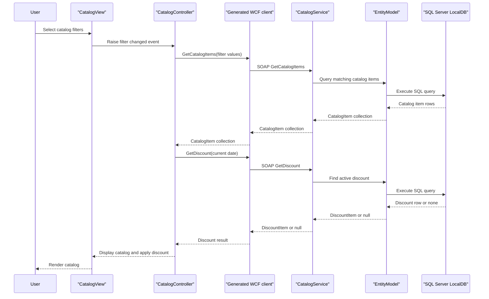

# API & Service Communication Contracts

The application exposes ten synchronous WCF operations on a catalog service contract. The Windows Forms project is the client; no separate HTTP REST API or asynchronous messaging endpoint was identified.

## Service Catalog

| Service | Port | Category | Purpose |
|---|---|---|---|
| eShopWinForms | None | Client | Desktop interface for browsing catalog items and managing stock |
| eShopWCFService CatalogService | Client configuration points to localhost port 62314; deployed server port is host-defined | API Layer | Provides catalog, discount, and stock operations |

## API Endpoints Inventory

Operations use the WCF SOAP contract at `/CatalogService.svc`; WCF metadata exchange is configured separately at `mex`.

| Service | Method | Path | Request Type | Response Type |
|---|---|---|---|---|
| CatalogService | SOAP `FindCatalogItem` | `/CatalogService.svc` | `int id` | `CatalogItem` |
| CatalogService | SOAP `GetCatalogBrands` | `/CatalogService.svc` | None | `List<CatalogBrand>` |
| CatalogService | SOAP `GetCatalogItems` | `/CatalogService.svc` | `int brandIdFilter`, `int typeIdFilter` | `List<CatalogItem>` |
| CatalogService | SOAP `GetCatalogTypes` | `/CatalogService.svc` | None | `List<CatalogType>` |
| CatalogService | SOAP `GetAvailableStock` | `/CatalogService.svc` | `DateTime date`, `int catalogItemId` | `int` |
| CatalogService | SOAP `CreateAvailableStock` | `/CatalogService.svc` | `CatalogItemsStock` | `void` |
| CatalogService | SOAP `CreateCatalogItem` | `/CatalogService.svc` | `CatalogItem` | `void` |
| CatalogService | SOAP `UpdateCatalogItem` | `/CatalogService.svc` | `CatalogItem` | `void` |
| CatalogService | SOAP `RemoveCatalogItem` | `/CatalogService.svc` | `CatalogItem` | `void` |
| CatalogService | SOAP `GetDiscount` | `/CatalogService.svc` | `DateTime day` | `DiscountItem` |

## Management & Observability Endpoints

| Service | Endpoint | Custom Metrics |
|---|---|---|
| CatalogService | WCF metadata exchange at `/CatalogService.svc/mex`; HTTP/HTTPS metadata publishing is enabled in service configuration | None detected |

No health-check, metrics, or tracing endpoints were found.

## DTOs & Contracts

`ICatalogService` defines the service contract. `CatalogItem`, `CatalogItemsStock`, `CatalogBrand`, `CatalogType`, and `DiscountItem` are mutable data-contract classes used as operation inputs or responses. A generated WCF service reference provides the client-side contract types. No OpenAPI, protobuf, or GraphQL schema was found.

## Communication Patterns

The Windows Forms client makes synchronous calls through the generated WCF client to a `basicHttpBinding` endpoint. The service uses direct Entity Framework access; no message broker, retry policy, circuit breaker, timeout override, service discovery, or gateway aggregation was identified. The client endpoint is a configured loopback URL rather than a discovered service name. The explicit service endpoint uses HTTP; no authentication or authorization configuration is present in the service binding or contract.

## Service Technology Matrix

| Service | Web | Data Access | Discovery | Gateway | Actuator | Cache | Metrics |
|---|---|---|---|---|---|---|---|
| eShopWinForms | Windows Forms client | None | None | None | None | None | None |
| eShopWCFService | WCF `basicHttpBinding` | Entity Framework 6 | None | None | None | None | None |

## Service Communication Sequence

