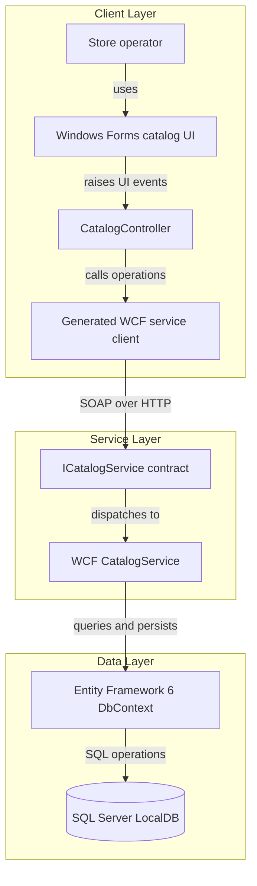
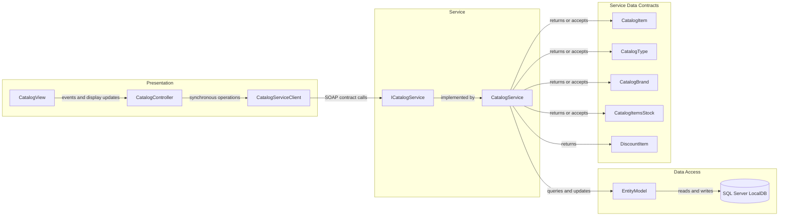

# Architecture Diagram

The solution has a Windows Forms catalog client and a separately hosted WCF service. The service uses Entity Framework to read and update catalog data in SQL Server.

## Application Architecture

### Technology Stack Summary

| Layer | Technology | Version | Purpose |
|---|---|---:|---|
| Presentation | Windows Forms on .NET Framework | 4.7 | Catalog browsing and stock management UI |
| Service | Windows Communication Foundation | .NET Framework 4.6.1 | Synchronous catalog and inventory operations |
| Data access | Entity Framework | 6.1.3 | Object-relational mapping and persistence |
| Database | SQL Server LocalDB | MSSQLLocalDB | Catalog and stock storage |

### Data Storage & External Services

The WCF service persists catalog, discount, and stock records through Entity Framework to SQL Server LocalDB by default. The `ConnectionString` environment variable can override the configured connection. The Windows Forms client communicates with the WCF service; no cache, message broker, or other external API was identified.

### Key Architectural Decisions

- The Windows Forms client and WCF service are separate projects connected through a generated service reference.
- The service accesses data through an Entity Framework `DbContext`; no repository abstraction is present.
- Catalog and stock seed data is supplied by a database initializer when the database is first created.

## Component Relationships

### Component Inventory

| Component | Layer | Type | Responsibility |
|---|---|---|---|
| CatalogView | Presentation | Windows Form | Displays catalog data, filters, discounts, and stock controls |
| CatalogController | Presentation | Controller | Coordinates view events with catalog service operations |
| CatalogServiceClient | Presentation | Generated WCF client | Calls the remote service contract |
| ICatalogService | Service | WCF contract | Defines catalog, discount, and stock operations |
| CatalogService | Service | WCF service | Implements the contract and applies persistence operations |
| EntityModel | Data Access | Entity Framework DbContext | Exposes catalog, type, brand, stock, and discount sets |
| CatalogItem | Domain / Contract | Data contract | Represents a catalog product |
| CatalogType | Domain / Contract | Data contract | Represents a catalog product type |
| CatalogBrand | Domain / Contract | Data contract | Represents a catalog brand |
| CatalogItemsStock | Domain / Contract | Data contract | Represents item stock for a date |
| DiscountItem | Domain / Contract | Data contract | Represents a discount period |
