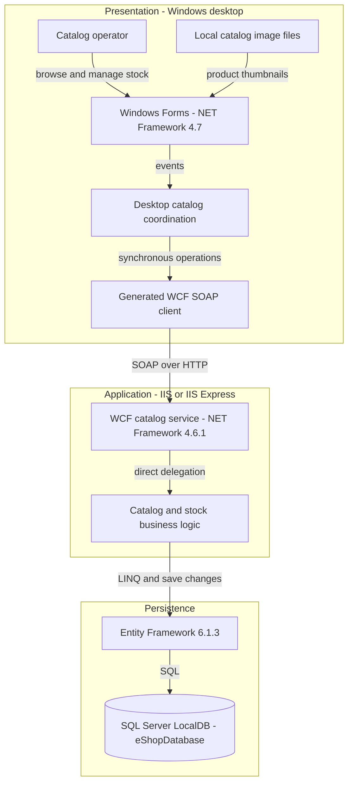
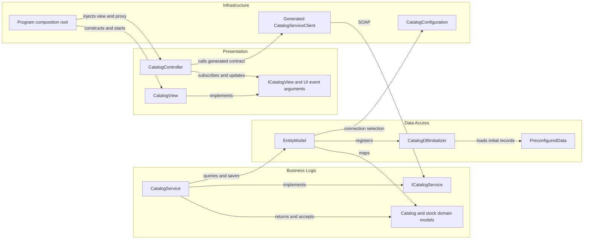

# Architecture Diagram

Assessment scope is **eShopLegacyNTier only**. All source citations are relative to that directory; diagrams describe checked-in configuration and code, not verified deployed infrastructure.

## Application Architecture

### Technology Stack Summary

| Layer | Technology | Version | Purpose |
|---|---|---|---|
| Presentation | Windows Forms, System.Drawing | .NET Framework 4.7 | Desktop catalog, filter, stock and shipment screens |
| Communication | WCF basicHttpBinding | Framework-provided | SOAP request/reply between desktop and server |
| Service hosting | ASP.NET / IIS Express | .NET Framework 4.6.1 target | Hosts CatalogService.svc; actual IIS version not declared |
| Persistence | Entity Framework | 6.1.3 | DbContext, LINQ queries and writes |
| Database | SQL Server LocalDB | Engine version not pinned | Default eShopDatabase store |
| Build | Classic MSBuild / Visual Studio | ToolsVersion 15.0 | Separate WinExe and web-library projects |

Evidence: `src\eShopWinForms\eShopWinForms.csproj:2-11,76-85`; `src\eShopWCFService\eShopWCFService.csproj:1-18,119-124`; `src\eShopWCFService\packages.config:3`; `src\eShopWinForms\App.config:19-29`; `src\eShopWCFService\Web.config:52-64`.

### Data Storage & External Services

The server owns a SQL Server database via EntityModel; its default connection names LocalDB and eShopDatabase. An environment connection override can select another database connection (`src\eShopWCFService\Models\Infrastructure\CatalogConfiguration.cs:10-18`). Five DbSets cover catalog, classifications, stock and discounts (`src\eShopWCFService\EntityModel.cs:18-22`). The desktop loads images from local files, not a media service (`src\eShopWinForms\Views\CatalogView.cs:55-61`). No broker, distributed cache, cloud service or additional remote API is evidenced in this scoped application.

### Key Architectural Decisions

- The desktop uses view/controller separation and manual constructor injection; Program composes the real generated proxy and view without a DI container (`src\eShopWinForms\Program.cs:22-27`; `src\eShopWinForms\Controllers\CatalogController.cs:14-20`).
- Service operations contain business rules and access DbContext directly; there is no separate repository abstraction (`src\eShopWCFService\CatalogService.svc.cs:14-30,56-82,90-117`).
- Domain entities double as mutable WCF data contracts; database creation and seed data are code-first initializer responsibilities (`src\eShopWCFService\Models\CatalogItem.cs:10-35`; `src\eShopWCFService\EntityModel.cs:12-16`).

## Component Relationships

### Component Inventory

| Component | Layer | Type | Responsibility |
|---|---|---|---|
| CatalogView | Presentation | Form / ICatalogView implementation | Render catalog and raise filter, search and shipment events (`src\eShopWinForms\Views\CatalogView.cs:18-29,48-71,142-168`) |
| ICatalogView and event arguments | Presentation | Interface and event payloads | Decouple view updates and user events (`src\eShopWinForms\Controllers\ICatalogView.cs:18-80`) |
| CatalogController | Presentation coordination | Controller | Fetch catalog/classifications/discounts; orchestrate stock calls (`src\eShopWinForms\Controllers\CatalogController.cs:35-84,98-157`) |
| Program | Infrastructure | Composition root | Instantiate proxy/controller/view and load data before showing dialog (`src\eShopWinForms\Program.cs:16-27`) |
| Generated CatalogServiceClient | Infrastructure | WCF ClientBase proxy | Remote request/reply and generated async alternatives (`src\eShopWinForms\Connected Services\eShopServiceReference\Reference.cs:570-667`) |
| ICatalogService | Business boundary | WCF ServiceContract | Ten remotely callable operations (`src\eShopWCFService\ICatalogService.cs:12-34`) |
| CatalogService | Business / data access | Service implementation | Filtering, discounts, catalog CRUD, stock lookup/upsert (`src\eShopWCFService\CatalogService.svc.cs:28-117`) |
| CatalogItem, CatalogBrand, CatalogType, CatalogItemsStock, DiscountItem | Domain | Mutable data contracts/entities | Shared domain and serialized shapes (`src\eShopWCFService\EntityModel.cs:18-22`) |
| EntityModel | Data access | EF6 DbContext | Mapping and five entity sets (`src\eShopWCFService\EntityModel.cs:10-40`) |
| CatalogDBInitializer / PreconfiguredData | Data access | Initializer / seed factory | Create-if-absent seed setup (`src\eShopWCFService\Models\Infrastructure\CatalogDBInitializer.cs:11-20`) |
| CatalogConfiguration | Infrastructure | Static configuration accessor | Environment-first connection selection (`src\eShopWCFService\Models\Infrastructure\CatalogConfiguration.cs:10-18`) |
| CatalogServiceMock | Alternate implementation, not active | In-memory service mock | Compiled but not selected by Program; discount operation throws (`src\eShopWCFService\eShopWCFService.csproj:79`; `src\eShopWCFService\CatalogServiceMock.cs:18-23,118-120`) |

No authentication filter, metrics middleware or logging pipeline is evidenced in the composition root or service configuration (`src\eShopWinForms\Program.cs:16-27`; `src\eShopWCFService\Web.config:22-43`). The similarly named server-side `CatalogServiceClient.cs` is not included in the server project's explicit Compile items and is not the active desktop proxy (`src\eShopWCFService\eShopWCFService.csproj:78-94`).
