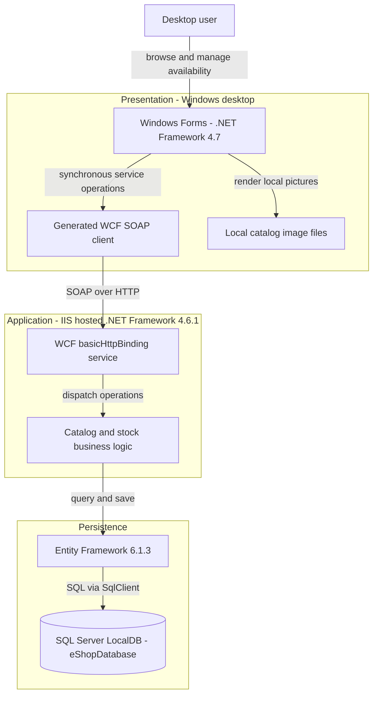
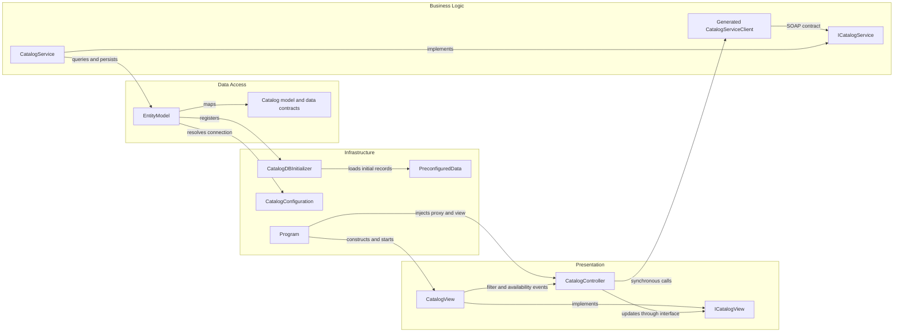

# Architecture Diagram

Static assessment of `D:\a\eShopModernizing\eShopModernizing\eShopLegacyNTier` only. Source references below are relative to that workspace; the diagrams describe checked-in wiring, not a verified running deployment.

## Application Architecture

### Technology Stack Summary

| Layer | Technology | Version | Purpose |
|---|---|---|---|
| Presentation | Windows Forms, .NET Framework | 4.7 | Desktop catalog, filtering, availability and shipment UI; `src\eShopWinForms\eShopWinForms.csproj:8-11,85`; `src\eShopWinForms\Views\CatalogView.cs:18-29`. |
| Communication | WCF basicHttpBinding | Framework-provided; no independent version pinned | Generated SOAP proxy and IIS service; `src\eShopWinForms\App.config:19-29`; `src\eShopWCFService\Web.config:37-41`. |
| Application | .NET Framework / System.Web | 4.6.1 target | WCF host and catalog operations; `src\eShopWCFService\eShopWCFService.csproj:11-18`; `src\eShopWCFService\CatalogService.svc:1`. |
| Persistence | Entity Framework | 6.1.3 | Code First context and initialization; `src\eShopWCFService\packages.config:3`; `src\eShopWCFService\EntityModel.cs:10-22`. |
| Storage | SQL Server LocalDB | Engine version not pinned | Default catalog store; `src\eShopWCFService\Web.config:52-64`. |

### Data Storage & External Services

The service owns one SQL database, defaulting to LocalDB `eShopDatabase`. A process environment connection-string override can change its destination (`src\eShopWCFService\Models\Infrastructure\CatalogConfiguration.cs:10-18`). Catalog images are read from the desktop filesystem, not fetched from the service (`src\eShopWinForms\Views\CatalogView.cs:55-61`). No broker, distributed cache, cloud service or other external API integration is wired in the two projects.

### Key Architectural Decisions

- Two deployable processes, not microservices: desktop UI and IIS-hosted WCF service, connected by a generated proxy (`src\eShopWinForms\Program.cs:22-27`; `src\eShopWCFService\CatalogService.svc:1`).
- Event-driven view/controller separation with manual constructor wiring rather than a DI container (`src\eShopWinForms\Controllers\CatalogController.cs:14-20`; `src\eShopWinForms\Program.cs:22-24`).
- Service methods directly use `EntityModel`; no repository abstraction. Domain objects are also WCF data contracts (`src\eShopWCFService\CatalogService.svc.cs:16-25,56-82`; `src\eShopWCFService\Models\CatalogItem.cs:10-35`).

## Component Relationships

### Component Inventory

| Component | Layer | Type | Responsibility |
|---|---|---|---|
| CatalogView / ICatalogView | Presentation | Form / interface | Render catalog and raise user-input events; `src\eShopWinForms\Views\CatalogView.cs:18-29,48-72,142-168`; `src\eShopWinForms\Controllers\ICatalogView.cs:65-80`. |
| CatalogController | Presentation | Controller | Load filters, discounts and availability; `src\eShopWinForms\Controllers\CatalogController.cs:35-85,98-158`. |
| Generated CatalogServiceClient | Business boundary | WCF proxy | Dispatch contract operations; `src\eShopWinForms\Connected Services\eShopServiceReference\Reference.cs:568-665`. |
| ICatalogService / CatalogService | Business | Contract / implementation | Ten operations, stock replacement and catalog CRUD; `src\eShopWCFService\ICatalogService.cs:12-34`; `src\eShopWCFService\CatalogService.svc.cs:28-117`. |
| EntityModel | Data access | EF DbContext | Five sets and model mappings; `src\eShopWCFService\EntityModel.cs:10-40`. |
| CatalogConfiguration | Infrastructure | Static configuration accessor | Environment override then named connection; `src\eShopWCFService\Models\Infrastructure\CatalogConfiguration.cs:10-18`. |
| CatalogDBInitializer / PreconfiguredData | Infrastructure | Initializer / seed factory | Create-if-absent seeding; `src\eShopWCFService\Models\Infrastructure\CatalogDBInitializer.cs:11-20`; `src\eShopWCFService\Models\Infrastructure\PreconfiguredData.cs:10-75`. |
| Program | Infrastructure | Composition root | Load data before showing desktop; `src\eShopWinForms\Program.cs:17-27`. |

No authentication, logging middleware or authorization interceptor is explicitly wired. `CatalogServiceMock` is compiled but not selected by the host or desktop; its discount operation throws (`src\eShopWCFService\eShopWCFService.csproj:79`; `src\eShopWCFService\CatalogServiceMock.cs:118-120`). The separate handwritten `src\eShopWCFService\CatalogServiceClient.cs` is not in the service project's explicit compile list (`src\eShopWCFService\eShopWCFService.csproj:79-95`); it is not the active desktop proxy.
