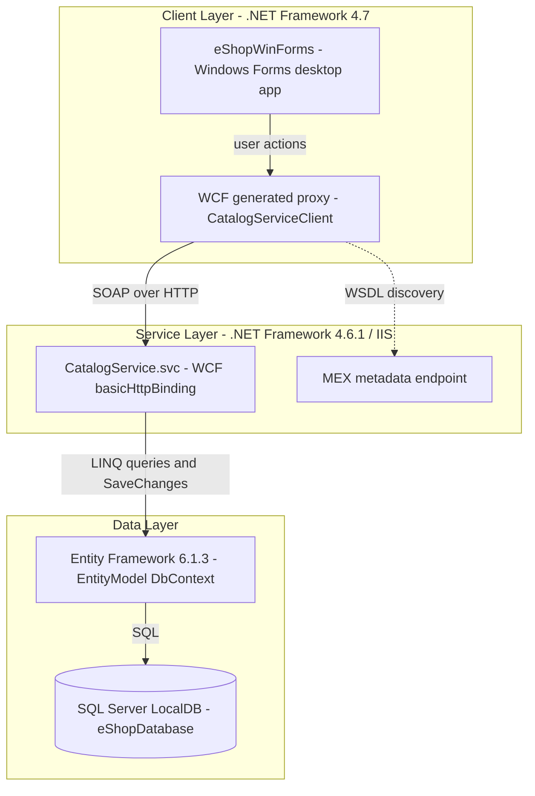
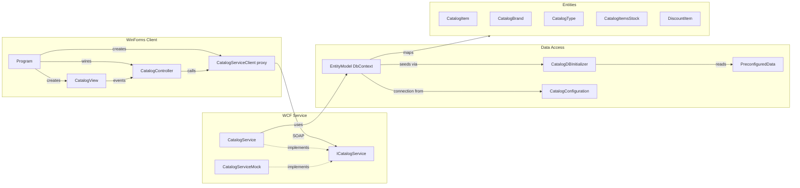

# Architecture Diagram

eShopLegacyNTier is a two-project .NET Framework N-tier solution: a WCF catalog service (hosted in IIS) and a Windows Forms desktop client that consumes it over SOAP.

## Application Architecture

### Technology Stack Summary

| Layer | Technology | Version | Purpose |
|-------|-----------|---------|---------|
| Presentation | Windows Forms | .NET Framework 4.7 | Desktop catalog and stock management UI |
| Service | WCF (System.ServiceModel) | .NET Framework 4.6.1 | SOAP catalog service hosted via .svc |
| Data access | Entity Framework | 6.1.3 | Code First ORM with DB initializer seeding |
| Database | SQL Server LocalDB | mssqllocaldb | Catalog, stock and discount storage |
| Serialization | Newtonsoft.Json | 6.0.4 | JSON helpers in the client |

### Data Storage & External Services

The only data store is a SQL Server LocalDB database (`eShopDatabase`) created and seeded automatically by `CatalogDBInitializer` on first access. The connection string can be overridden with the `ConnectionString` environment variable. There are no other external services; the client talks to the WCF service at a hard-coded `http://localhost:62314/CatalogService.svc` endpoint.

### Key Architectural Decisions

- Classic N-tier: view and controller in the client (MVP style), business and data logic in a single WCF service class.
- Code First EF6 with `CreateDatabaseIfNotExists` initializer provides schema and seed data.
- Client uses a generated service reference (`Connected Services`) and constructor injection of `ICatalogService` and `ICatalogView` into the controller.

## Component Relationships

### Component Inventory

| Component | Layer | Type | Responsibility |
|-----------|-------|------|----------------|
| Program | Presentation | Entry point | Composes view, proxy and controller |
| CatalogView | Presentation | WinForms form | Grid of items, filters, stock search, discount banner |
| ICatalogView | Presentation | View interface | Events and update methods used by the controller |
| CatalogController | Presentation | Controller | Handles view events and calls the service |
| CatalogServiceClient | Presentation | WCF proxy | Generated client for ICatalogService |
| ICatalogService | Service | Service contract | 10 operations for catalog, stock and discounts |
| CatalogService | Service | WCF service | Implements operations using EntityModel |
| CatalogServiceMock | Service | In-memory implementation | Mock implementation of the contract |
| EntityModel | Data access | EF DbContext | DbSets for 5 entities and model configuration |
| CatalogDBInitializer | Data access | DB initializer | Creates and seeds the database |
| PreconfiguredData | Data access | Seed data | Static seed catalog data |
| CatalogConfiguration | Infrastructure | Config helper | Resolves connection string (env var or config) |
