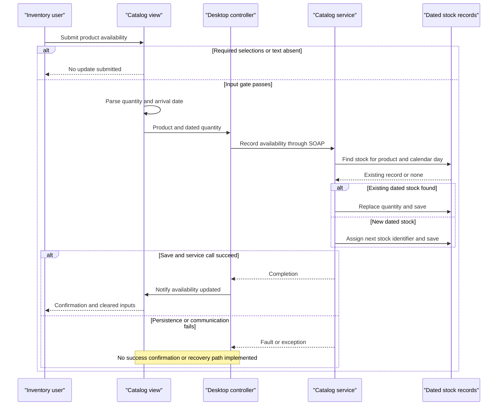

# Core Business Workflows

The application lets a desktop user browse a product catalog with date-dependent sale prices, check stock for a chosen date, and record or replace availability. The reviewed source does not implement checkout, customer accounts, payments, order fulfillment or shipment tracking.

## Domain Entities

| Entity | Service / Bounded Context | Description | Key Relationships |
|---|---|---|---|
| CatalogItem | CatalogService / catalog | Product shown with description, picture and displayed price | Classified by brand and type; logical subject of availability records. |
| CatalogBrand | CatalogService / catalog classification | Named brand available as a browsing filter | Groups catalog products. |
| CatalogType | CatalogService / catalog classification | Named product category available as a browsing filter | Groups catalog products. |
| CatalogItemsStock | CatalogService / dated inventory | Available quantity for one product on a calendar day | Logical reference to product; called a shipment by UI text, not a shipment lifecycle entity. |
| DiscountItem | CatalogService / promotions | Global date-range discount used for display | Applied to displayed products; no product-specific association. |

Evidence: `src\eShopWCFService\Models\CatalogItem.cs:10-35`; `Models\CatalogBrand.cs:10-19`; `Models\CatalogType.cs:10-19`; `Models\CatalogItemsStock.cs:10-25`; `Models\DiscountItem.cs:11-31` (model paths under `src\eShopWCFService`). UI behavior: `src\eShopWinForms\Views\CatalogView.cs:48-72,189-195`. Persistence fields/mappings belong to `data-architecture.md`.

## Service-to-Domain Mapping

| Service | Domain Context | Owned Entities | External Dependencies |
|---|---|---|---|
| CatalogService | Catalog, promotions, dated inventory in one service | All five domain entities | One database via EntityModel; no external business service. |
| eShopWinForms desktop | User-facing catalog and inventory interaction | No authoritative persisted entities; generated contract copies | CatalogService via WCF; local product images. |

There is no separate inventory or promotions deployment and no DDD aggregate-root or event boundary explicitly modeled. Domain ownership is inferred from service/context code, not independently documented bounded contexts (`src\eShopWCFService\EntityModel.cs:18-22`; `src\eShopWinForms\Program.cs:22-27`).

## Primary Workflows

### Workflow 1: Browse filtered products with current sale prices

1. Desktop starts, constructs the view, proxy and controller, and calls LoadView before showing the window (`src\eShopWinForms\Program.cs:22-27`).
2. Controller checks for the current sale, loads products, creates brand/type filters with an All choice, then populates inventory-selection controls (`src\eShopWinForms\Controllers\CatalogController.cs:60-69,98-158`).
3. Changing either filter raises FilterEventArgs; controller clears the grid and requests matching products (`src\eShopWinForms\Views\CatalogView.cs:106-135`; `src\eShopWinForms\Controllers\CatalogController.cs:27-29,75-78`).
4. Service applies the **All-filter rule**; controller separately requests the current discount using the **active-discount rule** and combines the results (`src\eShopWCFService\CatalogService.svc.cs:28-30,56-62`; `src\eShopWinForms\Controllers\CatalogController.cs:79-85`).
5. View applies the **display-price rule**, loads bundled/local pictures and renders rows (`src\eShopWinForms\Views\CatalogView.cs:48-61`).

There is no order/purchase mutation. Missing service/database/image files are not handled with a fallback in these paths.

### Workflow 2: Record or replace product availability

1. User chooses a product, enters quantity and arrival date, and submits. The view applies the **availability-input gate**, parses the values and emits AvailabilityEventArgs (`src\eShopWinForms\Views\CatalogView.cs:157-167`).
2. Controller constructs a CatalogItemsStock request and calls CreateAvailableStock (`src\eShopWinForms\Controllers\CatalogController.cs:35-42`).
3. Service finds an existing stock row for the same product/calendar date. The **dated-stock replacement rule** either replaces its quantity or inserts a new row using the **application-ID rule**, then saves (`src\eShopWCFService\CatalogService.svc.cs:99-117`).
4. Only after the call returns does the UI display the shipment-added notification and clear inputs (`src\eShopWinForms\Controllers\CatalogController.cs:42-43`; `src\eShopWinForms\Views\CatalogView.cs:189-195`).

The operation sets daily stock; it does not increment a running stock balance, persist a shipment history or trigger fulfillment.

### Workflow 3: Check availability for a selected day

User selects a product and calendar day; view extracts product ID, controller requests stock, service applies the **stock-lookup rule**, and view appends date/product/quantity to its result list (`src\eShopWinForms\Views\CatalogView.cs:142-151,173-182`; `src\eShopWinForms\Controllers\CatalogController.cs:50-54`; `src\eShopWCFService\CatalogService.svc.cs:90-96`). A missing stock row is displayed as zero; the contract does not distinguish missing data from recorded zero.

### Other Workflows

- **Catalog CRUD:** service exposes product find/create/update/remove, but the reviewed desktop controller does not wire a product-editor workflow. Create assigns an ID; update marks the supplied object modified; removal deletes it (`src\eShopWCFService\CatalogService.svc.cs:33-44,65-82`).
- **Initial sample business state:** create-if-absent initialization seeds reference data, products, stock and discounts, in that order. This is database initialization, not a recurring scheduled job (`src\eShopWCFService\Models\Infrastructure\CatalogDBInitializer.cs:11-20`).
- No scheduled jobs, message handlers or business event consumers are wired in the two projects.

## Cross-Service Data Flows

One desktop talks to one service. Catalog items and the current discount are fetched separately and merged only for the display; local pictures are joined by the returned filename (`src\eShopWinForms\Controllers\CatalogController.cs:75-85`; `src\eShopWinForms\Views\CatalogView.cs:55-61`). This is neither gateway aggregation nor a cross-backend business workflow.

No circuit breaker, compensating action, queued update, offline write or degraded-data fallback is implemented. Synchronous failures propagate instead of returning partial catalog/availability data. The compiled mock is not automatically selected and throws for discounts (`src\eShopWCFService\CatalogServiceMock.cs:118-120`); it is not an outage fallback.

## Business Workflow Sequence

Evidence: `src\eShopWinForms\Views\CatalogView.cs:157-167,189-195`; `src\eShopWinForms\Controllers\CatalogController.cs:35-43`; `src\eShopWCFService\CatalogService.svc.cs:99-117`. Failure branch describes propagation, not a coded catch/retry.

## Business Rules & Decision Logic

| Rule | Observed behavior | Evidence |
|---|---|---|
| All-filter rule | Zero means no brand/type filter; otherwise both selected filters must match. | `src\eShopWCFService\CatalogService.svc.cs:56-62` |
| Active-discount rule | Match inclusive Start/End calendar days; take first matching discount, not greatest discount or an explicitly ordered winner. Null means no current promotion. | `src\eShopWCFService\CatalogService.svc.cs:28-30`; `src\eShopWinForms\Controllers\CatalogController.cs:79-82` |
| Display-price rule | Display base price times one minus discount size; conversion to double and fixed-point formatting occur in the view. Banner percentage is rounded separately. No price writeback occurs. | `src\eShopWinForms\Views\CatalogView.cs:50-61`; `src\eShopWinForms\Controllers\CatalogController.cs:62-68` |
| Availability-input gate | Submission returns silently if no product selection or quantity/date text is empty. Parsing uses int.Parse and Convert.ToDateTime; no guarded parse, positive-quantity check or allowed date window is implemented. | `src\eShopWinForms\Views\CatalogView.cs:157-167` |
| Stock-lookup rule | Match product and calendar day, first row only; absent row returns zero. Selection is assumed non-null by UI search handler. | `src\eShopWCFService\CatalogService.svc.cs:90-96`; `src\eShopWinForms\Views\CatalogView.cs:142-150` |
| Dated-stock replacement rule | Existing product/day row has its quantity overwritten, not added; otherwise insert. No explicit uniqueness constraint or duplicate-row repair. | `src\eShopWCFService\CatalogService.svc.cs:101-116` |
| Application-ID rule | Product and new stock identifiers are maximum existing ID plus one; no empty-table guard or concurrent allocation protection. | `src\eShopWCFService\CatalogService.svc.cs:65-70,113-116` |
| Model validation metadata | Brand and type text each have StringLength 50. No Required, Range, discount size bounds, date-order validator or custom domain validator is declared on the five model classes. | `src\eShopWCFService\Models\CatalogBrand.cs:17-19`; `Models\CatalogType.cs:17-19`; remaining model definitions cited above |

**State transitions:** no order state machine, reservation lifecycle, shipment status or promotion approval state exists; mutations are direct catalog/availability changes. Promotions are effective by date comparison, not explicit activation events. Seed promotions end in 2017, so the checked-in sample alone does not establish a current promotion (`src\eShopWCFService\Models\Infrastructure\PreconfiguredData.cs:41-50`).

**Transactions and integrity:** each service mutation saves its changes; no multi-operation transaction/saga or cross-context relationship-maintenance routine is declared. There is no explicit optimistic concurrency token or atomic identifier allocator. See `data-architecture.md` for mapping/transaction implications.

**Errors and audit:** service/controller paths have no domain-specific exceptions, compensating actions, audit trail or business-event logging. WCF exception details are disabled (`src\eShopWCFService\Web.config:29`); that is fault presentation, not business recovery.

**Authorization:** no business-level roles, ownership checks or user identity checks appear in the service/controller flows. Deployment-level access policies are unknown. No workflow was executed; findings reflect the checked-in source only.
