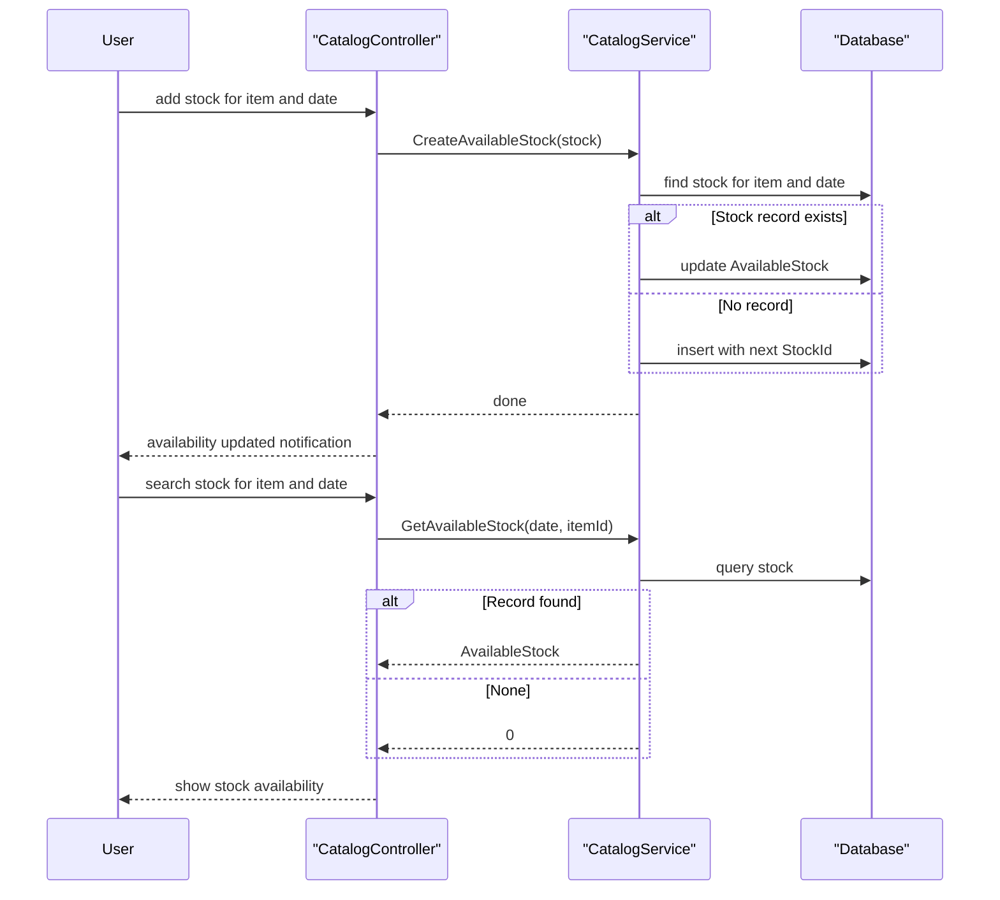

# Core Business Workflows

The application lets staff browse a product catalog by brand and type, check and record daily stock levels, and see active sale discounts.

## Domain Entities

| Entity | Service / Bounded Context | Description | Key Relationships |
|--------|---------------------------|-------------|-------------------|
| CatalogItem | Catalog | A product for sale | Belongs to one brand and one type; has daily stock |
| CatalogBrand | Catalog | Manufacturer or brand | Has many items |
| CatalogType | Catalog | Product category | Has many items |
| CatalogItemsStock | Inventory | Available quantity of an item on a date | References an item |
| DiscountItem | Promotions | Percentage sale for a date range | Standalone |

## Service-to-Domain Mapping

| Service | Domain Context | Owned Entities | External Dependencies |
|---------|----------------|----------------|-----------------------|
| eShopWCFService | Catalog, Inventory, Promotions | All five entities | SQL Server LocalDB |
| eShopWinForms | Catalog browsing UI | none | eShopWCFService |

## Primary Workflows

### Workflow 1: Browse catalog with discount

1. The client loads brand and type filters from the service and adds an "all" option (id 0).
2. The user selects a filter; the controller requests items for the brand and type (0 means no filter).
3. The controller fetches the discount valid for today.
4. The view shows items with the discount applied and a banner "N% sale ends on date".

### Workflow 2: Check and record stock

1. The user searches stock for an item and date; the service returns the available quantity, or 0 when no record exists.
2. The user adds a shipment for an item and date; an existing record for that date is overwritten, otherwise a new record is created with the next id.
3. The view is notified that availability was updated.

### Workflow 3: Catalog maintenance (service operations)

The service supports creating (next id = max + 1), updating and removing catalog items; the WinForms client does not currently invoke them.

## Cross-Service Data Flows

The client is the only composer of data: it combines items, brands, types, discount and stock from separate calls. There is no fallback if the service is unavailable; the call fails with a WCF exception.

## Business Workflow Sequence

## Business Rules & Decision Logic

- Filter value 0 means "all" for brand or type.
- A discount applies when today is within its start and end dates (inclusive, date only).
- Discount percentage is shown as the size multiplied by 100, rounded.
- Stock is unique per item per day; adding stock replaces the existing quantity rather than accumulating.
- Missing stock is reported as 0.
- Identifiers are assigned in application code (max + 1), which is not safe under concurrent writers.
