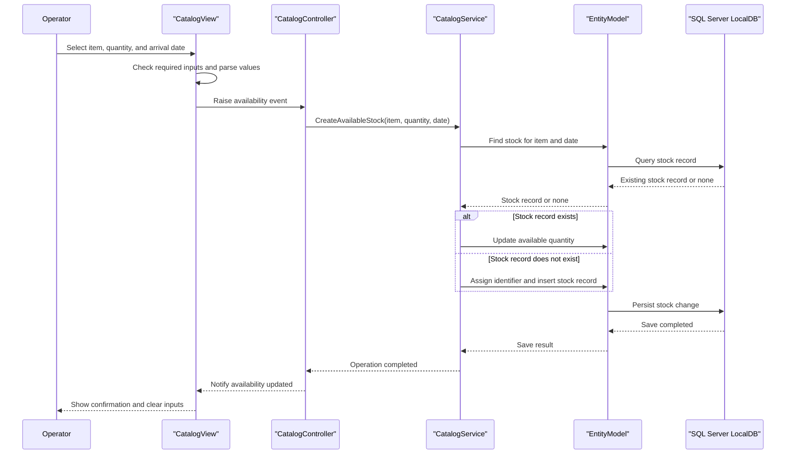

# Core Business Workflows

The application supports product catalog browsing and basic inventory availability management. Store operators can filter products, see date-based discounts, query item stock, and add or update stock availability.

## Domain Entities

| Entity | Service / Bounded Context | Description | Key Relationships |
|---|---|---|---|
| CatalogItem | Catalog | A product offered in the catalog | Classified by a brand and type; may have dated stock records |
| CatalogBrand | Catalog | Product brand grouping | Groups catalog items |
| CatalogType | Catalog | Product type grouping | Classifies catalog items |
| CatalogItemsStock | Inventory | Available quantity for a catalog item on a date | Refers to a catalog item by identifier |
| DiscountItem | Promotions | Discount percentage active over a date range | Independent discount schedule |

## Service-to-Domain Mapping

| Service | Domain Context | Owned Entities | External Dependencies |
|---|---|---|---|
| eShopWCFService | Catalog, inventory, promotions | CatalogItem, CatalogBrand, CatalogType, CatalogItemsStock, DiscountItem | SQL Server through Entity Framework |
| eShopWinForms | Store operations UI | None; uses service data contracts | eShopWCFService |

All domain data is owned by the WCF service. The desktop client exchanges service-contract objects synchronously; there are no separate bounded services or event-driven flows.

## Primary Workflows

### Workflow 1: Browse and filter the catalog

1. On startup, the controller loads the current discount, catalog items, brands, types, and shipment item choices.
2. Selecting a brand or type raises a view event; the controller calls `GetCatalogItems` with the selected identifiers. Identifier zero means that dimension is not filtered.
3. The controller checks for a discount active on the current date and passes its fractional size to the view.
4. The view computes each displayed discounted price and renders the returned product and image.

### Workflow 2: Check item availability

1. The operator selects an item and date in the view.
2. The controller requests stock for that item and date.
3. The service returns the matching stock quantity, or zero when no matching record exists.
4. The view displays the date, item, and available quantity.

### Workflow 3: Add or update stock availability

1. The operator selects an item, quantity, and arrival date. The view ignores the request if required text fields are empty and parses the entered values.
2. The controller creates a stock request and sends it to the service.
3. The service finds a record for the same item and date. It updates that record's quantity when present; otherwise, it assigns a new identifier and inserts a record.
4. The view confirms the update and clears its shipment inputs.

## Cross-Service Data Flows

The client composes no data from multiple services. Catalog, discount, and stock information all come from the single WCF service, which queries its database. If the WCF service is unavailable, no retry, circuit breaker, or local data fallback is configured.

## Business Workflow Sequence

## Business Rules & Decision Logic

- Catalog filters use zero identifiers to represent “all” brands or types.
- A discount is active when the requested date falls inclusively between its start and end dates; its size is used as the fraction discounted from product price.
- Stock availability is selected by item and date; missing stock is reported as zero.
- Adding stock updates an existing item/date record or creates a new one.
- The view checks for blank stock inputs and parses quantity/date values, but no additional service-side validation rules were identified.
- Persistence operations are performed through Entity Framework. No explicit business transaction orchestration, event publication, audit log, or role-based authorization was found.
