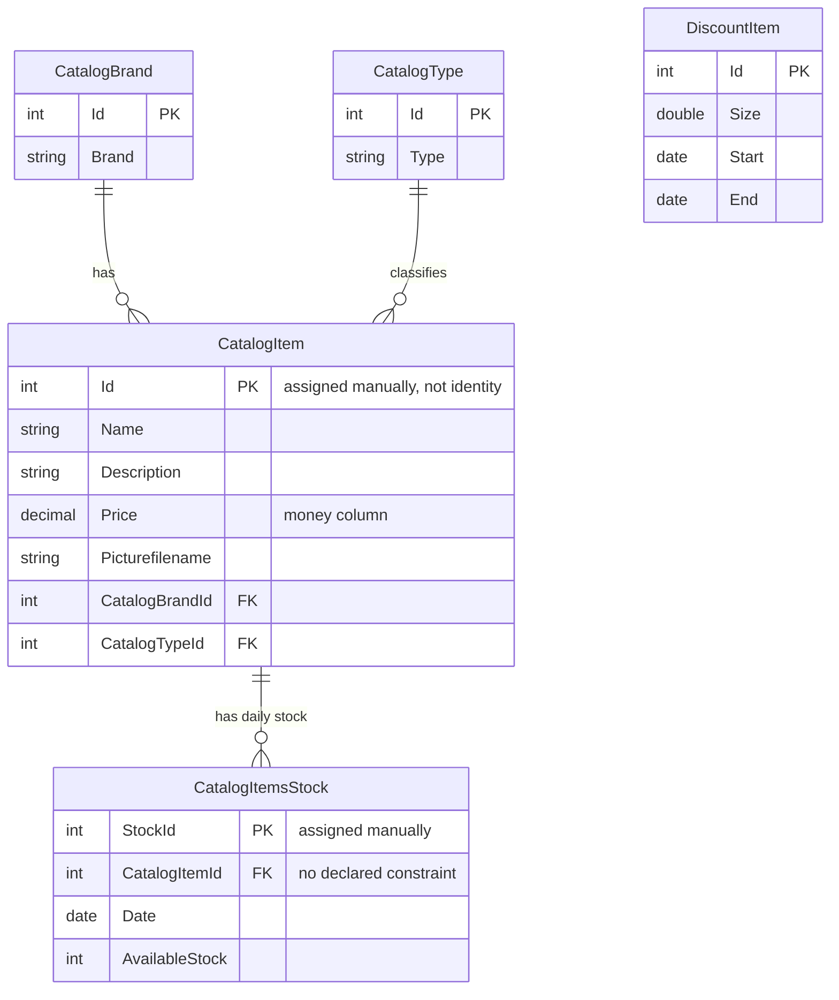

# Data Architecture & Persistence Layer

The data layer consists of 5 Entity Framework 6 Code First entities stored in a single SQL Server LocalDB database, accessed only by the WCF service.

## Database Configuration

| Service/Module | DB Type | Profile | Driver | Connection | Migration Tool |
|----------------|---------|---------|--------|------------|----------------|
| eShopWCFService | SQL Server LocalDB | none (Web.config / env var override) | System.Data.SqlClient | `EntityModel` connection string, DB `eShopDatabase`, or `ConnectionString` env var | None; `CreateDatabaseIfNotExists` initializer with seed |

## Data Ownership per Service

| Service | Tables Owned | ORM Framework | Caching | Notes |
|---------|--------------|---------------|---------|-------|
| eShopWCFService | CatalogBrands, CatalogItems, CatalogItemsStock, CatalogTypes, DiscountItems | Entity Framework 6.1.3 | None | Only service with DB access |
| eShopWinForms | none | none | None | Reads data through WCF |

## Entity Model

## Key Repository Methods

There is no repository layer; `CatalogService` queries `EntityModel` directly.

| Service | Repository | Notable Methods | Purpose |
|---------|-----------|-----------------|---------|
| eShopWCFService | EntityModel (DbContext) | GetCatalogItems, GetDiscount, GetAvailableStock | Filtering is done in memory after `ToList()` |
| eShopWCFService | EntityModel (DbContext) | CreateCatalogItem, CreateAvailableStock | Primary keys computed as `Max(Id) + 1` |

## Caching Strategy

No caching is implemented; every call queries the database.

## Data Ownership Boundaries

A single database is owned by the WCF service. The WinForms client has no direct data access, although it references EntityFramework. Related data (brand and type) is loaded manually in `FindCatalogItem`.

### Data Classification & Sensitivity

No PII, PHI, or PCI data detected in entity model.
