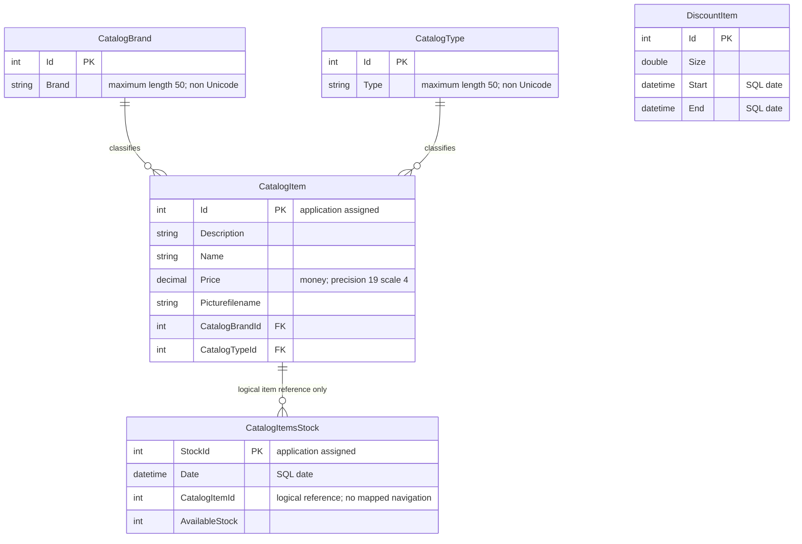

# Data Architecture & Persistence Layer

The assessed workspace contains five EF6 entity types in one context backed by SQL Server, with LocalDB as the checked-in default. This is a source-only assessment of `eShopLegacyNTier`; paths below are workspace-relative, and no database schema was inspected at runtime.

## Database Configuration

| Service/Module | DB Type | Profile | Driver | Connection | Migration Tool |
|---|---|---|---|---|---|
| eShopWCFService | SQL Server LocalDB | Default checked-in configuration | System.Data.SqlClient / EF6 SQL Server provider | Named connection to local `eShopDatabase`; configuration inventory holds exact settings | No explicit migration set; Code First CreateDatabaseIfNotExists initializer |
| eShopWCFService | SQL Server-compatible configured destination | Process environment override; not a named profile | Same declared provider stack | Full connection string supplied externally; value not recorded here | Same initializer; actual target/schema unknown |

Evidence: `src\eShopWCFService\Web.config:52-64`; `src\eShopWCFService\Models\Infrastructure\CatalogConfiguration.cs:10-18`; `src\eShopWCFService\EntityModel.cs:12-16`. See `configuration-inventory.md` for property names and override precedence.

The initializer creates a missing database and seeds types, brands, products, dated stock and discounts, saving each group separately (`src\eShopWCFService\Models\Infrastructure\CatalogDBInitializer.cs:11-79`). It does not declare migration/versioning of an existing database. Seed source has 12 products, 5 brands, 4 types, 6 stock rows and 6 discounts; the dated stock/discount samples are from 2017 (`src\eShopWCFService\Models\Infrastructure\PreconfiguredData.cs:10-75`). No explicit pooling tuning or raw SQL scripts were found in this workspace.

## Data Ownership per Service

| Service | Tables Owned | ORM Framework | Caching | Notes |
|---|---|---|---|---|
| CatalogService | CatalogBrands, CatalogItems, CatalogTypes, DiscountItems (conventional names); CatalogItemsStock (explicit name) | EF 6.1.3 | None explicitly configured | Five DbSets; only stock table has an explicit Table attribute. Actual generated schema not runtime-verified. |
| eShopWinForms | None | EF package declared, but no DbContext in the active desktop path | None explicitly configured | Receives generated contract objects; no direct persistence ownership. |

Evidence: `src\eShopWCFService\EntityModel.cs:18-22`; `src\eShopWCFService\Models\CatalogItemsStock.cs:10`; `src\eShopWCFService\packages.config:3`; `src\eShopWinForms\Program.cs:22-27`; `src\eShopWinForms\packages.config:3`.

## Entity Model

| Entity | Source | Persistence details |
|---|---|---|
| CatalogBrand | `src\eShopWCFService\Models\CatalogBrand.cs:10-19` | Convention key Id, database generation disabled; Brand nullable by CLR/annotation model, length 50. |
| CatalogType | `src\eShopWCFService\Models\CatalogType.cs:10-19` | Convention key Id, database generation disabled; Type length 50. |
| CatalogItem | `src\eShopWCFService\Models\CatalogItem.cs:10-35` | Convention key Id, generation disabled; scalar brand/type references and non-virtual navigation properties. |
| CatalogItemsStock | `src\eShopWCFService\Models\CatalogItemsStock.cs:10-25` | Explicit table name and StockId key; no navigation or ForeignKey attribute for CatalogItemId. |
| DiscountItem | `src\eShopWCFService\Models\DiscountItem.cs:11-31` | Explicit Id key; no DatabaseGenerated.None annotation; independent date-range discount, no entity relationships. |

`src\eShopWCFService\EntityModel.cs:24-40` configures non-Unicode brand/type names and product price precision. Brand/type relationships are inferred by EF conventions from product navigation properties and non-null integer IDs; there are no inverse collections or explicit cascade/fetch overrides. Navigation properties are not virtual, so proxy lazy-loading of them is not established by this model. Stock-to-product is **logical only**: the diagram must not be read as proof of a database FK. No item/date unique constraint, row-version concurrency token, or explicit relationship-maintenance helper is declared.

## Key Repository Methods

There is no repository interface: `CatalogService` directly queries the five `EntityModel` sets. Methods below are the effective data-access boundary, not REST endpoints.

| Service | Repository | Notable Methods | Purpose |
|---|---|---|---|
| CatalogService | EntityModel via service | `CatalogItem FindCatalogItem(int id)` | First product by ID, then explicit brand/type lookups; `src\eShopWCFService\CatalogService.svc.cs:33-44`. |
| CatalogService | EntityModel via service | `List<CatalogItem> GetCatalogItems(int brandIdFilter, int typeIdFilter)` | Loads all products before in-memory optional filtering; `src\eShopWCFService\CatalogService.svc.cs:56-62`. |
| CatalogService | EntityModel via service | `DiscountItem GetDiscount(DateTime day)` | Loads all discounts, selects first inclusive calendar-day match; `src\eShopWCFService\CatalogService.svc.cs:28-30`. |
| CatalogService | EntityModel via service | `int GetAvailableStock(DateTime date, int catalogItemId)` | Server-side item filter, then in-memory date match; absent row returns zero; `src\eShopWCFService\CatalogService.svc.cs:90-96`. |
| CatalogService | EntityModel via service | `void CreateAvailableStock(CatalogItemsStock stock)` | Updates first matching dated stock or inserts with maximum StockId plus one; `src\eShopWCFService\CatalogService.svc.cs:99-117`. |
| CatalogService | EntityModel via service | `void CreateCatalogItem(CatalogItem item)` | Assigns maximum product ID plus one, adds and saves; `src\eShopWCFService\CatalogService.svc.cs:65-70`. |

Ordinary list lookups and product update/delete use direct DbSet/Entry operations (`src\eShopWCFService\CatalogService.svc.cs:46-54,73-82`). No stored procedures, raw SQL, batch aggregation repository, custom transaction scope or CQRS query model is declared. Each mutation invokes `SaveChanges`; no transaction spans separate SOAP operations or the multi-group seed sequence.

## Caching Strategy

No application cache, distributed cache, explicit TTL, eviction policy or query-result cache is configured in the active desktop/service path (`src\eShopWCFService\CatalogService.svc.cs:28-117`; `src\eShopWinForms\Controllers\CatalogController.cs:60-85,150-157`). EF context tracking and desktop display collections are not a cross-request caching strategy. The unused in-memory mock is not a cache provider.

## Data Ownership Boundaries

One service owns one store; desktop calls SOAP rather than querying another service's tables. Catalog, stock and discounts are in one persistence boundary, with no database-per-service isolation, outbox, broker-mediated replication or CQRS split. Client composition combines catalog data with a separate discount result, not data from separate backend domains (`src\eShopWinForms\Controllers\CatalogController.cs:75-85`).

Application-assigned maximum-plus-one IDs depend on non-empty tables and are not atomically allocated; concurrent inserts and first-match stock updates have no explicit uniqueness/concurrency guard (`src\eShopWCFService\CatalogService.svc.cs:65-70,101-116`). These are source-observed limitations, not runtime test results.

### Data Classification & Sensitivity

| Entity | Sensitive Fields | Classification (PII/PHI/PCI/None) | Controls in Place |
|---|---|---|---|
| CatalogItem | No designated sensitive fields; free text and product image filename | None evident in model | No field encryption, masking or field-level access checks declared. |
| CatalogBrand / CatalogType | No designated sensitive fields | None evident in model | No field-level protection declared. |
| CatalogItemsStock | Product/date/quantity operational information | None of PII/PHI/PCI evident | No field-level protection declared. |
| DiscountItem | Discount amount and dates | None of PII/PHI/PCI evident | No field-level protection declared. |

No PII, PHI, or PCI data detected in the declared entity model (sources in the entity table above). This does not classify arbitrary future free-text contents. Encryption at rest, database permissions and production backups are deployment concerns not established by the checked-in files; no claim about their actual state is made.
