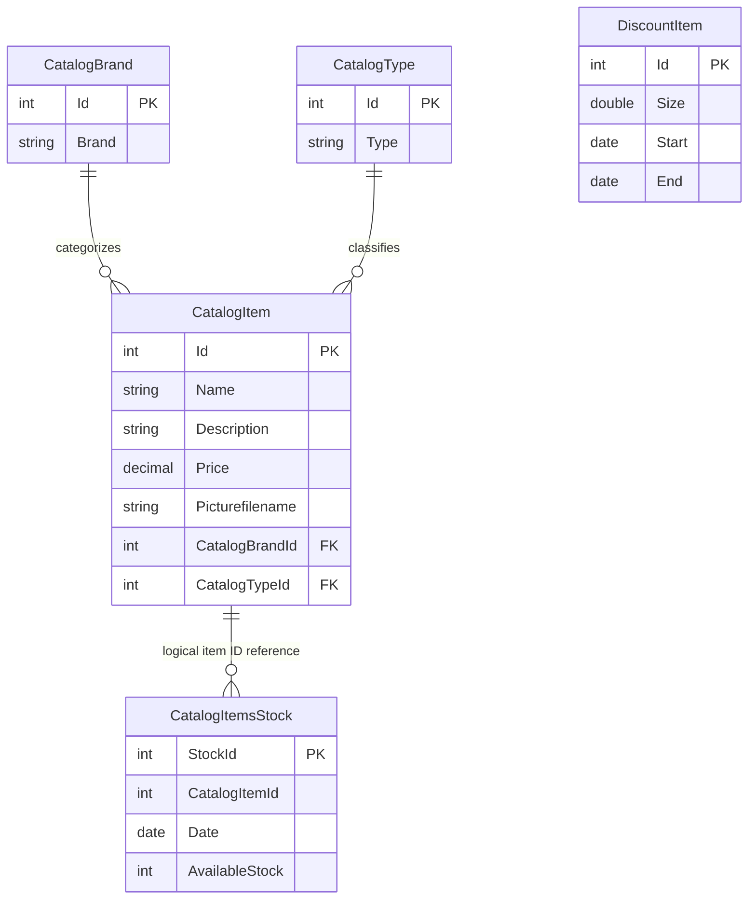

# Data Architecture & Persistence Layer

The WCF service owns a catalog data model with five entity types and uses Entity Framework 6 against SQL Server. The model contains product classification and dated stock records, plus independent discount periods.

## Database Configuration

| Service/Module | DB Type | Profile | Driver | Connection | Migration Tool |
|---|---|---|---|---|---|
| eShopWCFService | SQL Server LocalDB | Default | `System.Data.SqlClient` | `EntityModel` connection string; EF may receive an environment-provided connection string | None detected |
| eShopWCFService | SQL Server | Deployment override | `System.Data.SqlClient` | `ConnectionString` environment variable can replace the named connection | None detected |

The service uses a create-if-not-exists initializer and seeds initial catalog data programmatically. No EF migration or schema-versioning tool was found.

## Data Ownership per Service

| Service | Tables Owned | ORM Framework | Caching | Notes |
|---|---|---|---|---|
| eShopWCFService | CatalogItems, CatalogBrands, CatalogTypes, CatalogItemsStock, DiscountItems | Entity Framework 6.1.3 | None detected | Seeded by `CatalogDBInitializer` |

## Entity Model

`CatalogItem` declares navigation properties for brand and type. `CatalogItemsStock.CatalogItemId` is used by service queries as an item identifier, but the stock entity has no navigation property or explicit foreign-key mapping. `DiscountItem` is independent of the catalog relationships.

## Key Repository Methods

| Service | Repository | Notable Methods | Purpose |
|---|---|---|---|
| eShopWCFService | No repository interface; `CatalogService` uses `EntityModel` directly | `GetCatalogItems`, `FindCatalogItem`, `GetAvailableStock`, `GetDiscount` | Reads catalog, item, stock, and active discount data using Entity Framework LINQ |
| eShopWCFService | No repository interface; `CatalogService` uses `EntityModel` directly | `CreateCatalogItem`, `UpdateCatalogItem`, `RemoveCatalogItem`, `CreateAvailableStock` | Writes catalog and stock records through the DbContext |

No raw SQL, stored procedure call, custom repository interface, or transaction annotation was found.

## Caching Strategy

No application-level or ORM second-level cache was detected.

## Data Ownership Boundaries

The WCF service is the single data owner and accesses one SQL Server database directly through its DbContext. The Windows Forms client obtains data through the service contract rather than accessing the database. No cross-service database sharing, CQRS split, or data aggregation across independent services was found.

### Data Classification & Sensitivity

| Entity | Sensitive Fields | Classification (PII/PHI/PCI/None) | Controls in Place |
|---|---|---|---|
| CatalogItem | Product name, description, price, image filename | None | No personal or payment data identified |
| CatalogBrand | Brand name | None | No personal or payment data identified |
| CatalogType | Product type | None | No personal or payment data identified |
| CatalogItemsStock | Item identifier, date, stock quantity | None | No personal or payment data identified |
| DiscountItem | Discount size and dates | None | No personal or payment data identified |
