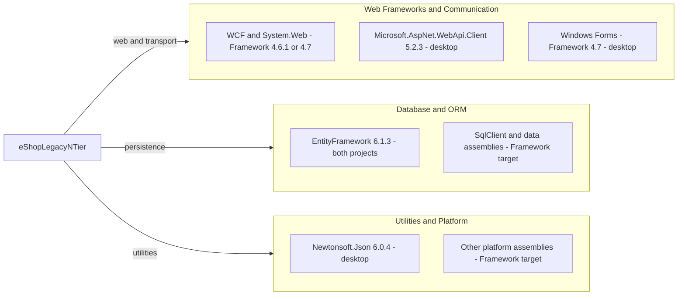

# Dependency Map

`eShopLegacyNTier` declares **3 distinct NuGet packages** across 4 package entries in two projects, plus **26 distinct framework assembly references** (30 distinct assembly reference names including package assemblies). This inventory uses only scoped build/package files; package counts exclude framework references and do not imply a resolved transitive graph.

## Dependencies

### Dependency Summary

| Category | Count | Key Libraries | Notes |
|---|---|---|---|
| Web Frameworks | 1 NuGet package | Microsoft.AspNet.WebApi.Client 5.2.3 | Desktop only; compile reference to System.Net.Http.Formatting 5.2.3.0. `src\eShopWinForms\packages.config:4`; `src\eShopWinForms\eShopWinForms.csproj:73-75`. |
| Database / ORM | 1 NuGet package | EntityFramework 6.1.3 | Both projects; EntityFramework and EntityFramework.SqlServer assembly version 6.0.0.0 is not the package version. `src\eShopWCFService\packages.config:3`; `src\eShopWinForms\packages.config:3`; service project `:45-49`, desktop project `:57-61`. |
| Utilities | 1 NuGet package | Newtonsoft.Json 6.0.4 | Desktop only; assembly identity 6.0.0.0. `src\eShopWinForms\packages.config:5`; `src\eShopWinForms\eShopWinForms.csproj:63-64`. |
| Framework/platform baseline | 26 distinct framework assembly names | WCF, System.Web, WinForms, SqlClient, XML | Supplied by .NET Framework targets, not separate NuGet packages; see inventory below. |

All NuGet entries are ordinary application dependencies; both `packages.config` files record `targetFramework="net461"`, although the desktop project itself now targets 4.7. Reference metadata does not declare separate runtime-only or test scopes.

**Complete framework reference inventory:** `Microsoft.CSharp`, `System`, `System.ComponentModel.DataAnnotations`, `System.Configuration`, `System.Core`, `System.Data`, `System.Data.DataSetExtensions`, `System.Data.Entity.Design`, `System.Deployment`, `System.Drawing`, `System.EnterpriseServices`, `System.IO.Compression`, `System.IO.Compression.FileSystem`, `System.Net.Http`, `System.Runtime.Serialization`, `System.ServiceModel`, `System.ServiceModel.Web`, `System.Web`, `System.Web.ApplicationServices`, `System.Web.DynamicData`, `System.Web.Entity`, `System.Web.Extensions`, `System.Web.Services`, `System.Windows.Forms`, `System.Xml`, `System.Xml.Linq`. Evidence: `src\eShopWCFService\eShopWCFService.csproj:51-70`; `src\eShopWinForms\eShopWinForms.csproj:67-86`. Framework assemblies have no individually pinned versions; the enclosing targets are 4.6.1 and 4.7 respectively.

### Version & Compatibility Risks

The service targets the retired .NET Framework 4.6.1; the desktop targets 4.7, whose servicing depends on the Windows/runtime installation. These are classic Framework projects, not modern .NET targets (`src\eShopWCFService\eShopWCFService.csproj:1-18`; `src\eShopWinForms\eShopWinForms.csproj:2-11`). EF 6.1.3, Web API Client 5.2.3 and Newtonsoft.Json 6.0.4 are old pinned releases and need compatibility/security review before reuse; this document does not claim an advisory scan or provide verified CVE findings.

### Notable Observations

- No central package management or lockfile is present in the scoped project; transitive closure and actual restored versions cannot be verified from these manifests alone.
- EF is declared in both projects; it is shown once in the diagram. No internal project reference appears in either project file.
- `HintPath` entries point at `src\packages` relative to the project directories; restoration/layout must match these legacy paths (`src\eShopWCFService\eShopWCFService.csproj:45-49`; `src\eShopWinForms\eShopWinForms.csproj:57-75`).
- System.Data.Entity.Design / System.Web.Entity framework references coexist with package-based EF6. These declarations alone do not prove which API paths execute.

## Test Dependencies

| Framework | Version | Notes |
|---|---|---|
| None detected | Not applicable | Neither package manifest nor project list declares a test framework; solution contains only the desktop and WCF projects (`eShopLegacyNTier.sln:6-9`). |

Total test-scope dependencies: **0**.

No test package or test infrastructure is declared inside the assessed workspace. No build, restore, test run or dependency vulnerability scan was performed.
