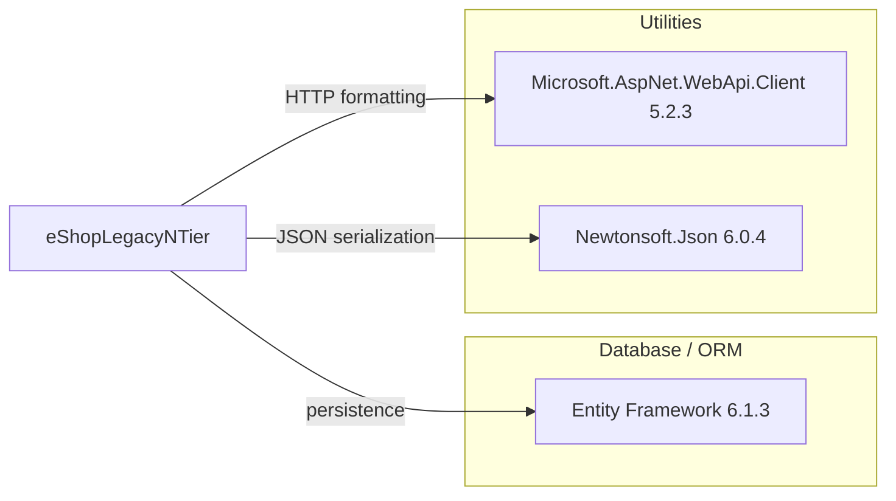

# Dependency Map

The eShopLegacyNTier solution declares four NuGet package references across two projects, representing three unique packages.

## Dependencies

### Dependency Summary

| Category | Count | Key Libraries | Notes |
|---|---:|---|---|
| Database / ORM | 1 unique package (2 references) | Entity Framework 6.1.3 | Used by both the WCF service and Windows Forms project |
| Utilities | 2 | Microsoft.AspNet.WebApi.Client 5.2.3, Newtonsoft.Json 6.0.4 | Client formatting and JSON serialization |

### Version & Compatibility Risks

The packages are declared in legacy `packages.config` files and use older versions. The Newtonsoft.Json 6.0.4 dependency is affected by CVE-2024-21907; the dependency update assessment should consider supported patched versions. Entity Framework 6.1.3 and Microsoft.AspNet.WebApi.Client 5.2.3 also warrant compatibility review for the target framework upgrade.

### Notable Observations

- Entity Framework is referenced by both projects, so its upgrade should keep client and service package versions aligned.
- The solution uses `packages.config` rather than SDK-style `PackageReference`.
- The package inventory is based on declared manifests; transitive dependencies could not be collected because the legacy WCF project requires unavailable Visual Studio Web targets.

## Test Dependencies

| Framework | Version | Notes |
|---|---|---|
| None detected | — | No test project or test-scoped package reference was found in the target solution. |

Total test-scope dependencies: 0

No test dependencies detected.
