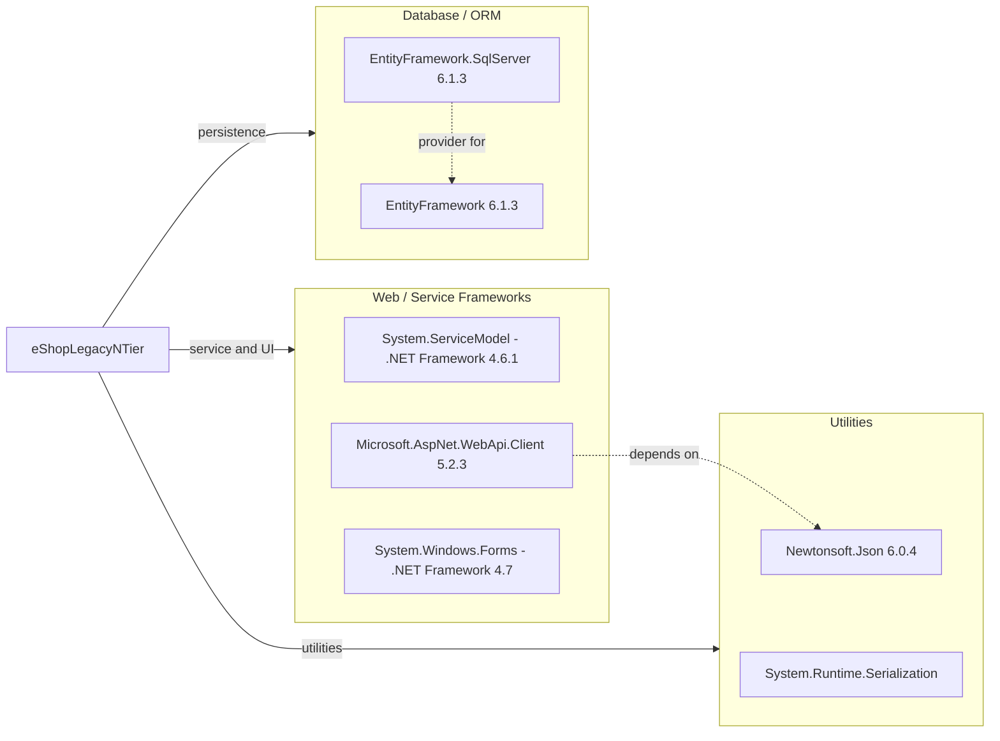

# Dependency Map

eShopLegacyNTier (eShopWCFService and eShopWinForms) declares 3 NuGet packages plus framework assembly references.

## Dependencies

### Dependency Summary

| Category | Count | Key Libraries | Notes |
|----------|-------|---------------|-------|
| Web / Service Frameworks | 3 | WCF, Web API Client 5.2.3, WinForms | Legacy .NET Framework stack |
| Database / ORM | 2 | EntityFramework 6.1.3 (service and client), EntityFramework.SqlServer | Used in both projects, but only the service queries the DB |
| Utilities | 2 | Newtonsoft.Json 6.0.4, Runtime.Serialization | JSON helper in client; DataContract serialization |

No logging, messaging, caching, security or observability packages are declared.

### Version & Compatibility Risks

Both projects use old-style csproj files with `packages.config` on .NET Framework 4.6.1/4.7. Entity Framework 6.1.3 and Newtonsoft.Json 6.0.4 (2014) are outdated, and Newtonsoft.Json 6.0.4 has known vulnerabilities in older releases. WCF server-side hosting (`.svc`) and Windows Forms need replacement strategies (CoreWCF or REST/gRPC; WinForms is supported on modern .NET for Windows only). EF6 has a migration path to EF Core.

### Notable Observations

- EntityFramework is referenced by the WinForms client although it never accesses the database directly.
- Newtonsoft.Json and Web API Client are only used by UWP-style helper files in the client.
- No central package management; versions are in each `packages.config`.

## Test Dependencies

No test dependencies detected.

Total test-scope dependencies: 0
There are no test projects in the solution.
