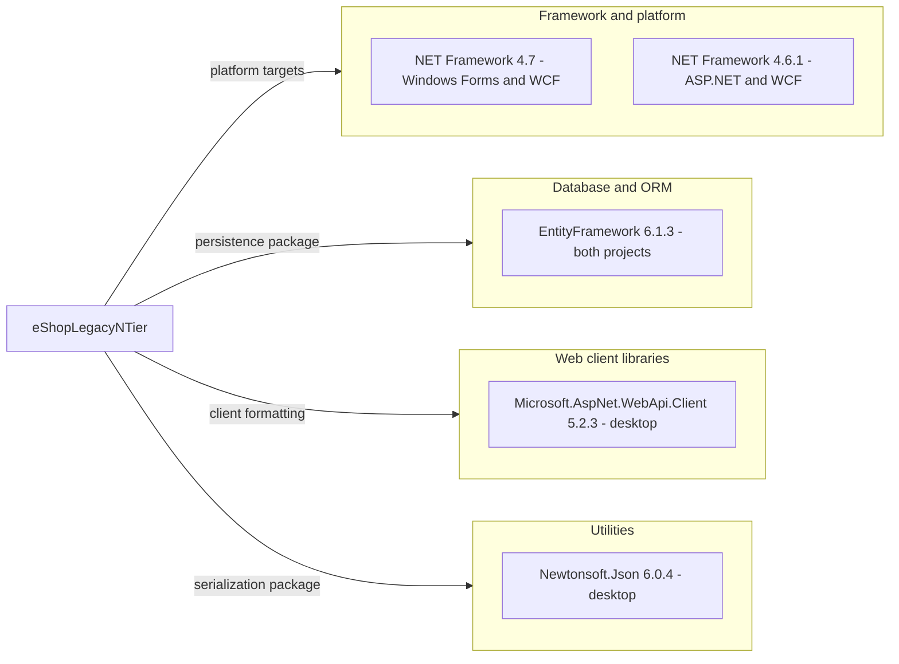

# Dependency Map

The scoped eShopLegacyNTier solution declares **3 distinct NuGet packages across 4 package declarations** in two projects. Framework/platform assemblies are distinguished from package counts; no lock-file-derived transitive closure is available.

## Dependencies

### Dependency Summary

| Category | Count | Key Libraries | Notes |
|---|---|---|---|
| Database / ORM | 1 distinct package; 2 declarations | EntityFramework 6.1.3 | Both projects; EntityFramework and EntityFramework.SqlServer assemblies come from the same package |
| Web client libraries | 1 | Microsoft.AspNet.WebApi.Client 5.2.3 | Desktop; referenced assembly is System.Net.Http.Formatting |
| Utilities | 1 | Newtonsoft.Json 6.0.4 | Desktop; package version differs from assembly version 6.0.0.0 |
| Framework/platform, not NuGet count | 2 target frameworks | .NET Framework 4.7 desktop; 4.6.1 server | System.Windows.Forms, WCF, ASP.NET and BCL references supplied by framework |

**Declared package ledger** (classic references are compile-time with normal runtime assembly use; packages.config has no explicit test/runtime-only scope):

| Project | Package | Declared version | Declaration |
|---|---|---|---|
| eShopWCFService | EntityFramework | 6.1.3 | `src\eShopWCFService\packages.config:3` |
| eShopWinForms | EntityFramework | 6.1.3 | `src\eShopWinForms\packages.config:3` |
| eShopWinForms | Microsoft.AspNet.WebApi.Client | 5.2.3 | `src\eShopWinForms\packages.config:4` |
| eShopWinForms | Newtonsoft.Json | 6.0.4 | `src\eShopWinForms\packages.config:5` |

**Complete framework assembly reference inventory**, grouped here rather than presenting each BCL assembly as an independent third-party library:

- Shared: Microsoft.CSharp, System, System.ComponentModel.DataAnnotations, System.Configuration, System.Core where explicitly declared by desktop, System.Data, System.Data.DataSetExtensions, System.Drawing, System.Runtime.Serialization, System.ServiceModel, System.Xml, System.Xml.Linq.
- Server-specific: System.Data.Entity.Design, System.Web.DynamicData, System.Web.Entity, System.Web.ApplicationServices, System.EnterpriseServices, System.ServiceModel.Web, System.Web, System.Web.Extensions, System.Web.Services.
- Desktop-specific: System.IO.Compression, System.IO.Compression.FileSystem, System.Deployment, System.Net.Http, System.Windows.Forms.

Evidence: `src\eShopWCFService\eShopWCFService.csproj:44-70`; `src\eShopWinForms\eShopWinForms.csproj:56-86`. Framework assembly versions are inherited from each target framework; no individual versions are pinned for these System references.

### Version & Compatibility Risks

The server targets the retired .NET Framework 4.6.1 release, while the desktop targets 4.7; deployment support also depends on the installed framework/Windows lifecycle. EF6 6.1.3, Web API Client 5.2.3 and Newtonsoft.Json 6.0.4 are old declarations and need compatibility and advisory review before modernization. This dependency inventory is **not a vulnerability scan** and does not claim CVE verification. Classic System.Web hosting, desktop Windows Forms and WCF server hosting are material portability considerations (`src\eShopWCFService\eShopWCFService.csproj:10-18,64-68`; `src\eShopWinForms\eShopWinForms.csproj:8-11,85`).

### Notable Observations

- Both projects carry EF6; the package ledger alone does not establish that the desktop accesses a database (`src\eShopWinForms\packages.config:3`).
- Packages use `packages.config` and sibling `..\packages\...` hint paths, not SDK PackageReference or central package management (`src\eShopWCFService\eShopWCFService.csproj:45-49`; `src\eShopWinForms\eShopWinForms.csproj:57-74`).
- No project-to-project reference is declared. The solution contains two projects, while the desktop explicitly compiles a generated service reference (`eShopLegacyNTier.sln:6-9`; `src\eShopWinForms\eShopWinForms.csproj:89-93`).
- No lock file or resolved transitive dependency graph is present in scope; declared package relationships must not be mistaken for a verified transitive tree. A .NET 3.5 SP1 bootstrapper entry is disabled and is not an active package/runtime target (`src\eShopWinForms\eShopWinForms.csproj:270-274`).

## Test Dependencies

| Framework | Version | Notes |
|---|---|---|
| None detected | Not applicable | Neither package manifest declares test libraries; solution lists only the desktop and service projects |

Total test-scope dependencies: **0**.

No unit, integration or contract-testing framework is declared in the scoped build/package files (`eShopLegacyNTier.sln:6-9`; both `packages.config` files). This is manifest inspection only; no tests or builds were run.
