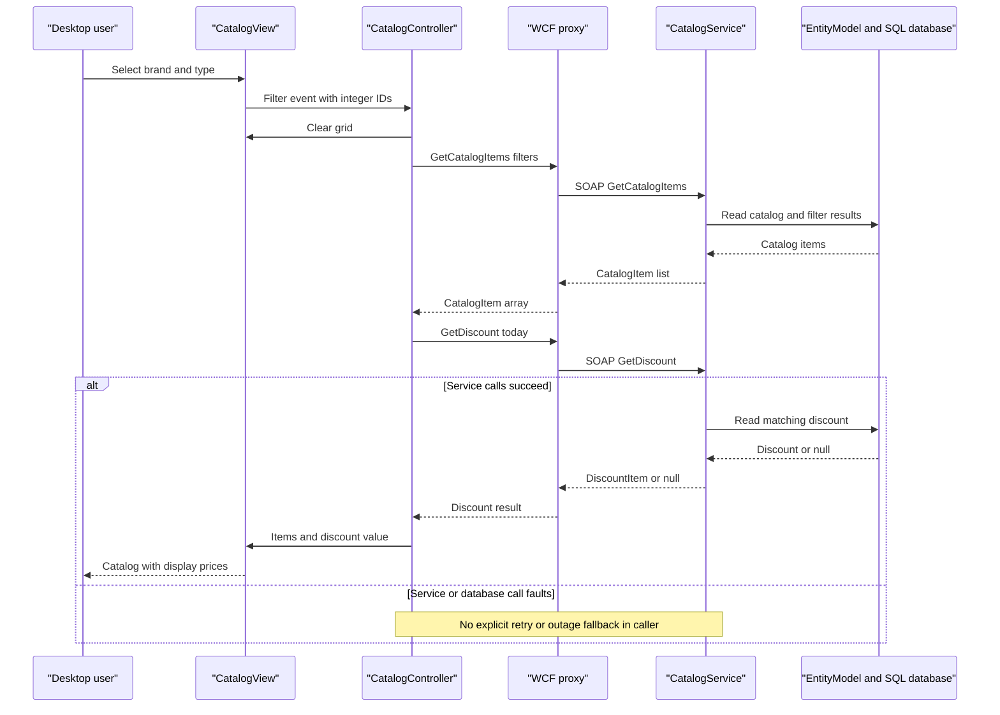

# API & Service Communication Contracts

The observed API is **one WCF SOAP endpoint exposing 10 operations**, with synchronous request/reply calls from a desktop client. These are not REST resources; the checked-in WSDL and generated proxy are available but show a filter-nullability discrepancy with current server source.

All citations are relative to `eShopLegacyNTier`; deployed availability is unknown.

## Service Catalog

| Service | Port | Category | Purpose |
|---|---|---|---|
| eShopWCFService / CatalogService | 62314 development HTTP; production unknown | Business | Catalog, discount and dated-stock SOAP operations; WCF/System.Web and EF6 (`src\eShopWCFService\eShopWCFService.csproj:15,45-68,119-124`). |
| eShopWinForms | No listening port observed | API consumer / presentation | Windows Forms desktop consumer, not a gateway or server (`src\eShopWinForms\eShopWinForms.csproj:8-11,76-85`; `src\eShopWinForms\Program.cs:22-27`). |

Only these two projects are in scope (`eShopLegacyNTier.sln:6-9`). No independently deployed broker, gateway, discovery service, or observability service was found within the scoped files.

## API Endpoints Inventory

All operations use **HTTP POST with a SOAP 1.1 envelope** at `/CatalogService.svc` through `basicHttpBinding`; operation names below identify SOAP actions, not URL suffixes. The generated action pattern is `http://tempuri.org/ICatalogService/<Operation>` with corresponding `<Operation>Response` replies (`src\eShopWinForms\Connected Services\eShopServiceReference\CatalogService.wsdl:113-205`; `src\eShopWinForms\Connected Services\eShopServiceReference\Reference.cs:497-557`). No explicit API versioning is declared.

| Service | Method | Path | Request Type | Response Type |
|---|---|---|---|---|
| CatalogService | SOAP POST: FindCatalogItem | `/CatalogService.svc` | `int id` | `CatalogItem`, nullable if not found |
| CatalogService | SOAP POST: GetCatalogBrands | Same | Empty operation body | `List<CatalogBrand>` |
| CatalogService | SOAP POST: GetCatalogItems | Same | `int brandIdFilter, int typeIdFilter` in current server | `List<CatalogItem>` |
| CatalogService | SOAP POST: GetCatalogTypes | Same | Empty operation body | `List<CatalogType>` |
| CatalogService | SOAP POST: GetAvailableStock | Same | `DateTime date, int catalogItemId` | `int` |
| CatalogService | SOAP POST: CreateAvailableStock | Same | `CatalogItemsStock catalogItemsStock` | Empty response (`void`) |
| CatalogService | SOAP POST: CreateCatalogItem | Same | `CatalogItem catalogItem` | Empty response (`void`) |
| CatalogService | SOAP POST: UpdateCatalogItem | Same | `CatalogItem catalogItem` | Empty response (`void`) |
| CatalogService | SOAP POST: RemoveCatalogItem | Same | `CatalogItem catalogItem` | Empty response (`void`) |
| CatalogService | SOAP POST: GetDiscount | Same | `DateTime day` | `DiscountItem`, nullable if none |

Source contract: `src\eShopWCFService\ICatalogService.cs:12-34`. Null/zero outcomes: `src\eShopWCFService\CatalogService.svc.cs:28-44,90-96`. No `FaultContract`, custom HTTP status mapping, or REST-style 201/204/404 response scheme is defined in this interface. `void` means an empty SOAP reply, not a fire-and-forget operation.

## Management & Observability Endpoints

| Service | Endpoint | Custom Metrics (if any) |
|---|---|---|
| CatalogService | `/CatalogService.svc/mex` using `mexHttpBinding` | Metadata exchange, not a health probe (`src\eShopWCFService\Web.config:37-40`). |
| CatalogService | WCF metadata HTTP/HTTPS GET enabled; conventional `?wsdl` metadata retrieval | No custom metrics observed; metadata flags do not prove a live HTTPS listener (`src\eShopWCFService\Web.config:25-35`). |
| Both projects | No dedicated health, Swagger, or metrics endpoint observed | No instrumentation in the reviewed contract/startup path (`src\eShopWCFService\ICatalogService.cs:12-34`; `src\eShopWinForms\Program.cs:17-27`). |

## DTOs & Contracts

| Contract class | API role | Mutability / serialization |
|---|---|---|
| CatalogItem | Catalog read response and create/update/remove request | Mutable `DataContract` with `DataMember` properties (`src\eShopWCFService\Models\CatalogItem.cs:10-35`). |
| CatalogBrand, CatalogType | Reference-list responses and nested catalog data | Mutable data contracts (`src\eShopWCFService\Models\CatalogBrand.cs:10-19`; `src\eShopWCFService\Models\CatalogType.cs:10-19`). |
| CatalogItemsStock | Stock write request | Mutable data contract (`src\eShopWCFService\Models\CatalogItemsStock.cs:10-25`). |
| DiscountItem | Discount response | Mutable data contract (`src\eShopWCFService\Models\DiscountItem.cs:11-31`). |

These are service-level entities reused on the wire; no gateway DTO or aggregation service exists in the observed flow. See `data-architecture.md` for fields. WCF uses XML data-contract serialization; WSDL/XSD documents are checked in, not OpenAPI or protobuf (`src\eShopWinForms\eShopWinForms.csproj:122-130,258-264`).

**Contract drift:** the generated client accepts nullable filter integers, and its XSD marks them nillable; the current service requires non-nullable `int` and treats zero as “All” (`src\eShopWinForms\Connected Services\eShopServiceReference\Reference.cs:513-517`; `src\eShopWinForms\Connected Services\eShopServiceReference\CatalogService.xsd:31-35`; `src\eShopWCFService\ICatalogService.cs:20`; `src\eShopWCFService\CatalogService.svc.cs:56-62`). The desktop passes integers; null interoperability and live WSDL agreement are unverified.

## Communication Patterns

- **Synchronous SOAP:** desktop controller calls the generated WCF proxy directly; generated Task methods are alternate client invocation methods, not messaging or asynchronous business processing (`src\eShopWinForms\Controllers\CatalogController.cs:35-54,75-84`; `src\eShopWinForms\Connected Services\eShopServiceReference\Reference.cs:501-557`).
- **Composition:** the controller fetches items and a discount separately, then passes both to the view. This is client-side composition, not gateway aggregation (`src\eShopWinForms\Controllers\CatalogController.cs:75-84`).
- **Resilience:** no explicit retries, circuit breaker, bulkhead, custom timeout values, or downstream-outage fallback is observed. The binding is empty, so framework defaults apply; deployed effective values were not verified (`src\eShopWinForms\App.config:21-28`). Controller calls have no catch/recovery path.
- **Addressing:** a configured development URL is used, with no observed service discovery or client-side load balancing (`src\eShopWinForms\App.config:26-28`). The server/database must be usable before initial desktop loading; see `configuration-inventory.md`.
- **Security posture:** the configured desktop endpoint is HTTP with basicHttpBinding and no explicit credentials/security mode. The source contract and implementation show no application authorization checks. Server HTTPS protocol mapping and metadata flags exist, but do not establish TLS enforcement, a certificate, or IIS authentication settings (`src\eShopWCFService\Web.config:22-42`; `src\eShopWCFService\eShopWCFService.csproj:20-22,124`). Actual host-level access controls remain unknown; do not infer public Internet exposure.
- **Errors:** exception details in SOAP faults are disabled; no declared typed business faults or compensating action is observed (`src\eShopWCFService\Web.config:29`; `src\eShopWCFService\ICatalogService.cs:12-34`).

## Service Technology Matrix

| Service | Web | Data Access | Discovery | Gateway | Actuator / Health | Cache | Metrics |
|---|---|---|---|---|---|---|---|
| CatalogService | WCF SOAP / System.Web | EF6 DbContext | None observed | No | Metadata only | No explicit application cache | None observed |
| eShopWinForms | Desktop WCF client | SOAP only in active path | Configured URL | No | None observed | No explicit result cache | None observed |

Evidence: `src\eShopWCFService\Web.config:22-64`; `src\eShopWCFService\CatalogService.svc.cs:16-82`; `src\eShopWinForms\Program.cs:22-27`; `src\eShopWinForms\Controllers\CatalogController.cs:75-84`.

## Service Communication Sequence

Flow evidence: `src\eShopWinForms\Views\CatalogView.cs:106-135`; `src\eShopWinForms\Controllers\CatalogController.cs:75-84`; `src\eShopWCFService\CatalogService.svc.cs:28-30,56-62`. Fault block describes absence of recovery, not a configured circuit breaker.
