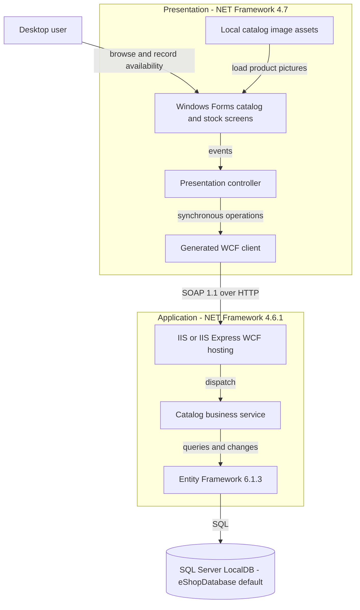
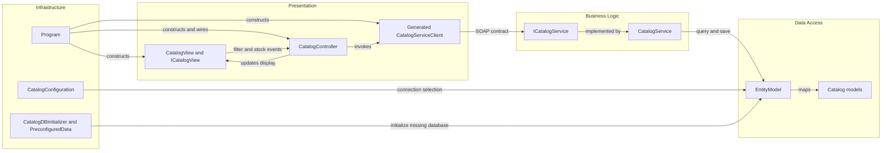

# Architecture Diagram

Static assessment of **eShopLegacyNTier only**. Citations throughout this assessment are relative to `eShopLegacyNTier`; observed source behavior is distinguished from unverified deployment behavior.

## Application Architecture

### Technology Stack Summary

| Layer | Technology | Version | Purpose |
|---|---|---|---|
| Presentation | Windows Forms, .NET Framework | 4.7 | Desktop executable and form/controller interaction (`src\eShopWinForms\eShopWinForms.csproj:8-11,76-85`; `src\eShopWinForms\Program.cs:22-27`). |
| Communication | WCF basicHttpBinding | Framework-provided | Generated SOAP client, not REST (`src\eShopWinForms\App.config:19-29`; `src\eShopWinForms\Connected Services\eShopServiceReference\CatalogService.wsdl:113-123`). |
| Business/hosting | WCF, System.Web, IIS Express | .NET Framework 4.6.1 | Service library hosted through `.svc` (`src\eShopWCFService\eShopWCFService.csproj:11-18,63-68,119-124`; `src\eShopWCFService\CatalogService.svc:1`). |
| Persistence | Entity Framework | 6.1.3 | Five DbSets and SQL Server provider (`src\eShopWCFService\packages.config:3`; `src\eShopWCFService\EntityModel.cs:10-22`; `src\eShopWCFService\Web.config:52-64`). |
| Storage | SQL Server LocalDB | Engine version unknown | Configured local default; runtime connection may be overridden (`src\eShopWCFService\Web.config:63`; `src\eShopWCFService\Models\Infrastructure\CatalogConfiguration.cs:10-18`). |

### Data Storage & External Services

The server owns a single configured catalog database; the desktop consumes its SOAP contract rather than connecting directly in the observed startup path. Pictures are read from a relative local assets directory, not an image service (`src\eShopWinForms\Program.cs:22-26`; `src\eShopWinForms\Views\CatalogView.cs:48-61`). No broker, remote cache, or third-party integration is evidenced in the active path. Actual deployed hosts, database engine version, and availability are unknown.

### Key Architectural Decisions

- Manual composition: `Program` creates the view, generated proxy, and controller; the controller receives interfaces through its constructor, without an observed DI container (`src\eShopWinForms\Program.cs:22-26`; `src\eShopWinForms\Controllers\CatalogController.cs:14-20`).
- Business service queries EF directly; there is no separate repository layer. A default constructor creates its context, while an overload accepts one (`src\eShopWCFService\CatalogService.svc.cs:16-25,56-82`).
- EF entities also serve as mutable WCF data contracts, coupling persistence and wire models (`src\eShopWCFService\Models\CatalogItem.cs:10-35`).

## Component Relationships

### Component Inventory

| Component | Layer | Type | Responsibility |
|---|---|---|---|
| Program | Infrastructure | Composition root | Wires concrete desktop components (`src\eShopWinForms\Program.cs:17-27`). |
| CatalogView / ICatalogView | Presentation | Form / interface | Renders catalog, emits stock/filter events (`src\eShopWinForms\Views\CatalogView.cs:18-29,48-70,142-167`). |
| CatalogController | Presentation | Controller | Loads filters, prices, discounts, shipment and availability views (`src\eShopWinForms\Controllers\CatalogController.cs:35-84,150-157`). |
| Generated CatalogServiceClient | Presentation | WCF proxy | Implements generated contract; used by Program (`src\eShopWinForms\Connected Services\eShopServiceReference\Reference.cs:565-610`; `src\eShopWinForms\Program.cs:23`). |
| ICatalogService / CatalogService | Business | SOAP interface / implementation | Ten operations for catalog, discounts and dated stock (`src\eShopWCFService\ICatalogService.cs:12-34`; `src\eShopWCFService\CatalogService.svc.cs:14-118`). |
| EntityModel / catalog models | Data access | DbContext / entities | Maps five entity sets (`src\eShopWCFService\EntityModel.cs:10-40`). |
| CatalogConfiguration | Infrastructure | Static configuration | Environment connection override and named fallback (`src\eShopWCFService\Models\Infrastructure\CatalogConfiguration.cs:10-18`). |
| CatalogDBInitializer / PreconfiguredData | Infrastructure | Initializer / seed definitions | Creates and populates absent database (`src\eShopWCFService\Models\Infrastructure\CatalogDBInitializer.cs:11-19`). |

No authentication filter, retry interceptor, or telemetry component is observed in these active paths. `CatalogServiceMock` is compiled but not selected by `Program`; the handwritten server-side `CatalogServiceClient.cs` is not in the server's explicit Compile list and is not the desktop proxy (`src\eShopWCFService\eShopWCFService.csproj:78-94`; `src\eShopWinForms\Program.cs:23`).
