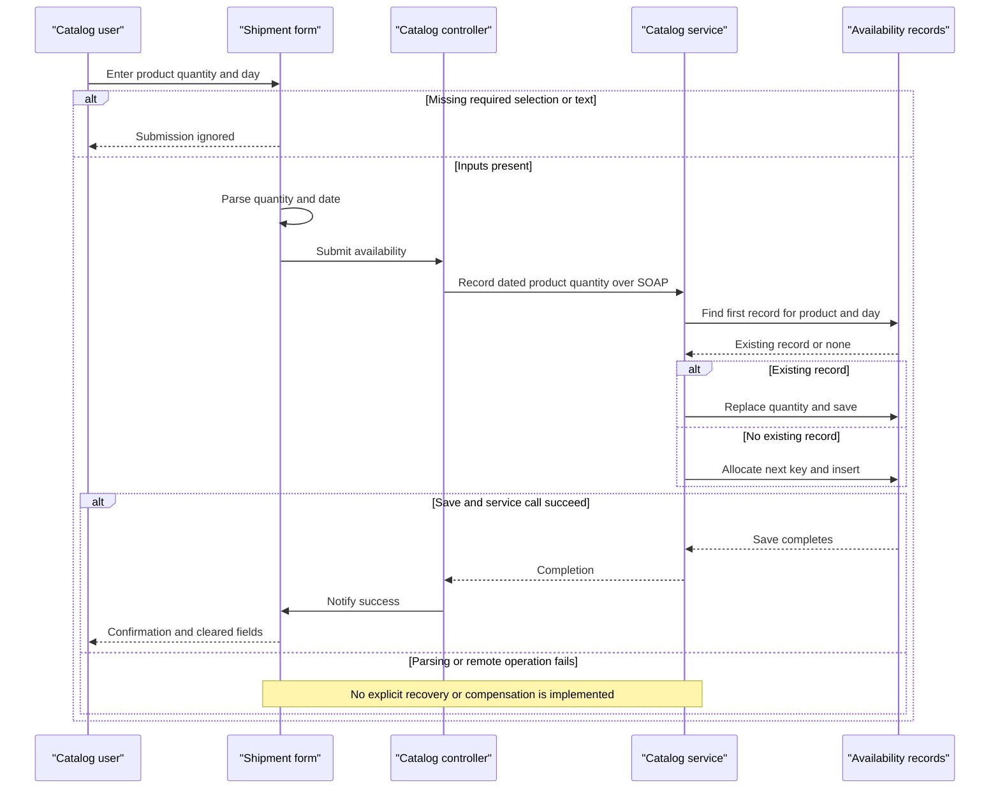

# Core Business Workflows

Users browse merchandise by brand/type, see date-based promotional prices, inspect dated stock availability, and record shipment availability. No checkout, ordering, payment, or customer-management workflow is evidenced in the assessed application.

All citations are relative to `eShopLegacyNTier`; flows describe source behavior rather than verified live execution.

## Domain Entities

| Entity | Service / Bounded Context | Description | Key Relationships |
|---|---|---|---|
| CatalogItem | CatalogService / merchandise | Product displayed to the user | Classified by one brand and type; associated logically with dated availability |
| CatalogBrand | CatalogService / merchandise | Brand used to filter products | Classifies products |
| CatalogType | CatalogService / merchandise | Product category used to filter products | Categorizes products |
| CatalogItemsStock | CatalogService / availability | Quantity recorded for a product on a day | Logical reference to product |
| DiscountItem | CatalogService / promotions | Date-bounded promotional fraction | Applied to displayed catalog prices, not linked to an individual product |

Evidence: `src\eShopWCFService\Models\CatalogItem.cs:10-35`; `src\eShopWCFService\Models\CatalogBrand.cs:10-19`; `src\eShopWCFService\Models\CatalogType.cs:10-19`; `src\eShopWCFService\Models\CatalogItemsStock.cs:10-25`; `src\eShopWCFService\Models\DiscountItem.cs:11-31`; `src\eShopWinForms\Views\CatalogView.cs:48-61`. These are conceptual responsibility groupings, not independently implemented DDD bounded contexts.

## Service-to-Domain Mapping

| Service | Domain Context | Owned Entities | External Dependencies |
|---|---|---|---|
| CatalogService | Catalog, availability, promotions | All five domain models | Configured SQL database (`src\eShopWCFService\EntityModel.cs:18-22`). |
| eShopWinForms | User interaction and price presentation | No authoritative persisted domain data | CatalogService SOAP contract and local product images (`src\eShopWinForms\Program.cs:22-26`; `src\eShopWinForms\Views\CatalogView.cs:55-58`). |

The server is the data source of truth; desktop composition does not create a separate domain owner.

## Primary Workflows

### Workflow 1: Browse and filter promotional catalog

1. On launch, the controller sets itself on the view, checks promotions, loads all catalog items, loads brand/type filters, then prepares shipment selectors (`src\eShopWinForms\Controllers\CatalogController.cs:150-157`).
2. Changing either selector emits a filter event; the controller clears and reloads the grid using the **All-filter rule** (`src\eShopWinForms\Views\CatalogView.cs:106-135`; `src\eShopWinForms\Controllers\CatalogController.cs:27-29,75-84`).
3. Server returns matching products; controller separately fetches today's discount using the **Active-promotion rule**, then passes both to the view (`src\eShopWCFService\CatalogService.svc.cs:28-30,56-62`).
4. View computes promotional display prices using the **Display-price rule** and loads local pictures (`src\eShopWinForms\Views\CatalogView.cs:48-61`). Prices are not persisted back as discounted amounts.
5. A banner is set only when the initial promotion check finds a discount. A null promotion means zero display discount; it is not an outage fallback (`src\eShopWinForms\Controllers\CatalogController.cs:60-69,79-84`).

### Workflow 2: Record dated shipment availability

1. User selects a product and enters quantity/date. The form applies the **Shipment-input rule** and emits an availability event (`src\eShopWinForms\Views\CatalogView.cs:157-167`).
2. Controller builds a stock request and submits it synchronously (`src\eShopWinForms\Controllers\CatalogController.cs:35-42`).
3. Server applies the **Stock-overwrite rule**: updates the first matching product/day record, otherwise creates a row using the **Application-key rule**, then saves (`src\eShopWCFService\CatalogService.svc.cs:99-117`).
4. Only after the call returns does the controller notify success; the view displays a message and clears inputs (`src\eShopWinForms\Controllers\CatalogController.cs:42-43`; `src\eShopWinForms\Views\CatalogView.cs:189-195`).

Despite UI wording “shipment,” recording an existing day **replaces** its quantity; it does not increment stock or model shipment movement.

### Workflow 3: Check stock availability

1. User selects a product and calendar day; the form parses the selected product label and raises a search event (`src\eShopWinForms\Views\CatalogView.cs:142-151`).
2. Controller queries the service; server applies the **Date-availability rule** (`src\eShopWinForms\Controllers\CatalogController.cs:50-54`; `src\eShopWCFService\CatalogService.svc.cs:90-96`).
3. The result is appended to the display history with item/date; previous displayed results are not refreshed automatically (`src\eShopWinForms\Views\CatalogView.cs:173-182`).

### Workflow 4: Initialize business reference data

For a missing database, the initializer seeds types, brands, products, dated availability and historical promotions in order. Each category is saved separately (`src\eShopWCFService\Models\Infrastructure\CatalogDBInitializer.cs:11-79`). Promotions in the checked-in seed all date to 2017; an unmodified seed does not imply an active current promotion (`src\eShopWCFService\Models\Infrastructure\PreconfiguredData.cs:41-50`).

Catalog create/update/remove operations also exist on the service, but the observed desktop controller does not wire product-maintenance actions (`src\eShopWCFService\ICatalogService.cs:27-32`; `src\eShopWinForms\Controllers\CatalogController.cs:14-20`).

## Cross-Service Data Flows

There is one desktop-to-server boundary, not multiple independent business services. The desktop fetches item lists and promotion data separately and combines them for display; reference lists populate filter labels. Product image filenames are resolved to local images. Stock submissions carry a logical product ID across the boundary; availability queries return only a quantity (`src\eShopWinForms\Controllers\CatalogController.cs:35-54,75-143`; `src\eShopWinForms\Views\CatalogView.cs:55-61`).

No gateway, broker, event choreography, circuit breaker, cached outage fallback, or compensation flow is observed. “No promotion” yields ordinary undiscounted pricing; service failure has no explicit recovery branch in the controller. There is no business authorization or resource-ownership check in the reviewed implementation (`src\eShopWCFService\CatalogService.svc.cs:28-117`).

## Business Workflow Sequence

Evidence: `src\eShopWinForms\Views\CatalogView.cs:157-167,189-195`; `src\eShopWinForms\Controllers\CatalogController.cs:35-43`; `src\eShopWCFService\CatalogService.svc.cs:99-117`. Failure handling in the diagram denotes an unhandled failure possibility, not an implemented fallback.

## Business Rules & Decision Logic

| Rule | Observed decision / constraint | Evidence |
|---|---|---|
| All-filter rule | Zero means unrestricted; nonzero brand/type values must both match. Desktop adds “All” entries using key zero. | `src\eShopWCFService\CatalogService.svc.cs:56-62`; `src\eShopWinForms\Controllers\CatalogController.cs:106-107,132-133` |
| Active-promotion rule | Inclusive calendar-day start/end; first matching discount wins, without explicit ordering or overlap precedence. | `src\eShopWCFService\CatalogService.svc.cs:28-30` |
| Display-price rule | `price * (1 - discount)` using double-converted price; formatted currency amount. Banner percentage rounded to zero decimals. No persisted price mutation. | `src\eShopWinForms\Views\CatalogView.cs:50-61`; `src\eShopWinForms\Controllers\CatalogController.cs:62-68` |
| Shipment-input rule | Missing product selection, empty quantity or empty date silently returns. Otherwise int/date parsing occurs without TryParse; no positivity, range, future-date or explicit product-existence validation is observed in server stock write. | `src\eShopWinForms\Views\CatalogView.cs:157-167`; `src\eShopWCFService\CatalogService.svc.cs:99-117` |
| Stock-overwrite rule | First existing product/calendar-day row has its quantity replaced; no additive stock calculation. No unique pair constraint declared. | `src\eShopWCFService\CatalogService.svc.cs:101-116`; `src\eShopWCFService\Models\CatalogItemsStock.cs:10-25` |
| Date-availability rule | Ignore time-of-day; return first matching row quantity or zero if absent. Zero cannot distinguish no row from recorded zero stock. | `src\eShopWCFService\CatalogService.svc.cs:90-96` |
| Application-key rule | Product and newly inserted stock IDs use Max plus one; empty-set and concurrent allocation behavior is not guarded. | `src\eShopWCFService\CatalogService.svc.cs:65-70,113-116` |
| Reference-label constraint | Brand/type labels have maximum length 50; no explicit API validator is declared. | `src\eShopWCFService\Models\CatalogBrand.cs:17-19`; `src\eShopWCFService\Models\CatalogType.cs:17-19` |

No order lifecycle/state machine, discount bounds validation, date-range consistency check, cross-service saga, or business audit trail is observed. Persistence mutations call SaveChanges individually; there is no explicit transaction spanning lookups, ID allocation and writes, nor one covering the entire seed (`src\eShopWCFService\CatalogService.svc.cs:65-82,99-117`; `src\eShopWCFService\Models\Infrastructure\CatalogDBInitializer.cs:22-79`). No explicit error translation, compensation, business logging or role checks appear in these paths. Host security remains a deployment unknown; see `api-service-contracts.md`.
