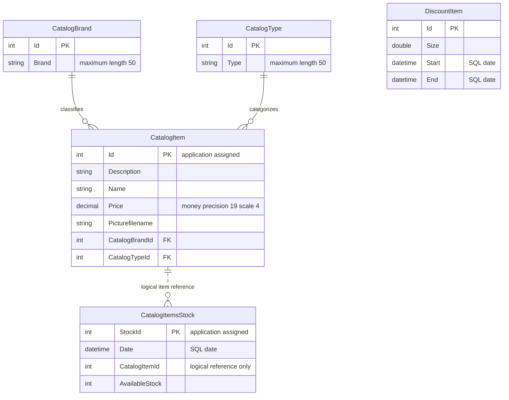

# Data Architecture & Persistence Layer

Five entity sets are mapped by one Entity Framework 6 DbContext to a SQL Server database, with LocalDB as the checked-in default. This is source-level evidence only; deployed schema, constraints and contents were not inspected.

All source citations are relative to `eShopLegacyNTier`.

## Database Configuration

| Service/Module | DB Type | Profile | Driver | Connection | Migration Tool |
|---|---|---|---|---|---|
| eShopWCFService | SQL Server LocalDB default | Base configuration; no named runtime profile | System.Data.SqlClient / EF6 SQL Server provider | Named connection by default, environment override available; values in `configuration-inventory.md` | `CreateDatabaseIfNotExists<EntityModel>` with programmatic seed; no migrations found |
| eShopWinForms | No direct DB access in observed startup/controller | Desktop default | EF libraries declared but not used by active controller | WCF proxy supplies data | Not applicable |

Evidence: `src\eShopWCFService\Web.config:52-64`; `src\eShopWCFService\Models\Infrastructure\CatalogConfiguration.cs:10-18`; `src\eShopWCFService\EntityModel.cs:10-22`; `src\eShopWCFService\Models\Infrastructure\CatalogDBInitializer.cs:11-19`; `src\eShopWinForms\Program.cs:22-26`.

The initializer is registered when the context is constructed. It seeds types, brands, products, stock and discounts in separate SaveChanges calls; this is not a versioned schema evolution mechanism (`src\eShopWCFService\Models\Infrastructure\CatalogDBInitializer.cs:13-79`). Seed definitions contain 12 products, 5 brands, 4 types, 6 stock rows and 6 historical promotions (`src\eShopWCFService\Models\Infrastructure\PreconfiguredData.cs:10-75`). No explicit pool sizing or database-wide encryption settings are provided in the examined configuration.

## Data Ownership per Service

| Service | Tables Owned | ORM Framework | Caching | Notes |
|---|---|---|---|---|
| CatalogService | CatalogBrands, CatalogItems, CatalogTypes, DiscountItems by EF convention; CatalogItemsStock explicitly named | EF 6.1.3 | No explicit result/distributed cache | Five DbSets; conventional physical names require deployed-schema confirmation (`src\eShopWCFService\EntityModel.cs:18-22`; `src\eShopWCFService\Models\CatalogItemsStock.cs:10`). |
| eShopWinForms | None observed | No active persistence path | Transient display state only | Receives generated contract objects (`src\eShopWinForms\Controllers\CatalogController.cs:35-84`). |

## Entity Model

Brand/type relationships are inferred from non-nullable foreign-key properties plus navigation properties on `CatalogItem`; no inverse collections are declared. The **dotted stock association is logical only**: stock has an item ID but no navigation property, FK annotation or explicit relationship configuration, so a database FK is not established by the source. Discount has no product association and applies by date (`src\eShopWCFService\Models\CatalogItem.cs:27-35`; `src\eShopWCFService\Models\CatalogItemsStock.cs:10-25`; `src\eShopWCFService\EntityModel.cs:24-40`; `src\eShopWCFService\Models\DiscountItem.cs:11-31`).

| Entity | Source and persistence details |
|---|---|
| CatalogBrand | `src\eShopWCFService\Models\CatalogBrand.cs:10-19`: convention Id key, non-generated; Brand length 50. Non-Unicode configured in `src\eShopWCFService\EntityModel.cs:26-28`. |
| CatalogType | `src\eShopWCFService\Models\CatalogType.cs:10-19`: convention Id key, non-generated; Type length 50. Non-Unicode configured in `src\eShopWCFService\EntityModel.cs:36-38`. |
| CatalogItem | `src\eShopWCFService\Models\CatalogItem.cs:10-35`: non-generated Id, scalar fields and unidirectional reference navigations; money mapping, precision in `src\eShopWCFService\EntityModel.cs:30-32`. |
| CatalogItemsStock | `src\eShopWCFService\Models\CatalogItemsStock.cs:10-25`: explicit table and StockId key; SQL date and application-assigned key. |
| DiscountItem | `src\eShopWCFService\Models\DiscountItem.cs:11-31`: explicit Id key; date-only boundaries; key generation otherwise conventional. |

No explicit cascade/fetch policy, concurrency token, or unique `(CatalogItemId, Date)` constraint is declared in these mappings. Framework conventions may apply; live schema is unknown.

## Key Repository Methods

No custom repository interface is present: `CatalogService` directly uses `EntityModel` DbSets.

| Service | Repository | Notable Methods | Purpose |
|---|---|---|---|
| CatalogService | Direct DbContext | `List<CatalogItem> GetCatalogItems(int, int)` | Materializes all products before optional in-memory filtering (`src\eShopWCFService\CatalogService.svc.cs:56-62`). |
| CatalogService | Direct DbContext | `CatalogItem FindCatalogItem(int)` | Finds product, then explicitly loads brand and type separately (`src\eShopWCFService\CatalogService.svc.cs:33-44`). |
| CatalogService | Direct DbContext | `DiscountItem GetDiscount(DateTime)` | Loads discounts and selects first date-range match in memory (`src\eShopWCFService\CatalogService.svc.cs:28-30`). |
| CatalogService | Direct DbContext | `int GetAvailableStock(DateTime, int)` | Filters item in query, materializes, then filters date (`src\eShopWCFService\CatalogService.svc.cs:90-96`). |
| CatalogService | Direct DbContext | `void CreateAvailableStock(CatalogItemsStock)` | Update first item/date row, otherwise assign maximum key plus one and insert (`src\eShopWCFService\CatalogService.svc.cs:99-117`). |
| CatalogService | Direct DbContext | `void CreateCatalogItem(CatalogItem)`, `UpdateCatalogItem(CatalogItem)`, `RemoveCatalogItem(CatalogItem)` | Add, mark Modified, or Remove, each followed by SaveChanges (`src\eShopWCFService\CatalogService.svc.cs:65-82`). |

No raw SQL, stored procedures, batching interface or explicit encompassing transaction is observed. EF SaveChanges supplies its normal per-call transaction semantics; key allocation/lookups occur before SaveChanges, not inside an explicit application transaction. Context disposal is implemented (`src\eShopWCFService\CatalogService.svc.cs:85-87`). Actual behavior for detached delete arguments and concurrent writes was not executed.

## Caching Strategy

No explicit cache provider, TTL, eviction policy, second-level cache, or distributed/session cache is configured in `src\eShopWCFService\Web.config:52-64` or the data access implementation. `ToList()` materialization is not a reusable cache (`src\eShopWCFService\CatalogService.svc.cs:28-62`). EF context tracking and desktop display collections are transient state, not evidence of an application caching policy.

## Data Ownership Boundaries

The single server context owns catalog reference data, products, dated availability and promotions in one database; there is no evidence of database-per-domain isolation or CQRS. The desktop reads and writes through WCF, not cross-service database joins. Client-side composition pairs catalog items with a global discount; it is not a distributed aggregate (`src\eShopWCFService\EntityModel.cs:18-22`; `src\eShopWinForms\Controllers\CatalogController.cs:75-84`). Image bytes remain local assets, while the DB stores filenames (`src\eShopWinForms\Views\CatalogView.cs:55-58`).

### Data Classification & Sensitivity

| Entity | Sensitive Fields | Classification (PII/PHI/PCI/None) | Controls in Place |
|---|---|---|---|
| CatalogItem, CatalogBrand, CatalogType | No personal/payment/health fields detected | None of PII/PHI/PCI detected; business catalog information | No field masking/encryption declared in entity definitions. |
| CatalogItemsStock | Availability and dates are business-operational data | None of PII/PHI/PCI detected | No field-level protection declared. |
| DiscountItem | Promotion dates and fraction are business data | None of PII/PHI/PCI detected | No field-level protection declared. |

Evidence: the five entity definitions cited in the Entity Model table. No PII, PHI, or PCI data was detected in this entity model; that is not proof about arbitrary database contents. Database encryption-at-rest, backups and host access controls are unknown, not verified absent.
