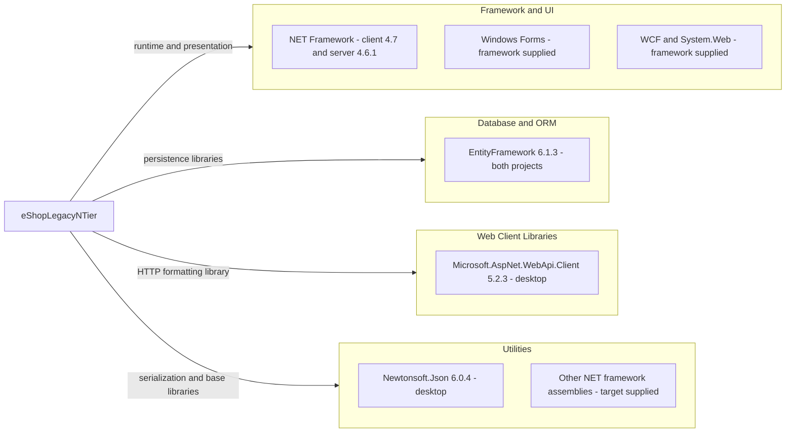

# Dependency Map

eShopLegacyNTier declares **3 unique NuGet packages across 4 package entries** in its two projects, plus framework assembly references. This inventory uses only build/package declarations; it does not infer runtime use or resolved transitive packages.

## Dependencies

### Dependency Summary

Counts below cover unique NuGet identities, not DLL references; framework groups are additional and excluded from the total of 3.

| Category | Count | Key Libraries | Notes |
|---|---|---|---|
| Database / ORM | 1 | EntityFramework 6.1.3 | Declared in both package manifests; includes EF and SQL Server DLL references (`src\eShopWCFService\packages.config:3`; `src\eShopWinForms\packages.config:3`; `src\eShopWCFService\eShopWCFService.csproj:45-50`). |
| Web client libraries | 1 | Microsoft.AspNet.WebApi.Client 5.2.3 | Desktop `System.Net.Http.Formatting` reference; package presence does not establish a REST server (`src\eShopWinForms\packages.config:4`; `src\eShopWinForms\eShopWinForms.csproj:73-75`). |
| Utilities | 1 | Newtonsoft.Json 6.0.4 | Desktop package, copied locally (`src\eShopWinForms\packages.config:5`; `src\eShopWinForms\eShopWinForms.csproj:63-65`). |
| Framework / UI | Additional framework group | .NET Framework 4.7 client, 4.6.1 server; Windows Forms, WCF, System.Web | Compile references, framework-supplied rather than independently versioned packages (`src\eShopWinForms\eShopWinForms.csproj:11,67-86`; `src\eShopWCFService\eShopWCFService.csproj:15,51-70`). |

All NuGet entries are unqualified application dependencies: `packages.config` does not distinguish compile versus runtime scopes (`src\eShopWinForms\packages.config:1-6`; `src\eShopWCFService\packages.config:1-4`).

### Version & Compatibility Risks

The declared stack is legacy: .NET Framework 4.6.1 and 4.7, EF 6.1.3, Web API Client 5.2.3, and Json.NET 6.0.4. Framework-only Windows Forms, System.Web and WCF server APIs require compatibility analysis for a different runtime; EF6 is not EF Core. These are source-based compatibility observations, not a vulnerability scan or a verified support-status determination. No advisory lookup or package restore was performed.

### Notable Observations

- Both projects use `packages.config` and relative `..\packages\...` HintPaths; package availability is unverified (`src\eShopWinForms\eShopWinForms.csproj:57-75`; `src\eShopWCFService\eShopWCFService.csproj:45-50`).
- Package versions differ from assembly identities: EF 6.1.3 references assembly 6.0.0.0; Json.NET 6.0.4 references assembly 6.0.0.0. Do not substitute assembly versions for package versions (same references).
- Desktop package entries still record `targetFramework="net461"` despite its current project target of 4.7 (`src\eShopWinForms\packages.config:3-5`; `src\eShopWinForms\eShopWinForms.csproj:11`).
- No lockfile, central package file, or explicit ProjectReference was found in this scoped project; a complete transitive closure cannot be established. The solution lists two projects (`eShopLegacyNTier.sln:6-9`).

## Test Dependencies

| Framework | Version | Notes |
|---|---|---|
| None detected | Not applicable | No test package is declared in either package manifest (`src\eShopWinForms\packages.config:2-6`; `src\eShopWCFService\packages.config:2-4`). |

Total test-scope dependencies: **0 detected**. The solution declares only desktop and service projects (`eShopLegacyNTier.sln:6-9`); no test infrastructure is established by the examined build files.
