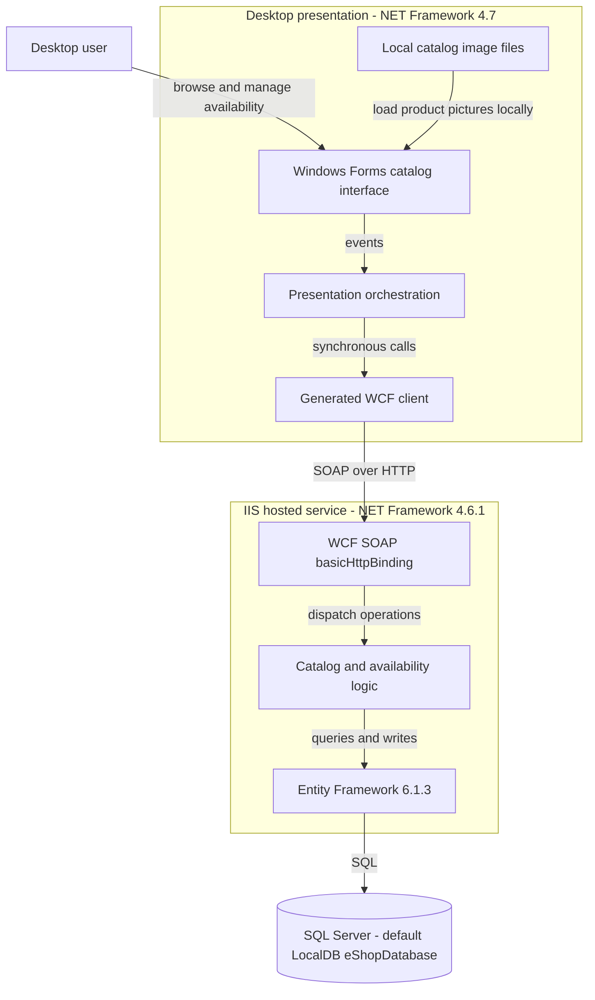
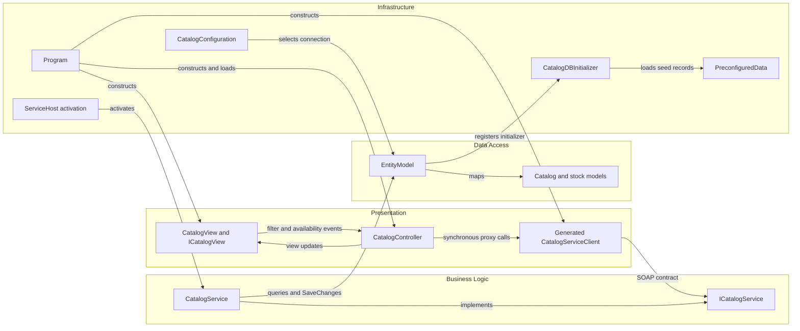

# Architecture Diagram

Static assessment of **eShopLegacyNTier only**. All evidence paths are relative to `D:\a\eShopModernizing\eShopModernizing\eShopLegacyNTier`; diagrams show source-defined behavior, not proposed modernization or verified deployment.

## Application Architecture

Evidence: executable wiring is `src\eShopWinForms\Program.cs:22-27`; SOAP client configuration is `src\eShopWinForms\App.config:19-29`; host activation and service binding are `src\eShopWCFService\CatalogService.svc:1` and `src\eShopWCFService\Web.config:37-41`. Database selection is `src\eShopWCFService\Models\Infrastructure\CatalogConfiguration.cs:10-18`; local image loading is `src\eShopWinForms\Views\CatalogView.cs:48-61`.

### Technology Stack Summary

| Layer | Technology | Version | Purpose |
|---|---|---|---|
| Presentation | Windows Forms / .NET Framework | 4.7 target | Desktop executable and event-driven views; `src\eShopWinForms\eShopWinForms.csproj:8-11,85` |
| Client communication | WCF / System.ServiceModel | Framework assembly; generated tool version 4.0.0.0 | SOAP proxy; `src\eShopWinForms\Connected Services\eShopServiceReference\Reference.cs:497-568` |
| Service hosting | ASP.NET / WCF on IIS or IIS Express | .NET Framework 4.6.1 target | Service library; `src\eShopWCFService\eShopWCFService.csproj:11-18` |
| Business | CatalogService | Application code | Catalog, discounts, dated stock; `src\eShopWCFService\CatalogService.svc.cs:28-117` |
| Persistence | Entity Framework | NuGet 6.1.3 | DbContext and SQL Server provider; `src\eShopWCFService\packages.config:3`, `src\eShopWCFService\EntityModel.cs:10-40` |
| Storage | SQL Server LocalDB | Engine version unspecified | Default database; deployment may supply another connection string |

### Data Storage & External Services

One service owns a single EF context with five entity sets. Default storage is LocalDB `eShopDatabase`; the `ConnectionString` environment variable can replace that connection. No external HTTP API, queue, distributed cache, identity provider, or cloud integration is wired in the inspected scope. Pictures are local client assets, not streamed by the service. See `data-architecture.md` and `configuration-inventory.md`.

### Key Architectural Decisions

- The desktop controller composes catalog and discount responses; there is no API gateway. Startup constructs dependencies manually rather than using a DI container (`src\eShopWinForms\Program.cs:22-26`, `src\eShopWinForms\Controllers\CatalogController.cs:75-84`).
- The WCF service directly queries EF; no repository or separate business-service project exists. A constructor accepts an `EntityModel`, but default activation constructs it (`src\eShopWCFService\CatalogService.svc.cs:16-25`).
- Contract artifacts are not fully synchronized: the generated client accepts nullable filter IDs while current server requires integers. Diagrams describe intended source wiring, not proof of wire compatibility (`src\eShopWinForms\Connected Services\eShopServiceReference\Reference.cs:513-517`, `src\eShopWCFService\ICatalogService.cs:20`).

## Component Relationships

### Component Inventory

| Component | Layer | Type | Responsibility |
|---|---|---|---|
| Program | Infrastructure | Entry point | Creates proxy, controller and form; loads before showing dialog (`src\eShopWinForms\Program.cs:17-27`) |
| CatalogView / ICatalogView | Presentation | Form / interface | Events, rendering and input parsing (`src\eShopWinForms\Views\CatalogView.cs:18-35,142-196`) |
| CatalogController | Presentation | Controller, not HTTP controller | Subscribes to view events; orchestrates service calls (`src\eShopWinForms\Controllers\CatalogController.cs:14-20,150-157`) |
| Generated CatalogServiceClient | Presentation | WCF ClientBase | Remote operation forwarding (`src\eShopWinForms\Connected Services\eShopServiceReference\Reference.cs:568-667`) |
| ICatalogService / CatalogService | Business | WCF contract / implementation | Ten exposed operations (`src\eShopWCFService\ICatalogService.cs:12-34`) |
| EntityModel | Data access | EF DbContext | Five DbSets and mappings (`src\eShopWCFService\EntityModel.cs:10-40`) |
| CatalogConfiguration | Infrastructure | Static configuration reader | Environment override / named connection (`src\eShopWCFService\Models\Infrastructure\CatalogConfiguration.cs:10-18`) |
| CatalogDBInitializer / PreconfiguredData | Infrastructure | Initializer / seed factory | Create-if-missing seeding (`src\eShopWCFService\Models\Infrastructure\CatalogDBInitializer.cs:11-20`) |

**Not active architecture:** `CatalogServiceMock` is compiled but not selected by the `.svc` host; it differs from production behavior and throws for discounts (`src\eShopWCFService\eShopWCFService.csproj:79`, `src\eShopWCFService\CatalogServiceMock.cs:95-120`). The server-folder `CatalogServiceClient.cs` is absent from explicit compile items, contains unimplemented methods, and calls an obsolete no-argument catalog operation (`src\eShopWCFService\eShopWCFService.csproj:79-94`, `src\eShopWCFService\CatalogServiceClient.cs:11-38`). Neither is a deployed service tier.

**Limitations:** source inspection only; no build, tests, live service, database introspection or Mermaid renderer was run. No production topology or proposed architecture is inferred.
