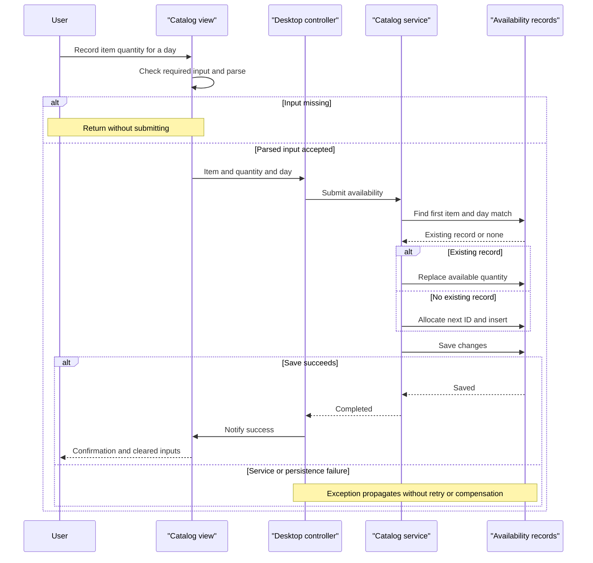

# Core Business Workflows

The application lets desktop users browse a merchandise catalog with promotional display prices, look up dated stock availability and record availability quantities. Although named eShop, the scoped implementation has no checkout, customer, payment, ordering or shipping execution workflow.

Evidence paths are relative to `eShopLegacyNTier`. Workflows describe actual source logic; successful execution and generated-client compatibility are not verified.

## Domain Entities

| Entity | Service / Bounded Context | Description | Key Relationships |
|---|---|---|---|
| CatalogItem | CatalogService / Catalog | Merchandise offered for display | Classified by brand and type; referenced by availability |
| CatalogBrand | CatalogService / Catalog | Brand lookup | Categorizes catalog items |
| CatalogType | CatalogService / Catalog | Product-type lookup | Categorizes catalog items |
| CatalogItemsStock | CatalogService / Availability | Available quantity for an item on a particular day | Logical item reference; not a shipment lifecycle |
| DiscountItem | CatalogService / Promotions | Date-bounded global display discount | Applied by desktop to returned catalog; no per-item association |

Model evidence: `src\eShopWCFService\Models\CatalogItem.cs:10-35`, `CatalogBrand.cs:10-19`, `CatalogType.cs:10-19`, `CatalogItemsStock.cs:10-25`, `DiscountItem.cs:11-31` in that same Models directory. Persistence fields and mapped versus logical associations are documented only in `data-architecture.md`.

## Service-to-Domain Mapping

| Service | Domain Context | Owned Entities | External Dependencies |
|---|---|---|---|
| CatalogService | Catalog, availability, promotions in one service | All five entity types | Shared EntityModel / SQL Server |
| Desktop CatalogController and CatalogView | User interaction and display composition | No persisted domain ownership; generated contract copies only | WCF service and local product pictures |

These are responsibilities within a single business service, not separately deployed bounded contexts. The desktop is not a gateway and there is no independent discount service. Evidence: `src\eShopWCFService\EntityModel.cs:18-22`; `src\eShopWinForms\Program.cs:22-26`.

## Primary Workflows

### Workflow 1: Initialize and browse a filtered catalog

1. Startup constructs the form, generated service client and controller, subscribes to view events and loads data before displaying the dialog (`src\eShopWinForms\Program.cs:22-27`; `src\eShopWinForms\Controllers\CatalogController.cs:14-20,150-157`).
2. Initialization checks for the current-day discount banner, loads initial catalog items, then brand/type selectors and the shipment/availability item selection list. These calls are sequential and synchronous.
3. A brand/type selector change sends both selected IDs to the controller; it clears the grid, requests catalog items, then separately requests today's discount (`src\eShopWinForms\Views\CatalogView.cs:106-135`; controller:27-30,75-84).
4. The service applies the **zero-means-all filter rule**. The controller supplies zero discount when no promotion is returned. The view applies the **display-price rule**, loads local picture assets and adds grid rows (`src\eShopWCFService\CatalogService.svc.cs:56-62`; view:48-61).
5. There is no server-side persisted repricing, cart or order. Service/image failures are not caught by this workflow; the grid has already been cleared on filter refresh.

Banner content is calculated separately from catalog rendering, and is checked during LoadView rather than on every filter change (`CatalogController.cs:60-69,150-157`). This can produce a stale banner if the process remains open across a date change; it is not a background promotion refresh.

### Workflow 2: Record an item's dated availability

1. User selects an item and supplies quantity and arrival-date text. The view applies the **availability input guard** and parses values (`src\eShopWinForms\Views\CatalogView.cs:157-167`).
2. Controller creates a stock contract and calls CreateAvailableStock (`src\eShopWinForms\Controllers\CatalogController.cs:35-43`).
3. Service finds the first stock entry for the same item and calendar date. Under the **replace-not-increment rule**, it overwrites an existing quantity; otherwise it uses the **manual ID allocation rule**, adds a row and saves (`src\eShopWCFService\CatalogService.svc.cs:99-117`).
4. Only after a successful synchronous return does the view show a confirmation and clear inputs (`src\eShopWinForms\Views\CatalogView.cs:189-195`). Failure has no implemented retry, compensation or friendly fallback.

The UI says "Shipment", but there is no shipment entity, carrier interaction, stock accumulation, reservation or inventory decrement process. Repeated entry for the same item/day replaces the stored amount rather than adding a delivered quantity.

### Workflow 3: Look up dated stock

1. User selects an item from the list and a calendar date. The view parses the selected item's ID; the **selection parsing limitation** applies (`src\eShopWinForms\Views\CatalogView.cs:142-151`).
2. Controller requests availability. Service selects the first row matching item and date, returning its quantity or zero (`src\eShopWinForms\Controllers\CatalogController.cs:50-54`; `src\eShopWCFService\CatalogService.svc.cs:90-96`).
3. View appends a result row containing date, item and quantity. It does not aggregate across dates or calculate running stock (`CatalogView.cs:173-182`).

### Workflow 4: Establish initial catalog state

On first database creation, the initializer adds catalog types, brands, products, availability and promotions using factory data, saving each group separately (`src\eShopWCFService\Models\Infrastructure\CatalogDBInitializer.cs:11-79`). All stock/promotion sample dates are in 2017 (`PreconfiguredData.cs:41-50,65-74` in the same directory). A newly initialized database therefore does **not** automatically have a currently active discount.

### Other exposed operations

Find/create/update/remove catalog operations are in the service contract and implementation, but the inspected desktop controller does not wire catalog CRUD buttons or invoke those operations (`src\eShopWCFService\ICatalogService.cs:15-34`; `src\eShopWinForms\Controllers\CatalogController.cs:14-157`). Their presence is an API capability, not evidence of a complete end-user maintenance workflow.

## Cross-Service Data Flows

There is one remote business-service boundary: desktop → CatalogService. Catalog/brand/type/availability/discount operations all use that service and database. Catalog display composes two responses in the desktop: catalog items plus a separately fetched promotion; a null promotion becomes an undiscounted display. This is not circuit-breaker degradation, and an unavailable promotion request does not fall back to an undiscounted catalog—the exception propagates (`src\eShopWinForms\Controllers\CatalogController.cs:75-84`).

There is no queue choreography, cross-service saga, remote join by bulk IDs, API gateway or asynchronous event processor. No scheduled business entry point was found in scoped source.

Generated client and saved schema accept nullable catalog filter IDs, while the current server contract requires integers and treats zero as no filter (`src\eShopWinForms\Connected Services\eShopServiceReference\Reference.cs:513-517`, `CatalogService.xsd:31-35` in the same directory; `src\eShopWCFService\ICatalogService.cs:20`). Diagrams show the intended current call chain, not a proven interoperable deployed contract.

## Business Workflow Sequence

Trace: `src\eShopWinForms\Views\CatalogView.cs:157-167,189-195`; `src\eShopWinForms\Controllers\CatalogController.cs:35-43`; `src\eShopWCFService\CatalogService.svc.cs:99-117`. Parsing errors can also escape before submission; the failure branch is a limitation, not an invented fallback mechanism.

## Business Rules & Decision Logic

| Named rule / concern | Actual implemented behavior | Evidence |
|---|---|---|
| Zero-means-all filter rule | Each filter is independent; zero means unrestricted and nonzero IDs must match | `src\eShopWCFService\CatalogService.svc.cs:56-62`; controller:107,133 adds All choices |
| Active promotion rule | Start and End inclusive after discarding time; first matching discount with no explicit ordering or overlap resolution | `src\eShopWCFService\CatalogService.svc.cs:28-30` |
| Display-price rule | Converts decimal price through string to double, multiplies by 1 minus discount and formats fixed-point with dollar prefix; no persisted price change | `src\eShopWinForms\Views\CatalogView.cs:48-61` |
| Banner rule | Percentage is rounded from Size times 100; banner includes promotion end date; no clear-on-expiry action | `src\eShopWinForms\Controllers\CatalogController.cs:60-69` |
| Availability input guard | Requires selected product and nonempty quantity/date; then uses int.Parse and Convert.ToDateTime without TryParse, sign/range checks or date-window rule | `src\eShopWinForms\Views\CatalogView.cs:157-167` |
| Selection parsing limitation | Stock search dereferences SelectedItem without a null guard, splits display string and parses ID | `src\eShopWinForms\Views\CatalogView.cs:142-151` |
| Replace-not-increment rule | First matching item/day record overwritten; missing row inserted; date comparison ignores time | `src\eShopWCFService\CatalogService.svc.cs:99-117` |
| Missing-stock rule | No match returns zero, indistinguishable from explicitly recorded zero | `src\eShopWCFService\CatalogService.svc.cs:90-96` |
| Manual ID allocation rule | Item and stock insertion use current Max plus one; empty collections and concurrent writers are not specially handled | `src\eShopWCFService\CatalogService.svc.cs:65-70,113-116` |
| Entity constraints | Brand/Type text max length 50; no Required, positive-price/stock, discount 0-to-1, interval-order or logical item/day uniqueness validation is declared | `src\eShopWCFService\Models\CatalogBrand.cs:17-19`, `CatalogType.cs:17-19`; remaining model classes |
| Update/delete behavior | Update marks supplied entity modified; delete calls Remove without explicit attach; no optimistic token or explicit existence validation | `src\eShopWCFService\CatalogService.svc.cs:73-82` |
| Transactions | SaveChanges per write; no explicit transaction around read-before-write, no saga or compensation | `src\eShopWCFService\CatalogService.svc.cs:65-82,99-117`; initializer:22-79 |
| Error handling / auditing | No business exception hierarchy, error mapping, business-event audit log or dead-letter processing found in traced flows | Controller and service operation bodies cited above |
| Authorization | No business role, resource-ownership or user identity checks found on these operations | `src\eShopWCFService\ICatalogService.cs:12-34`, `CatalogService.svc.cs:28-117` |

No order-state machine or approval lifecycle exists. Availability mutation is row creation/quantity replacement rather than a domain state transition. The mock must not be used to infer production rules: it throws on discounts and dereferences missing stock, unlike the actual service (`src\eShopWCFService\CatalogServiceMock.cs:95-120`).

**Limitations:** static source-only documentation; no application changes, builds, tests, service calls or database checks. Runtime errors, dates and data integrity have not been experimentally verified.
