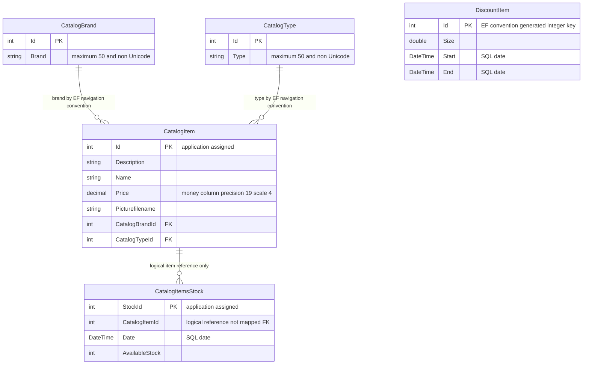

# Data Architecture & Persistence Layer

The scoped data layer contains **five persisted entity types**, one Entity Framework 6.1.3 context and a SQL Server provider, with LocalDB as the configured default. Evidence paths are relative to `eShopLegacyNTier`; database contents, generated DDL and deployment settings were not inspected.

## Database Configuration

| Service/Module | DB Type | Profile | Driver | Connection | Migration Tool |
|---|---|---|---|---|---|
| eShopWCFService | SQL Server LocalDB | Default configuration; no named runtime profiles | System.Data.SqlClient / EF SQL Server provider | Named connection to local eShopDatabase | No migration files found; CreateDatabaseIfNotExists initializer |
| eShopWCFService | Deployment-supplied database, SQL Server provider declared | Environment override, not a named profile | Same declared provider | Process environment can supply full connection string | Same initializer unless source is changed |
| eShopWinForms | No active direct DB access in traced workflows | Desktop default | EF package declared but remote proxy used | No desktop connection string configured | None |

Evidence: `src\eShopWCFService\EntityModel.cs:10-22`, `src\eShopWCFService\Models\Infrastructure\CatalogConfiguration.cs:10-18`, `src\eShopWCFService\Web.config:52-64`, `src\eShopWinForms\Program.cs:22-24`. Raw keys and connection values are in `configuration-inventory.md`.

`CatalogDBInitializer` creates and seeds a database only if it does not exist, rather than updating an existing schema. It seeds types, brands, items, stock and discounts in that order, with a `SaveChanges` after each group (`src\eShopWCFService\Models\Infrastructure\CatalogDBInitializer.cs:11-79`). Seed factories define 12 products, 5 brands, 4 types, 6 stock rows and 6 discount rows (`src\eShopWCFService\Models\Infrastructure\PreconfiguredData.cs:10-75`). Dates are fixed in 2017, not current runtime dates. No explicit custom pool settings, migrations history or SQL scripts were found; provider defaults and actual database schema remain unverified.

## Data Ownership per Service

| Service | Tables Owned | ORM Framework | Caching | Notes |
|---|---|---|---|---|
| eShopWCFService | CatalogBrands, CatalogItems, CatalogTypes, DiscountItems by EF convention; CatalogItemsStock explicitly mapped | EF6 EntityModel | No configured result or distributed cache | Five DbSets; stock table explicitly singular (`src\eShopWCFService\EntityModel.cs:18-22`, `src\eShopWCFService\Models\CatalogItemsStock.cs:10`) |
| eShopWinForms | None in traced implementation | No active ORM workflow found | No explicit result cache | Receives generated DTO copies through WCF |

## Entity Model

**Relationship qualification:** the stock-to-item edge shows business linkage, **not an EF/database-enforced FK**. Stock has a scalar item ID only, no navigation, ForeignKey annotation or fluent relationship configuration. Required scalar IDs plus item-to-brand/type navigation properties support the brand/type associations by EF convention; no inverse collections are defined. No explicit cascade override or fetch configuration is present. Actual constraint names, cascade DDL and production schema cannot be confirmed without database inspection.

| Entity | Complete scalar field inventory | Mapping / source |
|---|---|---|
| CatalogBrand | Id:int, Brand:string | Non-generated Id, StringLength(50); `src\eShopWCFService\Models\CatalogBrand.cs:10-19` |
| CatalogType | Id:int, Type:string | Non-generated Id, StringLength(50); `src\eShopWCFService\Models\CatalogType.cs:10-19` |
| CatalogItem | Id:int, Description:string, Name:string, Price:decimal, Picturefilename:string, CatalogBrandId:int, CatalogTypeId:int | Non-generated Id, money column; two non-virtual navigation properties; `src\eShopWCFService\Models\CatalogItem.cs:10-35` |
| CatalogItemsStock | Date:DateTime, CatalogItemId:int, AvailableStock:int, StockId:int | Explicit table, date column and non-generated StockId key; `src\eShopWCFService\Models\CatalogItemsStock.cs:10-25` |
| DiscountItem | Size:double, Start:DateTime, End:DateTime, Id:int | Date columns, explicit key; `src\eShopWCFService\Models\DiscountItem.cs:11-31` |

`EntityModel.OnModelCreating` additionally configures non-Unicode brand/type strings and price precision (`src\eShopWCFService\EntityModel.cs:24-40`). No row-version/concurrency token, soft-delete marker or audit columns appear. EF entity instances are exposed as WCF data contracts rather than projected DTOs.

## Key Repository Methods

There is **no repository interface**. `CatalogService` directly accesses DbSets; the table documents its data-access methods rather than inventing a repository abstraction.

| Service | Repository | Notable Methods | Purpose |
|---|---|---|---|
| CatalogService | EntityModel.CatalogItems | `List<CatalogItem> GetCatalogItems(int brandIdFilter, int typeIdFilter)` | Materializes all items before in-memory filtering; zero disables each filter (`src\eShopWCFService\CatalogService.svc.cs:56-62`) |
| CatalogService | CatalogItems / CatalogBrands / CatalogTypes | `CatalogItem FindCatalogItem(int id)` | First match then explicitly looks up brand and type (`CatalogService.svc.cs:33-44`) |
| CatalogService | CatalogBrands / CatalogTypes | `List<CatalogBrand> GetCatalogBrands()`; `List<CatalogType> GetCatalogTypes()` | Materialized lookup collections (`CatalogService.svc.cs:46-54`) |
| CatalogService | DiscountItems | `DiscountItem GetDiscount(DateTime day)` | Materializes all discounts before inclusive date predicate and first match (`CatalogService.svc.cs:28-30`) |
| CatalogService | CatalogItemsStocks | `int GetAvailableStock(DateTime date, int catalogItemId)` | Filters item in SQL, materializes then matches date; first quantity or zero (`CatalogService.svc.cs:90-96`) |
| CatalogService | CatalogItemsStocks | `void CreateAvailableStock(CatalogItemsStock stock)` | Existing row modified or application-assigned ID inserted, then SaveChanges (`CatalogService.svc.cs:99-117`) |
| CatalogService | CatalogItems | Create / Update / Remove with CatalogItem | Create uses Max(Id)+1; update marks entire incoming entity modified; remove calls DbSet.Remove then SaveChanges (`CatalogService.svc.cs:65-82`) |

No raw SQL, stored procedure calls, batch cross-service finder or explicit TransactionScope is present in these paths. EF provides its normal per-SaveChanges transaction behavior; there is no explicit transaction spanning the preliminary read and subsequent write. The remove path does not explicitly attach a detached SOAP entity before Remove, so successful remote deletion must not be assumed.

## Caching Strategy

No configured application result cache, distributed cache, second-level EF cache, cache TTL or invalidation policy was found in the context, service or runtime configuration. EF change tracking inside a context is not a shared catalog cache. `ToList` materialization is not cache-aside caching. The compiled but unwired `CatalogServiceMock` holds seeded lists; it is a mock, not a caching provider (`src\eShopWCFService\CatalogServiceMock.cs:13-23`).

## Data Ownership Boundaries

All persisted catalog, promotion and availability data belongs to the same service and context/database; this is not database-per-microservice or CQRS. The desktop's only traced data source is WCF; its EF package declaration does not establish direct shared-database access. Client-side composition combines catalog and discount results without an additional persisted read model (`src\eShopWinForms\Controllers\CatalogController.cs:75-84`).

Application-managed Max+1 keys are not protected by an explicit read/write transaction or concurrency token. No uniqueness annotation protects the logical item/date pair, and overlapping discount intervals are not constrained in the model. These are source-observed persistence limitations, not a claim that a production database has no additional controls.

### Data Classification & Sensitivity

| Entity | Sensitive Fields | Classification (PII/PHI/PCI/None) | Controls in Place |
|---|---|---|---|
| CatalogItem / CatalogBrand / CatalogType | No person or payment fields detected | None; product/reference data | No field encryption, masking or field-level authorization specified |
| CatalogItemsStock | No person or payment fields detected | None; operational inventory may be commercially sensitive | No field encryption/masking specified |
| DiscountItem | No person or payment fields detected | None; commercial promotion data | No field encryption/masking specified |

No PII, PHI, or PCI data detected in the entity model. Database encryption-at-rest, filesystem encryption and externally configured access controls are unknown, not proven absent. Connection strings can be sensitive even though they are not business entity data; see `configuration-inventory.md`.

**Limitations:** documentation-only source inspection; no build/tests, migration execution, database connection or schema validation. The ER diagram deliberately distinguishes mapped and logical relationships.
