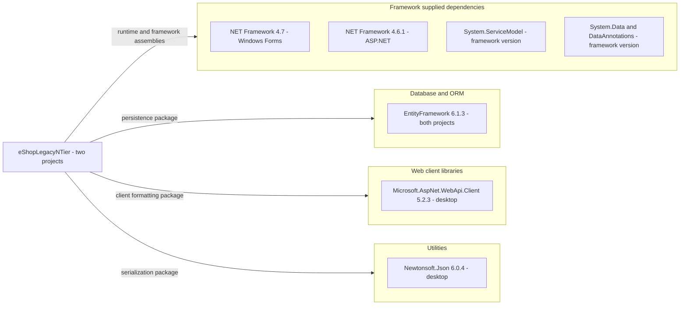

# Dependency Map

The scoped `eShopLegacyNTier` build declares **3 unique NuGet packages, 4 package entries across 2 projects**, plus .NET Framework assembly references. Counts below are unique package IDs, not resolved transitive dependencies; evidence is restricted to build and package files relative to the scoped root.

## Dependencies

Evidence: `src\eShopWCFService\packages.config:3`, `src\eShopWinForms\packages.config:3-5`; targets in `src\eShopWCFService\eShopWCFService.csproj:15` and `src\eShopWinForms\eShopWinForms.csproj:11`. Framework references are in the service project at lines 51-70 and desktop project at lines 67-86. No assembly node implies a separate NuGet package.

### Dependency Summary

| Category | Count | Key Libraries | Notes |
|---|---|---|---|
| Database / ORM | 1 | EntityFramework 6.1.3 | Both projects; references EntityFramework and EntityFramework.SqlServer assemblies. Package version is not assembly version 6.0.0.0 (`src\eShopWCFService\eShopWCFService.csproj:45-49`; desktop project:57-61) |
| Web Frameworks / client | 1 | Microsoft.AspNet.WebApi.Client 5.2.3 | Desktop only; provides System.Net.Http.Formatting assembly (`src\eShopWinForms\eShopWinForms.csproj:73-75`). Declaration does not prove a REST server exists |
| Utilities | 1 | Newtonsoft.Json 6.0.4 | Desktop only (`src\eShopWinForms\eShopWinForms.csproj:63-64`) |
| Framework supplied, excluded from package total | — | Windows Forms, WCF, ASP.NET, ADO.NET, XML, Drawing, Configuration, LINQ support | Referenced through framework assemblies, no independently declared package versions |
| Messaging / Caching / Logging / Security / Observability packages | 0 | None declared | No packages in these categories in the two manifests |

Package scope is conventional compile/runtime reference; the manifests do not declare separate scopes. All package entries record `targetFramework="net461"` even though the desktop project now targets 4.7. The complete external framework reference inventory is the two `.csproj` reference lists cited above; framework versions derive from target frameworks rather than NuGet version pins.

### Version & Compatibility Risks

The service targets legacy .NET Framework 4.6.1, and EF 6.1.3, Web API Client 5.2.3 and Json.NET 6.0.4 are old pinned releases. Framework and hosting compatibility need deliberate review for any upgrade; this document makes **no CVE or currently supported-version determination**. Both projects use non-SDK MSBuild files (`ToolsVersion="15.0"`), so their web application targets and installed framework reference assemblies matter. No build/restore was performed.

### Notable Observations

- EF is duplicated across project manifests, counted once; the SQL Server provider DLL belongs to that package, not an additional package.
- No lock file or resolved dependency graph is present in the inspected scoped build files. No speculative transitive edges are drawn; `packages.config` does not reliably distinguish direct from historically installed transitive entries.
- Relative DLL hints point to `..\packages\...` from each project, while the solution is one level above `src`; package restore location must agree with those hints. Existence/restoration was not validated (`src\eShopWCFService\eShopWCFService.csproj:46-49`, desktop:58-74).
- The solution contains the desktop and service projects, with no declared project-reference edge; the package map does not imply runtime use (`eShopLegacyNTier.sln:6-9`, the two project files).

## Test Dependencies

| Framework | Version | Notes |
|---|---|---|
| None detected | — | Neither package manifest declares a test framework; the scoped solution lists no test project |

Total test-scope dependencies: **0**.

This is a declaration inventory, not proof of absent external testing infrastructure. No builds, tests, dependency installation, vulnerability service or out-of-scope build files were used.
