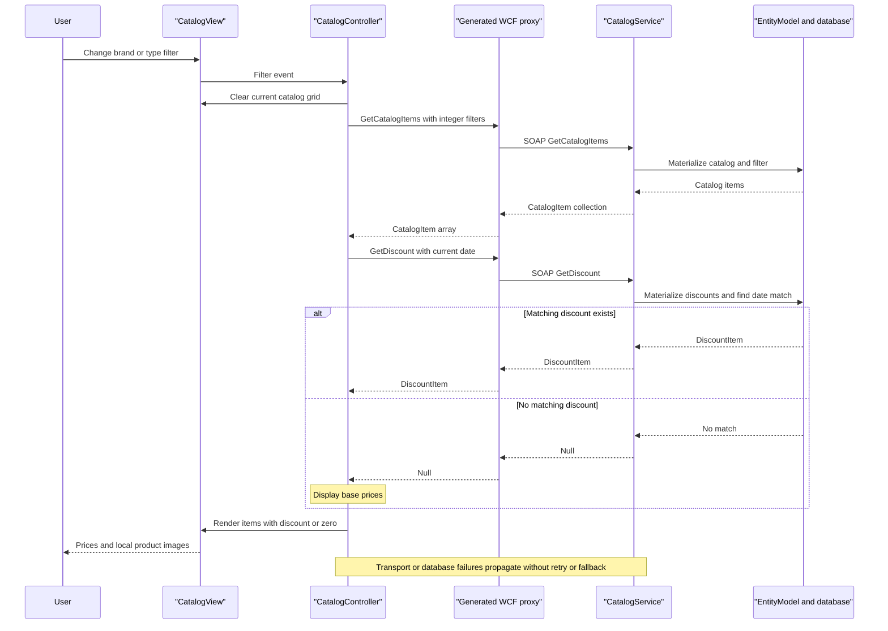

# API & Service Communication Contracts

Within `eShopLegacyNTier`, one SOAP service exposes ten request/reply operations at a shared service address. The desktop uses synchronous generated-proxy calls; there are no REST resource routes in the active implementation (`src\eShopWCFService\ICatalogService.cs:12-34`; `src\eShopWinForms\Controllers\CatalogController.cs:35-84`).

## Service Catalog

| Service | Port | Category | Purpose |
|---|---|---|---|
| `eShopWCFService` / `CatalogService` | 62314, development | Business | Hosted catalog, classification, dated stock and discount operations; WCF framework references and EF6 6.1.3 (`src\eShopWCFService\eShopWCFService.csproj:45-65,119-124`). |
| `eShopWinForms` | No listening port | API Layer — desktop consumer, not a gateway | User-facing client using generated WCF proxy; Windows Forms and WCF references (`src\eShopWinForms\eShopWinForms.csproj:77-85`; `src\eShopWinForms\Program.cs:22-27`). |

These are two deployable application projects, not a microservice fleet (`eShopLegacyNTier.sln:6-9`). SQL is a backing dependency, not an additional source-built API.

## API Endpoints Inventory

All rows use the same configured address, `http://localhost:62314/CatalogService.svc`, with SOAP 1.1 document/literal messages over HTTP POST. Operation names are SOAP actions, **not URL suffixes or REST verbs** (`src\eShopWinForms\App.config:19-28`; `src\eShopWinForms\Connected Services\eShopServiceReference\CatalogService.wsdl:113-208`).

| Service | Method | Path | Request Type | Response Type |
|---|---|---|---|---|
| CatalogService | SOAP POST — `FindCatalogItem` | `/CatalogService.svc` | `int id` in operation body | `CatalogItem` or null |
| CatalogService | SOAP POST — `GetCatalogBrands` | `/CatalogService.svc` | Empty operation body | `List<CatalogBrand>`; generated client `CatalogBrand[]` |
| CatalogService | SOAP POST — `GetCatalogItems` | `/CatalogService.svc` | `int brandIdFilter`, `int typeIdFilter`; generated proxy uses nullable integers | `List<CatalogItem>`; generated client `CatalogItem[]` |
| CatalogService | SOAP POST — `GetCatalogTypes` | `/CatalogService.svc` | Empty operation body | `List<CatalogType>`; generated client `CatalogType[]` |
| CatalogService | SOAP POST — `GetAvailableStock` | `/CatalogService.svc` | `DateTime date`, `int catalogItemId` | `int` |
| CatalogService | SOAP POST — `CreateAvailableStock` | `/CatalogService.svc` | `CatalogItemsStock` | Void operation response |
| CatalogService | SOAP POST — `CreateCatalogItem` | `/CatalogService.svc` | `CatalogItem` | Void operation response |
| CatalogService | SOAP POST — `UpdateCatalogItem` | `/CatalogService.svc` | `CatalogItem` | Void operation response |
| CatalogService | SOAP POST — `RemoveCatalogItem` | `/CatalogService.svc` | `CatalogItem` | Void operation response |
| CatalogService | SOAP POST — `GetDiscount` | `/CatalogService.svc` | `DateTime day` | `DiscountItem` or null |

Contract evidence: `src\eShopWCFService\ICatalogService.cs:15-34`; generated client evidence: `src\eShopWinForms\Connected Services\eShopServiceReference\Reference.cs:501-559`. SOAP actions follow `http://tempuri.org/ICatalogService/<Operation>` with corresponding response actions. There is no explicit API-version scheme, custom `FaultContract`, REST-style status model or per-operation HTTP success code declaration. SOAP faults, not invented HTTP 400 contracts, represent service errors.

The current UI invokes classification lists, filtered items, discounts and stock operations. Find/create/update/delete catalog-item operations are exposed but not invoked by its controller (`src\eShopWinForms\Controllers\CatalogController.cs:35-157`). The generated `GetCatalogItems(int?, int?)` and checked-in XSD's nillable filter elements differ from the current service's non-nullable parameters: callers here pass concrete integers, but nullable wire-contract compatibility requires verification rather than assuming generated metadata is current (`src\eShopWinForms\Connected Services\eShopServiceReference\CatalogService.xsd:31-35`).

## Management & Observability Endpoints

| Service | Endpoint | Custom Metrics (if any) |
|---|---|---|
| CatalogService | `/CatalogService.svc?wsdl` — HTTP metadata enabled; HTTPS metadata also enabled if hosted with HTTPS | None found |
| CatalogService | `/CatalogService.svc/mex` — HTTP metadata exchange | None found |
| Desktop / service | No application health, Swagger or metrics endpoint registered | None found |

Metadata evidence: `src\eShopWCFService\Web.config:27-40`. Enabling HTTPS metadata does not prove a TLS listener exists; the explicit application endpoint and configured client use basic HTTP.

## DTOs & Contracts

`CatalogItem`, `CatalogBrand`, `CatalogType` and `DiscountItem` are mutable service-level response contracts; `CatalogItem` is also the create/update/remove request contract. `CatalogItemsStock` is a mutable stock-update request contract. Entities are directly annotated with `DataContract` and `DataMember` and reused as persistence models, not immutable records or gateway composition DTOs (`src\eShopWCFService\Models\CatalogItem.cs:10-35`; `src\eShopWCFService\Models\CatalogBrand.cs:10-19`; `src\eShopWCFService\Models\CatalogType.cs:10-19`; `src\eShopWCFService\Models\CatalogItemsStock.cs:10-25`; `src\eShopWCFService\Models\DiscountItem.cs:11-31`).

WCF data-contract XML serialization is the active protocol. Generated mutable client copies implement property-change notifications; generated Task-based alternatives are client convenience methods, not separate asynchronous message-based services (`src\eShopWinForms\Connected Services\eShopServiceReference\Reference.cs:461-505`). WSDL/XSD files are checked in beside the proxy; no OpenAPI, protobuf or GraphQL contract is present in the scoped project declarations (`src\eShopWinForms\eShopWinForms.csproj:122-134`). See `data-architecture.md` for fields and relationships.

## Communication Patterns

- **Synchronous:** UI events call a controller, which uses a generated WCF proxy; the service executes EF queries and saves synchronously. Catalog and discount responses are combined in the desktop display, not in an API gateway (`src\eShopWinForms\Controllers\CatalogController.cs:75-85`; `src\eShopWCFService\CatalogService.svc.cs:28-117`).
- **No asynchronous integration:** no queue, event bus, background scheduler, service discovery, load-balancer or gateway implementation was found in the active paths. The endpoint is a configured localhost address.
- **Resilience:** no retry, circuit breaker, bulkhead, fallback or application-configured binding timeout values are present. The empty binding uses WCF framework defaults; numeric timeout settings are not explicitly declared (`src\eShopWinForms\App.config:20-28`). The controller has no exception-handling path; service outages are not converted into empty results. A missing stock row returns zero and a missing discount returns null, which are domain results rather than outage fallbacks (`src\eShopWCFService\CatalogService.svc.cs:28-30,90-96`).
- **Startup:** the service and its database must be available before the desktop's initial data calls; the dialog is shown only after `LoadView`. No readiness orchestration is declared; see `configuration-inventory.md` (`src\eShopWinForms\Program.cs:22-27`).
- **Security posture:** the selected basicHttpBinding client/server route is plain HTTP, with no explicit binding security override, supplied client credentials, service authorization checks or authentication logic in the inspected active code/config. A separate HTTPS protocol mapping and HTTPS metadata switch do not secure the explicitly configured HTTP route. Actual IIS/network access restrictions cannot be determined from source (`src\eShopWCFService\Web.config:22-42`; `src\eShopWinForms\App.config:19-28`; `src\eShopWCFService\CatalogService.svc.cs:14-117`).
- **Unused alternatives:** the service-folder hand-written `CatalogServiceClient.cs` is excluded from compilation and must not be mistaken for the active generated proxy. The compiled mock is not activated and its unimplemented discount behavior is not the active service behavior (`src\eShopWCFService\eShopWCFService.csproj:79-94`; `src\eShopWCFService\CatalogService.svc:1`; `src\eShopWCFService\CatalogServiceMock.cs:118-120`).

## Service Technology Matrix

| Service | Web | Data Access | Discovery | Gateway | Actuator | Cache | Metrics |
|---|---|---|---|---|---|---|---|
| eShopWCFService | WCF SOAP / ASP.NET hosting | EF6 direct context | None found | None | None; WCF metadata only | None configured | None found |
| eShopWinForms | WCF SOAP client; no web listener | No active DB access | Fixed configured address | None; local display composition | None | None configured | None found |

Evidence: `src\eShopWCFService\Web.config:22-64`; `src\eShopWCFService\CatalogService.svc.cs:14-117`; `src\eShopWinForms\Program.cs:22-27`; `src\eShopWinForms\Controllers\CatalogController.cs:75-85`.

## Service Communication Sequence

Sequence evidence: `src\eShopWinForms\Views\CatalogView.cs:48-61,106-135`; `src\eShopWinForms\Controllers\CatalogController.cs:75-85`; `src\eShopWCFService\CatalogService.svc.cs:28-30,56-62`.
