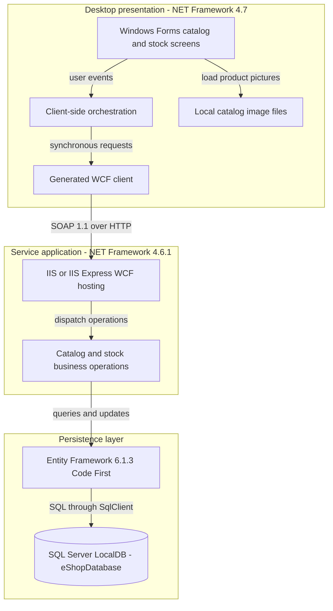
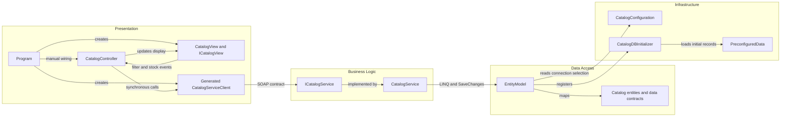

# Architecture Diagram

Assessment scope is only `eShopLegacyNTier`. The checked-in solution contains a Windows desktop client and one hosted catalog service; evidence paths below are relative to that directory (`eShopLegacyNTier.sln:6-9`).

## Application Architecture

### Technology Stack Summary

| Layer | Technology | Version | Purpose |
|---|---|---|---|
| Presentation | Windows Forms, .NET Framework | 4.7 target | Desktop catalog, filtering, stock enquiry and shipment entry (`src\eShopWinForms\eShopWinForms.csproj:8-11,85`; `src\eShopWinForms\Views\CatalogView.cs:18-34,142-168`). |
| Client communication | Generated WCF `ClientBase` proxy | Framework-supplied | SOAP request/reply; instantiated by the active entry point (`src\eShopWinForms\Program.cs:22-27`; `src\eShopWinForms\Connected Services\eShopServiceReference\Reference.cs:497-568`). |
| Service hosting | WCF, ASP.NET hosting, IIS Express development settings | .NET Framework 4.6.1 | Activates the catalog service (`src\eShopWCFService\eShopWCFService.csproj:15-18,119-124`; `src\eShopWCFService\CatalogService.svc:1`). |
| Persistence | Entity Framework Code First | 6.1.3 | Five entity sets, LINQ queries and `SaveChanges` (`src\eShopWCFService\packages.config:3`; `src\eShopWCFService\EntityModel.cs:10-40`). |
| Storage | SQL Server LocalDB, `System.Data.SqlClient` | Engine version not pinned | Default local catalog database (`src\eShopWCFService\Web.config:52-64`). |

### Data Storage & External Services

The service owns one SQL database, defaulting to LocalDB `eShopDatabase`; an environment-supplied connection string can replace it (`src\eShopWCFService\Models\Infrastructure\CatalogConfiguration.cs:10-18`). Catalog images are read from a working-directory-relative local asset folder, not downloaded from the service (`src\eShopWinForms\Views\CatalogView.cs:48-61`). No active cache, message broker, remote identity provider or other external business integration was found in the entry point, controller or hosted service.

### Key Architectural Decisions

- The desktop controller composes service responses and drives a view interface; dependencies are manually wired, without a DI container (`src\eShopWinForms\Program.cs:22-27`; `src\eShopWinForms\Controllers\CatalogController.cs:14-20,75-85`).
- Business operations access `EntityModel` directly; there is no separate repository layer. Missing-database creation and seeding are registered in the context constructor (`src\eShopWCFService\CatalogService.svc.cs:16-25`; `src\eShopWCFService\EntityModel.cs:12-22`).
- **Active versus unused:** the active client is the generated proxy under `Connected Services`. The service-side `CatalogServiceClient.cs` is absent from the service project's explicit compile list; WinForms `Helpers` files are likewise excluded. `CatalogServiceMock` is compiled but not selected by either startup or `.svc` activation; its discount operation throws (`src\eShopWCFService\eShopWCFService.csproj:79-94`; `src\eShopWinForms\eShopWinForms.csproj:89-103,109-113,155-159`; `src\eShopWCFService\CatalogServiceMock.cs:118-120`).

## Component Relationships

### Component Inventory

| Component | Layer | Type | Responsibility |
|---|---|---|---|
| `Program` | Presentation | Entry point | Constructs view, generated proxy and controller; loads data before showing the dialog (`src\eShopWinForms\Program.cs:17-27`). |
| `CatalogView` / `ICatalogView` | Presentation | Form / view contract | Emits filter and availability events; renders catalog, discount and stock results (`src\eShopWinForms\Views\CatalogView.cs:18-34,48-79,142-195`). |
| `CatalogController` | Presentation | Controller/orchestrator | Fetches catalog/discount/lookups and forwards stock operations (`src\eShopWinForms\Controllers\CatalogController.cs:35-84,98-157`). |
| Generated `CatalogServiceClient` | Presentation | WCF proxy | Forwards operations through the WCF channel (`src\eShopWinForms\Connected Services\eShopServiceReference\Reference.cs:568-635`). |
| `ICatalogService` | Business logic | SOAP service contract | Declares ten operation contracts (`src\eShopWCFService\ICatalogService.cs:12-34`). |
| `CatalogService` | Business logic | Service implementation | Performs lookup, filtering, discount selection, stock overwrite/create and catalog CRUD (`src\eShopWCFService\CatalogService.svc.cs:28-117`). |
| `EntityModel` and five entities | Data access | EF6 context / mapped classes | Holds catalog, classification, dated stock and discount data (`src\eShopWCFService\EntityModel.cs:18-40`). |
| `CatalogConfiguration` | Infrastructure | Static configuration resolver | Environment connection string before named configuration (`src\eShopWCFService\Models\Infrastructure\CatalogConfiguration.cs:10-18`). |
| `CatalogDBInitializer` / `PreconfiguredData` | Infrastructure | Initializer / seed factory | Creates and seeds an absent database (`src\eShopWCFService\Models\Infrastructure\CatalogDBInitializer.cs:11-20`). |
