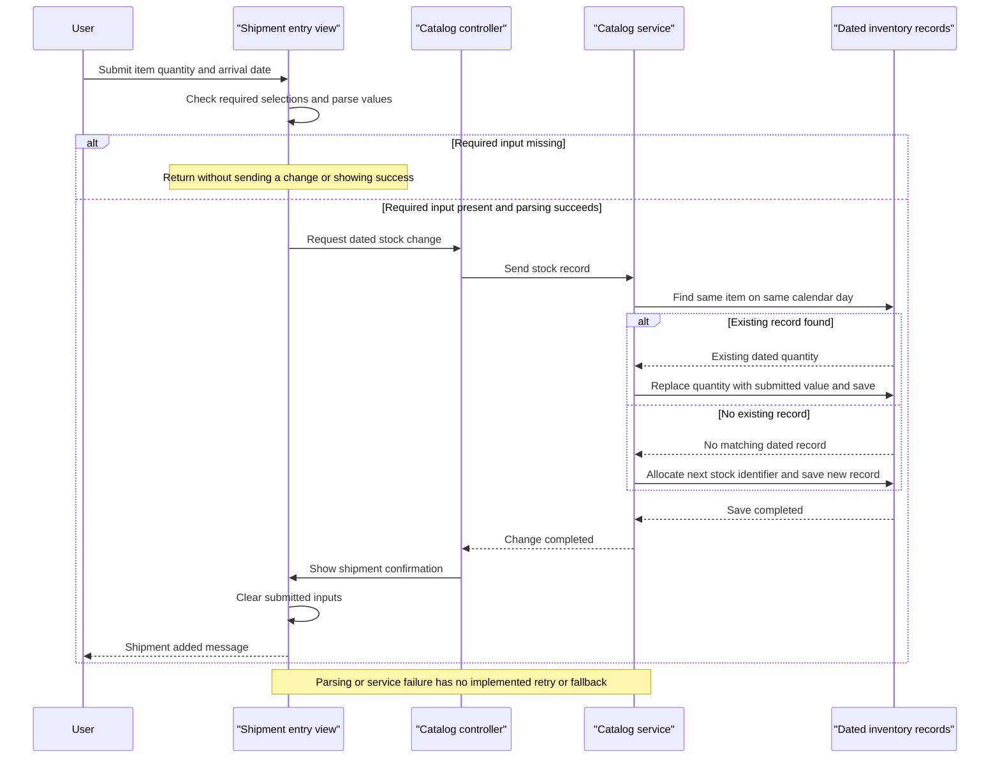

# Core Business Workflows

`eShopLegacyNTier` lets users browse merchandise by brand/type, see current promotional pricing, inspect stock for a chosen date, and record shipment availability. It does not implement shopping carts, ordering, payment, checkout or customer accounts in the inspected active code.

## Domain Entities

| Entity | Service / Bounded Context | Description | Key Relationships |
|---|---|---|---|
| CatalogItem | CatalogService / catalog management | Merchandise shown in the catalog | Classified by brand and type; referenced by dated inventory |
| CatalogBrand | CatalogService / catalog classification | Product brand used to filter merchandise | Groups catalog items |
| CatalogType | CatalogService / catalog classification | Product category used to filter merchandise | Groups catalog items |
| CatalogItemsStock | CatalogService / inventory availability | Recorded quantity for one item on a calendar date | Logical reference to merchandise; no separate shipment aggregate |
| DiscountItem | CatalogService / promotions | Storewide fractional discount valid for a date interval | Applied to displayed catalog prices; not linked to specific merchandise |

Evidence: `src\eShopWCFService\Models\CatalogItem.cs:10-35`; `Models\CatalogBrand.cs:10-19`; `Models\CatalogType.cs:10-19`; `Models\CatalogItemsStock.cs:10-25`; `Models\DiscountItem.cs:11-31`; `src\eShopWCFService\CatalogService.svc.cs:28-30,90-117`. These are functional groupings inside one service, not separately implemented DDD bounded-context services.

## Service-to-Domain Mapping

| Service | Domain Context | Owned Entities | External Dependencies |
|---|---|---|---|
| CatalogService / eShopWCFService | Catalog, classification, promotions and inventory | All five domain entities | One database through `EntityModel`; seed factories for initial sample records |
| eShopWinForms / CatalogController | Catalog browsing and stock-maintenance user interaction | No authoritative persistent entities; generated contract copies | CatalogService SOAP operations; local catalog image assets |

The service is the source of truth; the desktop composes display data without owning another domain store. No independent order/customer domain exchange is implemented (`src\eShopWCFService\EntityModel.cs:18-22`; `src\eShopWinForms\Controllers\CatalogController.cs:35-84`; `src\eShopWinForms\Views\CatalogView.cs:55-61`).

## Primary Workflows

### Workflow 1: Browse and filter catalog with current promotional pricing

1. Startup wires the controller and view, checks the current promotion, loads catalog items and classification filters, then populates inventory-selection lists before displaying the window (`src\eShopWinForms\Program.cs:22-27`; `src\eShopWinForms\Controllers\CatalogController.cs:150-157`).
2. The controller adds an `All` choice to both classification lists. Changing either selection raises a filter event carrying both selections (`src\eShopWinForms\Controllers\CatalogController.cs:98-143`; `src\eShopWinForms\Views\CatalogView.cs:106-135`).
3. The controller clears the grid, retrieves matching items and separately asks for today's discount. The service uses the **All-filter rule** and **Active-promotion rule** below (`src\eShopWinForms\Controllers\CatalogController.cs:75-85`; `src\eShopWCFService\CatalogService.svc.cs:28-30,56-62`).
4. The view computes **Promotional display price**, reads product images locally and adds rows. With no active discount, it displays base prices. The initial banner is separate from price loading and is not refreshed by later filter changes (`src\eShopWinForms\Views\CatalogView.cs:48-61`; `src\eShopWinForms\Controllers\CatalogController.cs:60-84`).

There is no purchase or inventory reservation side effect. A transport/database/image-loading failure has no implemented graceful degradation path.

### Workflow 2: Inspect dated stock availability

1. The user selects an item and calendar date. The view extracts the item identifier from the selection text and raises a stock-search event (`src\eShopWinForms\Views\CatalogView.cs:142-151`).
2. The controller requests that item/day's stock. The service applies the **Dated-stock lookup rule**, returning zero if no row matches (`src\eShopWinForms\Controllers\CatalogController.cs:50-54`; `src\eShopWCFService\CatalogService.svc.cs:90-96`).
3. The result is appended to the displayed stock history; it is not accumulated across earlier dates or treated as a reservation (`src\eShopWinForms\Views\CatalogView.cs:173-182`).

The search handler does not guard a missing selected item. Zero inventory is a business result, not a service-outage fallback.

### Workflow 3: Record or replace shipment availability

1. The user supplies an item, quantity and arrival date. The view applies **Shipment-entry presence/parsing checks** and raises an event (`src\eShopWinForms\Views\CatalogView.cs:157-167`).
2. The controller creates a stock contract and sends it to the service (`src\eShopWinForms\Controllers\CatalogController.cs:35-42`).
3. The service applies **Same-day stock replacement**: overwrite a matching record's quantity, otherwise create a new record using **Manual stock-key allocation**, then save (`src\eShopWCFService\CatalogService.svc.cs:99-117`).
4. Only after the service call returns does the UI confirm that a shipment was added and clear inputs. The success text also appears for replacement; it does not imply quantities were added together (`src\eShopWinForms\Controllers\CatalogController.cs:42-43`; `src\eShopWinForms\Views\CatalogView.cs:189-195`).

There is no separate shipment lifecycle, receiving approval, stock summation or event publication.

### Workflow 4: Initial sample catalog provisioning and exposed maintenance operations

The first database initialization creates an absent database and seeds classifications, merchandise, dated inventory and historical promotions. This is a startup data-initialization path, not a scheduled promotion-refresh process (`src\eShopWCFService\EntityModel.cs:12-16`; `src\eShopWCFService\Models\Infrastructure\CatalogDBInitializer.cs:11-20`).

Item lookup/create/update/remove operations are exposed at the service but not connected to the active desktop controller. Create uses a max-ID allocation; update marks the provided entity modified; remove passes the provided entity to `Remove`. These are service capabilities, not user workflows demonstrated by the checked-in UI (`src\eShopWCFService\CatalogService.svc.cs:33-44,65-82`; `src\eShopWinForms\Controllers\CatalogController.cs:35-157`).

## Cross-Service Data Flows

The only application network boundary is desktop → CatalogService. The desktop obtains products and promotions in separate calls and joins them by applying the same selected discount to every displayed product; this is client-side composition, not API-gateway or cross-microservice aggregation. Brands/types are fetched independently to populate choices. Stock enquiries and changes use item identifiers from the product selection (`src\eShopWinForms\Controllers\CatalogController.cs:35-84,88-143`).

No broker, choreography, distributed transaction, compensating workflow or circuit-breaker fallback exists in the active implementation. A missing promotion yields undiscounted prices; a missing stock row yields zero. Service unavailability is not mapped to either result because calls are not caught or retried (`src\eShopWCFService\CatalogService.svc.cs:28-30,90-117`; `src\eShopWinForms\Controllers\CatalogController.cs:35-84`).

The compiled mock is not wired into startup or hosting and cannot be treated as an offline fallback; its discount method throws. The service-side hand-written client and UWP-style desktop helper files are excluded from the respective explicit compile lists (`src\eShopWCFService\CatalogServiceMock.cs:118-120`; `src\eShopWCFService\CatalogService.svc:1`; `src\eShopWCFService\eShopWCFService.csproj:79-94`; `src\eShopWinForms\eShopWinForms.csproj:89-103,109-113,155-159`).

## Business Workflow Sequence

Sequence evidence: `src\eShopWinForms\Views\CatalogView.cs:157-167,189-195`; `src\eShopWinForms\Controllers\CatalogController.cs:35-43`; `src\eShopWCFService\CatalogService.svc.cs:99-117`.

## Business Rules & Decision Logic

| Rule / Concern | Implemented behavior | Evidence |
|---|---|---|
| All-filter rule | Filter ID zero means unrestricted; nonzero brand and type constraints are combined with AND. There is no paging or sorting contract. | `src\eShopWCFService\CatalogService.svc.cs:56-62`; `src\eShopWinForms\Controllers\CatalogController.cs:107,133` |
| Active-promotion rule | Select first discount whose start/end calendar dates inclusively contain today; overlapping discounts are not combined or explicitly ordered. | `src\eShopWCFService\CatalogService.svc.cs:28-30` |
| Promotional display price | Convert persisted price to `double`, compute `price * (1 - discount)`, prepend a dollar symbol and format with `"F"`. Banner percentage is rounded separately. No tax, persisted price mutation or discount-range validation is implemented. | `src\eShopWinForms\Views\CatalogView.cs:48-61`; `src\eShopWinForms\Controllers\CatalogController.cs:60-68` |
| Dated-stock lookup rule | Match item and exact calendar date; return first matching record's quantity or zero. No carry-forward, cumulative shipment sum or inventory deduction. | `src\eShopWCFService\CatalogService.svc.cs:90-96` |
| Shipment-entry presence/parsing checks | Require selected item and nonempty quantity/date text; parse with `int.Parse` and `Convert.ToDateTime`. No `TryParse`, positive-quantity check or past-date restriction; search selection is not null-guarded. | `src\eShopWinForms\Views\CatalogView.cs:142-167` |
| Same-day stock replacement | First matching item/day record is overwritten, not incremented; otherwise insert. No explicit service validation that item exists, no quantity/date checks or declared unique item/day constraint. | `src\eShopWCFService\CatalogService.svc.cs:99-117`; `Models\CatalogItemsStock.cs:10-25` |
| Manual key allocation | Item and new stock creation use current maximum plus one. Empty sets and concurrent writers are not specially handled. | `src\eShopWCFService\CatalogService.svc.cs:65-70,113-116` |
| Model validation | Brand/type labels have maximum-length annotations of 50; no custom business validator is present. No explicit positive price, valid discount interval or discount fraction range constraint is declared. | `src\eShopWCFService\Models\CatalogBrand.cs:17-19`; `Models\CatalogType.cs:17-19`; `Models\CatalogItem.cs:21-29`; `Models\DiscountItem.cs:18-31` |
| State transitions | Create or replace dated inventory and catalog CRUD only; no order, payment or shipment-status state machine. | `src\eShopWCFService\CatalogService.svc.cs:65-82,99-117` |
| Transactions and concurrency | Each mutation calls `SaveChanges`; no explicit transaction covering reads plus write, concurrency token, distributed transaction or compensating action. Seed groups are saved separately. | `src\eShopWCFService\CatalogService.svc.cs:65-117`; `Models\Infrastructure\CatalogDBInitializer.cs:22-79` |
| Error handling | No business exception type, typed SOAP fault, catch/retry path or offline fallback; UI confirms only after the call returns. | `src\eShopWCFService\ICatalogService.cs:12-34`; `src\eShopWinForms\Controllers\CatalogController.cs:35-84` |
| Audit / authorization | No business audit trail, role/ownership check or authorization branch found in the active controller/service. Database change tracking is not an audit history. | `src\eShopWCFService\CatalogService.svc.cs:14-117`; `src\eShopWinForms\Controllers\CatalogController.cs:14-157` |
| Initial sample periods | Seeded promotions and stock dates are in 2017; no scheduled task advances them. An unchanged seed database therefore has no current active promotion at assessment time. | `src\eShopWCFService\Models\Infrastructure\PreconfiguredData.cs:41-50,65-74` |
