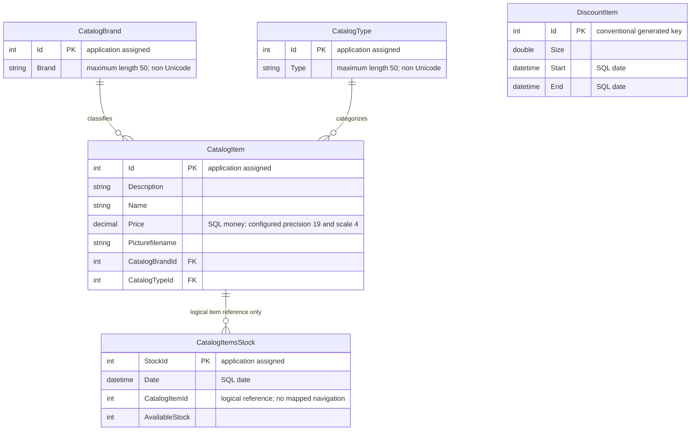

# Data Architecture & Persistence Layer

The scoped `eShopLegacyNTier` data layer has five EF6 entity sets backed by SQL Server, with LocalDB as the checked-in default. A Code First initializer creates and seeds an absent database; no versioned migration implementation is declared (`src\eShopWCFService\EntityModel.cs:10-22`; `src\eShopWCFService\Models\Infrastructure\CatalogDBInitializer.cs:11-20`).

## Database Configuration

| Service/Module | DB Type | Profile | Driver | Connection | Migration Tool |
|---|---|---|---|---|---|
| eShopWCFService | SQL Server LocalDB | Default; no named runtime profiles | `System.Data.SqlClient`, EF6 SQL Server provider | Named application connection to local `eShopDatabase`; no explicit pool tuning | None found; `CreateDatabaseIfNotExists` creates and seeds only an absent database |
| eShopWCFService | Environment-selected connection; SQL Server provider configured | Environment override, not a separate profile | EF6 configured SQL Server provider | Process environment connection string takes precedence over named configuration; actual value not supplied here | Same initializer; no environment-specific migration tool found |
| eShopWinForms | None used by active client | Default | No active DB driver use | Consumes service contracts rather than opening the database | Not applicable |

Evidence: `src\eShopWCFService\Web.config:52-64`; `src\eShopWCFService\Models\Infrastructure\CatalogConfiguration.cs:10-18`; `src\eShopWCFService\EntityModel.cs:12-16`; `src\eShopWinForms\Program.cs:22-27`. Exact configuration keys and resolution are documented in `configuration-inventory.md`.

Seed data comprises 12 catalog items, 5 brands, 4 types, 6 stock rows and 6 historical discount periods; each seed group is saved separately. This is initial sample data, not a live synchronization feed (`src\eShopWCFService\Models\Infrastructure\PreconfiguredData.cs:10-75`; `src\eShopWCFService\Models\Infrastructure\CatalogDBInitializer.cs:13-79`).

## Data Ownership per Service

| Service | Tables Owned | ORM Framework | Caching | Notes |
|---|---|---|---|---|
| eShopWCFService | `CatalogBrands`, `CatalogItems`, `CatalogTypes`, `DiscountItems` by EF convention; explicit `CatalogItemsStock` table | Entity Framework 6.1.3 | None configured | Five `DbSet` properties; catalog data, dated stock and discount ownership |
| eShopWinForms | None | EF6 package declared, but no active database context | None configured | Generated service contract copies are client models, not client-owned tables |

Evidence: `src\eShopWCFService\EntityModel.cs:18-40`; `src\eShopWCFService\Models\CatalogItemsStock.cs:10-25`; `src\eShopWCFService\packages.config:3`; `src\eShopWinForms\packages.config:3`; `src\eShopWinForms\Controllers\CatalogController.cs:11-20,35-84`. Convention-derived table names are not verified against a deployed database.

## Entity Model

`CatalogItem` has unidirectional, non-virtual `CatalogBrand` and `CatalogType` navigation properties and non-nullable foreign-key IDs. No inverse collection or explicit cascade policy is declared; normal EF conventions govern relationships. `FindCatalogItem` explicitly queries both classifications; the catalog list does not call `Include` or populate those navigations explicitly (`src\eShopWCFService\Models\CatalogItem.cs:27-35`; `src\eShopWCFService\CatalogService.svc.cs:33-62`).

The stock-to-item line is a **logical relationship inferred from queries**, not evidence of an enforced EF/database foreign key: `CatalogItemsStock` contains only a scalar `CatalogItemId` and no navigation or fluent relationship configuration. No composite unique constraint for item/date, explicit index, row-version concurrency token or relationship to discounts is declared (`src\eShopWCFService\Models\CatalogItemsStock.cs:10-25`; `src\eShopWCFService\EntityModel.cs:24-40`).

Entity sources and persistence constraints:

- `src\eShopWCFService\Models\CatalogBrand.cs:10-19` and `Models\CatalogType.cs:10-19`: keys are not database generated; classification strings have a length annotation of 50. Non-Unicode mapping is in `src\eShopWCFService\EntityModel.cs:26-38`.
- `src\eShopWCFService\Models\CatalogItem.cs:10-35`: item key is not database generated; price uses SQL `money`; precision is configured in `src\eShopWCFService\EntityModel.cs:30-32`. Strings other than classification labels have no declared length bounds.
- `src\eShopWCFService\Models\CatalogItemsStock.cs:10-25`: explicit table name, `StockId` key with no database generation, and date-only SQL column.
- `src\eShopWCFService\Models\DiscountItem.cs:11-31`: integer key without `DatabaseGenerated(None)`; fractional discount and inclusive date range are plain mutable persisted values.

## Key Repository Methods

There are **no repository interfaces or inherited repository CRUD abstractions**. `CatalogService` operates directly on `EntityModel` sets.

| Service | Repository | Notable Methods | Purpose |
|---|---|---|---|
| eShopWCFService | Direct `EntityModel` access in `CatalogService` | `CatalogItem FindCatalogItem(int id)` | `FirstOrDefault` item lookup, then explicit brand/type lookups (`src\eShopWCFService\CatalogService.svc.cs:33-44`). |
| eShopWCFService | Same | `List<CatalogItem> GetCatalogItems(int brandIdFilter, int typeIdFilter)` | Materializes all items before applying both filters in memory (`src\eShopWCFService\CatalogService.svc.cs:56-62`). |
| eShopWCFService | Same | `List<CatalogBrand> GetCatalogBrands()`; `List<CatalogType> GetCatalogTypes()` | Materialized classification lists (`src\eShopWCFService\CatalogService.svc.cs:46-54`). |
| eShopWCFService | Same | `DiscountItem GetDiscount(DateTime day)` | Loads all discounts, selects first inclusive date-range match in memory (`src\eShopWCFService\CatalogService.svc.cs:28-30`). |
| eShopWCFService | Same | `int GetAvailableStock(DateTime date, int catalogItemId)` | SQL item filter followed by in-memory date-only match; first matching row or zero (`src\eShopWCFService\CatalogService.svc.cs:90-96`). |
| eShopWCFService | Same | `void CreateAvailableStock(CatalogItemsStock stock)` | Updates first matching item/day row or allocates max ID plus one, inserts and saves (`src\eShopWCFService\CatalogService.svc.cs:99-117`). |
| eShopWCFService | Same | `CreateCatalogItem`, `UpdateCatalogItem`, `RemoveCatalogItem` accepting `CatalogItem` | Max-ID allocation for create; detached modified-state update; direct remove; each immediately saves (`src\eShopWCFService\CatalogService.svc.cs:65-82`). |

No raw SQL, stored procedure, cross-service batch query or explicit `TransactionScope` is present in these methods. Each `SaveChanges` is its own EF persistence boundary; reads and preceding max-ID allocation are not enclosed in an application transaction. Context disposal is implemented by the service (`src\eShopWCFService\CatalogService.svc.cs:65-117`).

## Caching Strategy

No distributed cache, `MemoryCache`, query cache, TTL, invalidation policy or EF second-level cache is configured in the inspected context/service/config (`src\eShopWCFService\EntityModel.cs:10-40`; `src\eShopWCFService\CatalogService.svc.cs:28-117`; `src\eShopWCFService\Web.config:52-64`). EF change tracking and local `ToList` materialization are not a shared application cache. The unused `CatalogServiceMock` keeps lists in memory but is neither activated nor a production cache (`src\eShopWCFService\CatalogServiceMock.cs:13-24`; `src\eShopWCFService\CatalogService.svc:1`).

## Data Ownership Boundaries

One service owns one database for all five model types; there are no database-per-microservice or schema-per-context boundaries. The desktop reads and writes through SOAP operations, never directly querying the database in its active path. Its controller combines catalog records with a separately returned discount for presentation, not cross-database joins (`src\eShopWinForms\Controllers\CatalogController.cs:35-84`; `src\eShopWinForms\Program.cs:22-27`).

Reads and writes share the same context/model; no CQRS read store, outbox, event replication or eventual-consistency mechanism is declared. Product image binaries reside in desktop assets, while the database stores a filename; deployed image-directory availability is a separate filesystem dependency (`src\eShopWCFService\EntityModel.cs:18-22`; `src\eShopWinForms\Views\CatalogView.cs:55-61`).

### Data Classification & Sensitivity

| Entity | Sensitive Fields | Classification (PII/PHI/PCI/None) | Controls in Place |
|---|---|---|---|
| CatalogItem | None detected; product descriptions, prices and image filenames | None | No field encryption/masking or field-level access checks declared |
| CatalogBrand / CatalogType | None detected; product classifications | None | No special controls declared |
| CatalogItemsStock | None detected; inventory quantities and dates | None | No special controls declared |
| DiscountItem | None detected; discount sizes and periods | None | No special controls declared |

No PII, PHI, or PCI data detected in entity model. Catalog pricing and inventory may still be business-sensitive; encryption-at-rest and deployed database permissions cannot be established from the checked-in mappings/configuration. Connection settings are operationally sensitive and are covered separately in `configuration-inventory.md`.
