# Dependency Map

`eShopLegacyNTier` declares **3 distinct NuGet packages** across 4 package entries and **26 distinct framework assembly references**, for 29 dependency units when framework references are included. This inventory uses only the two project files, their `packages.config` files and the solution; package assemblies are not double-counted as separate packages.

## Dependencies

```mermaid
flowchart LR
    App["eShopLegacyNTier"]
    subgraph Web["Web and SOAP communication"]
        WAC["Microsoft.AspNet.WebApi.Client 5.2.3"]
        SM["System.ServiceModel - Framework 4.6.1 or 4.7"]
        SMW["System.ServiceModel.Web - Framework 4.6.1"]
        SW["System.Web - Framework 4.6.1"]
        SWA["System.Web.ApplicationServices - Framework 4.6.1"]
        SWD["System.Web.DynamicData - Framework 4.6.1"]
        SWE["System.Web.Entity - Framework 4.6.1"]
        SWX["System.Web.Extensions - Framework 4.6.1"]
        SWS["System.Web.Services - Framework 4.6.1"]
    end
    subgraph DB["Database and ORM"]
        EF["EntityFramework 6.1.3"]
        SD["System.Data - Framework 4.6.1 or 4.7"]
        SDS["System.Data.DataSetExtensions - Framework 4.6.1 or 4.7"]
        SDE["System.Data.Entity.Design - Framework 4.6.1"]
    end
    subgraph Desktop["Desktop presentation"]
        WF["System.Windows.Forms - Framework 4.7"]
        Draw["System.Drawing - Framework 4.6.1 or 4.7"]
    end
    subgraph Util["Utilities and platform"]
        JSON["Newtonsoft.Json 6.0.4"]
        CS["Microsoft.CSharp - Framework 4.6.1 or 4.7"]
        Sys["System - Framework 4.6.1 or 4.7"]
        Core["System.Core - Framework 4.7 explicit reference"]
        DA["System.ComponentModel.DataAnnotations - Framework 4.6.1 or 4.7"]
        Conf["System.Configuration - Framework 4.6.1 or 4.7"]
        Deploy["System.Deployment - Framework 4.7"]
        Ent["System.EnterpriseServices - Framework 4.6.1"]
        Zip["System.IO.Compression - Framework 4.7"]
        ZipFS["System.IO.Compression.FileSystem - Framework 4.7"]
        Http["System.Net.Http - Framework 4.7"]
        Ser["System.Runtime.Serialization - Framework 4.6.1 or 4.7"]
        XML["System.Xml - Framework 4.6.1 or 4.7"]
        XL["System.Xml.Linq - Framework 4.6.1 or 4.7"]
    end
    App -->|"communication references"| Web
    App -->|"persistence references"| DB
    App -->|"desktop references"| Desktop
    App -->|"platform references"| Util
```

Framework labels identify target-framework versions, **not independently pinned assembly package versions**. NuGet evidence: `src\eShopWCFService\packages.config:3`; `src\eShopWinForms\packages.config:3-5`. Assembly inventory evidence: `src\eShopWCFService\eShopWCFService.csproj:45-70`; `src\eShopWinForms\eShopWinForms.csproj:57-86`.

### Dependency Summary

| Category | Count | Key Libraries | Notes |
|---|---|---|---|
| Web and SOAP communication | 9 | WebApi.Client 5.2.3; eight framework assemblies shown above | WebApi.Client belongs only to WinForms. A declared HTTP-formatting package does not establish a REST server. WCF and ASP.NET references are framework-provided. |
| Database / ORM | 4 | EntityFramework 6.1.3; `System.Data`, `System.Data.DataSetExtensions`, `System.Data.Entity.Design` | EF is in both package manifests; `EntityFramework` and `EntityFramework.SqlServer` assemblies come from that one package. |
| Desktop presentation | 2 | `System.Windows.Forms`, `System.Drawing` | Windows desktop dependencies; Forms is client-specific. |
| Utilities and platform | 14 | Newtonsoft.Json 6.0.4 and 13 framework references shown above | JSON is client-specific. `System.Net.Http.Formatting` is supplied by WebApi.Client, not an additional dependency. |
| Total | 29 | 3 NuGet packages and 26 framework references shown above | Distinct across both projects; shared references counted once. |

The project XML declares 30 distinct assembly names: four are supplied by the three NuGet packages, leaving 26 framework names. All are compile references; default copy behavior is not a separately declared runtime-only scope (`src\eShopWCFService\eShopWCFService.csproj:45-70`; `src\eShopWinForms\eShopWinForms.csproj:57-86`).

### Version & Compatibility Risks

The service targets .NET Framework 4.6.1 and the client 4.7; the 4.6.1 target is out of support, while 4.7 servicing depends on the deployed Windows lifecycle. EF6 6.1.3, Newtonsoft.Json 6.0.4 and WebApi.Client 5.2.3 are old pinned releases and warrant compatibility and advisory review before modernization. This document does not claim a live vulnerability scan or infer the installed runtime (`src\eShopWCFService\eShopWCFService.csproj:15`; `src\eShopWinForms\eShopWinForms.csproj:11`; both `packages.config` files).

### Notable Observations

- Packages use legacy `packages.config` plus relative `..\packages\...` assembly hint paths, rather than `PackageReference` or central version management (`src\eShopWCFService\eShopWCFService.csproj:45-49`; `src\eShopWinForms\eShopWinForms.csproj:57-74`).
- Both manifests label packages `net461`, although the desktop project targets `v4.7`; framework-target metadata differs from the project target (`src\eShopWinForms\packages.config:3-5`; `src\eShopWinForms\eShopWinForms.csproj:11`).
- No package lockfile, central package file, test project or test-scoped package declaration was found in this scoped solution. Transitive edges cannot be reliably reconstructed from these declarations alone (`eShopLegacyNTier.sln:6-9`; both package manifests).
- A `.NET Framework 3.5 SP1` bootstrapper entry is present but has `Install=false`; it is not an enabled runtime prerequisite or an extra NuGet dependency (`src\eShopWinForms\eShopWinForms.csproj:271-276`).

## Test Dependencies

| Framework | Version | Notes |
|---|---|---|
| None detected | Not applicable | Neither package manifest declares test libraries; the solution contains only the desktop and service projects. |

Total test-scope dependencies: 0

No test dependencies detected. A mock class file is not evidence of a declared test framework or executable test suite.
