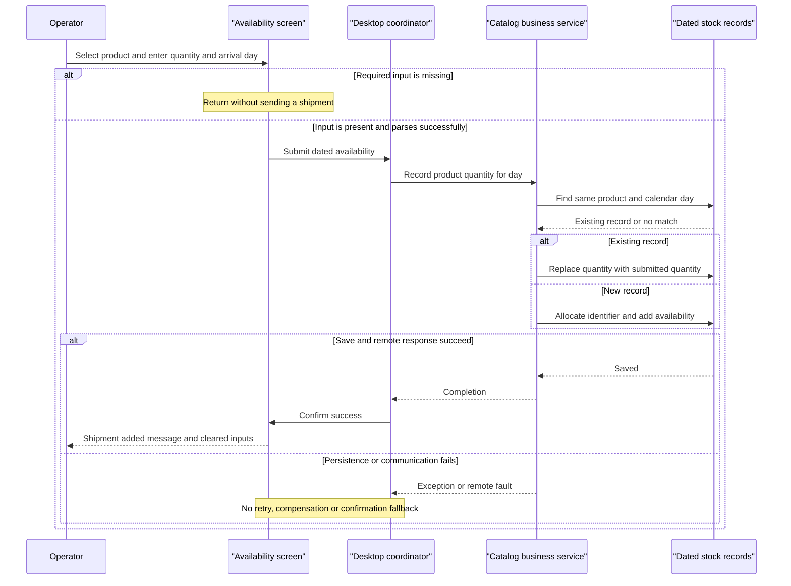

# Core Business Workflows

The application lets operators browse a product catalog, see date-based promotions, look up stock for a selected day and record a product's stock availability. No basket, checkout, payment or order-fulfillment workflow is implemented in the scoped application.

## Domain Entities

| Entity | Service / Bounded Context | Description | Key Relationships |
|---|---|---|---|
| CatalogItem | CatalogService / catalog management | Product description, selling price and image reference | Classified by brand and type; referenced by dated stock |
| CatalogBrand | CatalogService / catalog classification | Product brand classification | Shared classification for products |
| CatalogType | CatalogService / catalog classification | Product type classification | Shared classification for products |
| CatalogItemsStock | CatalogService / availability | Quantity available for a product on a calendar day | Logical product association; not an accumulated movement ledger |
| DiscountItem | CatalogService / promotions | Promotion fraction valid during a date interval | Applied globally to displayed products; no per-product association |

Evidence: `src\eShopWCFService\Models\CatalogItem.cs:11-35`; `src\eShopWCFService\Models\CatalogBrand.cs:11-19`; `src\eShopWCFService\Models\CatalogType.cs:11-19`; `src\eShopWCFService\Models\CatalogItemsStock.cs:12-25`; `src\eShopWCFService\Models\DiscountItem.cs:12-31`; `src\eShopWinForms\Views\CatalogView.cs:48-61`.

## Service-to-Domain Mapping

| Service | Domain Context | Owned Entities | External Dependencies |
|---|---|---|---|
| CatalogService | Catalog, classification, promotion and dated availability; one combined service boundary | All five domain entities | Persistence through EntityModel |
| Desktop CatalogController / CatalogView | Operator interaction and presentation composition | No authoritative persisted entities; consumes copies | Remote CatalogService and local images |

This is a single business service with a desktop client, not separately deployed bounded-context microservices. EntityModel's five sets and the desktop service injection establish the ownership boundary (`src\eShopWCFService\EntityModel.cs:18-22`; `src\eShopWinForms\Program.cs:22-27`).

## Primary Workflows

### Workflow 1: Browse and filter catalog with current promotion

1. Program constructs the remote client, view and controller. LoadView sets the controller, checks promotions, loads initial products, loads classification filters, then loads shipment-product choices (`src\eShopWinForms\Program.cs:22-27`; `src\eShopWinForms\Controllers\CatalogController.cs:150-157`).
2. A brand/type selection raises a filter event. The controller clears the grid and retrieves matching products under the **zero-means-all filtering rule** (`src\eShopWinForms\Views\CatalogView.cs:106-135`; `src\eShopWinForms\Controllers\CatalogController.cs:27-29,75-78`).
3. The service applies selected classifications after materializing products. The controller separately asks for today's promotion under the **inclusive promotion window rule** (`src\eShopWCFService\CatalogService.svc.cs:28-30,56-62`; `src\eShopWinForms\Controllers\CatalogController.cs:79-84`).
4. The view computes display prices under the **global display discount rule**, loads local product thumbnails and appends grid rows (`src\eShopWinForms\Views\CatalogView.cs:48-61`).
5. On initial load, an active promotion also sets banner text. The banner check is separate from the discount lookup used for prices (`src\eShopWinForms\Controllers\CatalogController.cs:60-69`).

No service-availability fallback exists. An image or service exception is not handled in this path; the grid may already have been cleared. The initial data load runs before the main dialog is shown.

### Workflow 2: Record dated stock availability

1. The operator selects a product and enters quantity/date. The view applies **shipment input presence checks**, then parses values and emits the shipment event (`src\eShopWinForms\Views\CatalogView.cs:157-167`).
2. The controller creates a stock contract and sends it to the service (`src\eShopWinForms\Controllers\CatalogController.cs:35-42`).
3. The service finds the first matching product/calendar-day record. Under the **replace-not-add stock rule**, it overwrites that record's quantity; otherwise it creates a record using **manual stock ID allocation** (`src\eShopWCFService\CatalogService.svc.cs:99-117`).
4. A successful response causes a confirmation dialog and clears shipment inputs. There is no automatic stock re-query or replenishment accumulation (`src\eShopWinForms\Controllers\CatalogController.cs:42-43`; `src\eShopWinForms\Views\CatalogView.cs:189-195`).

### Workflow 3: Query stock for a product and day

1. The user selects a product and calendar date; the view extracts the product ID from displayed text and raises a search event (`src\eShopWinForms\Views\CatalogView.cs:142-151`).
2. The controller requests stock; the service applies the **first matching stock or zero rule** (`src\eShopWinForms\Controllers\CatalogController.cs:50-54`; `src\eShopWCFService\CatalogService.svc.cs:90-96`).
3. The view appends a result row with date, product and availability rather than replacing earlier results (`src\eShopWinForms\Views\CatalogView.cs:173-182`).

### Workflow 4: Initialize demonstration data and maintain catalog records

The first database creation seeds classifications, products, stock and promotions using predefined samples; this is not a scheduled recurring process (`src\eShopWCFService\Models\Infrastructure\CatalogDBInitializer.cs:11-20`). Promotion/stock sample dates are in 2017 (`src\eShopWCFService\Models\Infrastructure\PreconfiguredData.cs:41-75`).

The service also exposes product creation, update and deletion. Creation uses **manual product ID allocation**; updates mark the supplied entity modified; deletion removes the supplied entity, each followed by SaveChanges. The active desktop controller does not initiate these catalog mutations (`src\eShopWCFService\CatalogService.svc.cs:65-82`; `src\eShopWinForms\Controllers\CatalogController.cs:35-157`).

## Cross-Service Data Flows

Only the desktop-to-CatalogService boundary is present. CatalogService is the source of truth for products, classifications, stock and promotions; the desktop composes product and promotion responses locally into discounted rows. Separate classification calls populate filter controls; stock requests reference the chosen product ID (`src\eShopWinForms\Controllers\CatalogController.cs:35-54,75-84,98-143`).

There is no gateway aggregation across multiple backend services, event choreography, broker or compensating workflow. If a call fails, the controller has no retry/circuit-breaker fallback or substitute service, so no intentionally degraded business response is defined. The service mock is not wired into the live desktop flow and its promotion method is unimplemented (`src\eShopWinForms\Program.cs:23`; `src\eShopWCFService\CatalogServiceMock.cs:118-120`).

## Business Workflow Sequence

Evidence: `src\eShopWinForms\Views\CatalogView.cs:157-167,189-195`; `src\eShopWinForms\Controllers\CatalogController.cs:35-43`; `src\eShopWCFService\CatalogService.svc.cs:99-117`. The diagram's error branch describes propagation, not an implemented error handler or circuit breaker.

## Business Rules & Decision Logic

| Rule | Implemented decision | Evidence |
|---|---|---|
| Zero-means-all filtering | Filter ID zero disables that dimension; nonzero brand and type conditions are combined with AND | `src\eShopWCFService\CatalogService.svc.cs:56-62` |
| Filter options | Desktop prepends an All option with ID zero to each classification list | `src\eShopWinForms\Controllers\CatalogController.cs:104-117,130-143` |
| Inclusive promotion window | Compare date-only values; start and end are inclusive; take first match with no explicit ordering or overlap resolution | `src\eShopWCFService\CatalogService.svc.cs:28-30` |
| Global display discount | Price displayed as price times one minus promotion size; no promotion means zero discount; no stored price mutation | `src\eShopWinForms\Controllers\CatalogController.cs:79-84`; `src\eShopWinForms\Views\CatalogView.cs:48-61` |
| Promotion banner | Round size times 100 to an integer percentage and display end date | `src\eShopWinForms\Controllers\CatalogController.cs:60-69` |
| Shipment input presence checks | Missing selected product, empty quantity or empty date returns silently; present values use int.Parse and Convert.ToDateTime | `src\eShopWinForms\Views\CatalogView.cs:157-164` |
| Replace-not-add stock | First matching product/day record quantity is overwritten, not incremented | `src\eShopWCFService\CatalogService.svc.cs:99-109` |
| First matching stock or zero | Missing stock returns zero; duplicate rows are neither summed nor rejected | `src\eShopWCFService\CatalogService.svc.cs:90-96` |
| Manual product/stock ID allocation | New ID equals current maximum plus one; no empty-set handling or concurrency protection is declared | `src\eShopWCFService\CatalogService.svc.cs:65-70,113-116` |
| Classification text length | Brand and type strings have maximum length 50 annotations; no custom validator is present | `src\eShopWCFService\Models\CatalogBrand.cs:17-19`; `src\eShopWCFService\Models\CatalogType.cs:17-19` |
| Validation gaps | No explicit positive quantity/price rule, promotion fraction range, start-before-end check or per-product/date uniqueness check is implemented | Entity annotations and `src\eShopWCFService\CatalogService.svc.cs:28-30,65-82,99-117` |

**State transitions and integrity:** stock is inserted or replaced; there is no shipment lifecycle/status machine, order lifecycle or running stock ledger. Product navigations are populated explicitly during individual item lookup, without inverse collection maintenance (`src\eShopWCFService\CatalogService.svc.cs:33-44`).

**Transactions:** each service mutation uses an individual SaveChanges. Lookup and max-ID selection are not wrapped with the write in a declared encompassing transaction; no saga or compensation exists. Initializer groups are separately saved (`src\eShopWCFService\CatalogService.svc.cs:65-82,99-117`; `src\eShopWCFService\Models\Infrastructure\CatalogDBInitializer.cs:22-79`).

**Errors:** there are no business exception types, controller catch handlers, dead-letter paths or idempotency keys in these flows. Quantity/date parse failures, missing stock-search selection and missing images can throw; a response lost after a successful save has no explicit reconciliation path (`src\eShopWinForms\Views\CatalogView.cs:55-59,142-164`).

**Authorization and audit:** no role/ownership checks or business audit trail are implemented in the examined controller/service code. A desktop success MessageBox is a user notification, not durable audit logging (`src\eShopWinForms\Views\CatalogView.cs:189-195`; `src\eShopWCFService\CatalogService.svc.cs:14-118`). Infrastructure-level controls outside the scoped source remain unknown.
