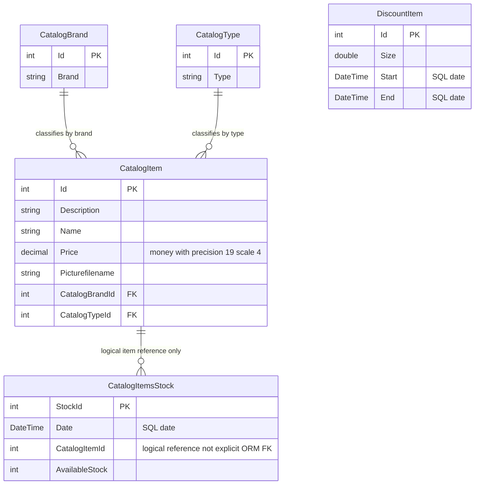

# Data Architecture & Persistence Layer

The scoped data layer contains **five EF6 entity sets** backed by SQL Server, with LocalDB configured by default. Schema creation and sample data initialization use a create-if-absent initializer rather than checked-in versioned migrations.

## Database Configuration

| Service/Module | DB Type | Profile | Driver | Connection | Migration Tool |
|---|---|---|---|---|---|
| eShopWCFService | SQL Server LocalDB | Default; no named runtime profiles | System.Data.SqlClient / EF6 SQL Server provider | Named local database configuration | No migrations found; CreateDatabaseIfNotExists |
| eShopWCFService | External connection, deployment-dependent | Environment override, not a named profile | Provider compatibility must match configuration | Environment-supplied connection takes precedence | Same initializer; external schema management not specified |
| eShopWinForms | None used by active application path | Default | EF package is declared, but generated service client is the active data boundary | Remote service calls only | Not applicable |

Configuration evidence: `src\eShopWCFService\Web.config:52-64`; `src\eShopWCFService\Models\Infrastructure\CatalogConfiguration.cs:10-18`; desktop composition: `src\eShopWinForms\Program.cs:22-27`. Raw keys and values are inventoried in `configuration-inventory.md`.

EntityModel registers its initializer during construction. The initializer seeds types, brands, products, dated stock, then discounts, with a separate SaveChanges per group (`src\eShopWCFService\EntityModel.cs:12-16`; `src\eShopWCFService\Models\Infrastructure\CatalogDBInitializer.cs:11-79`). Sample data contains 12 products, 5 brands, 4 types, 6 stock rows and 6 discounts; stock and promotion dates are in 2017 (`src\eShopWCFService\Models\Infrastructure\PreconfiguredData.cs:10-75`). No explicit pooling settings or schema-version tracking are declared.

## Data Ownership per Service

| Service | Tables Owned | ORM Framework | Caching | Notes |
|---|---|---|---|---|
| eShopWCFService | CatalogBrands, CatalogItems, CatalogTypes, DiscountItems by EF convention; CatalogItemsStock explicitly mapped | EF6 6.1.3 | No configured application cache | Five DbSets; stock table overrides pluralization |
| eShopWinForms | None | None on active path | None declared | Generated data-contract copies, not a separate persistence model |

Evidence: `src\eShopWCFService\EntityModel.cs:18-22`; `src\eShopWCFService\Models\CatalogItemsStock.cs:10`; `src\eShopWinForms\Program.cs:22-27`. Conventional table names are inferred from EF6 mapping conventions, not verified against a live database.

## Entity Model

The stock relationship above is **logical**, inferred from service queries and field naming; stock has no navigation property or explicit foreign-key mapping, so database FK enforcement is not established by this source. Brand/type relationships are unidirectional item navigations with non-nullable foreign-key IDs and no inverse collections. DiscountItem has no mapped relationship to products (`src\eShopWCFService\Models\CatalogItem.cs:26-35`; `src\eShopWCFService\Models\CatalogItemsStock.cs:10-25`; `src\eShopWCFService\CatalogService.svc.cs:90-102`).

| Entity | Fields and persistence details | Source |
|---|---|---|
| CatalogBrand | int Id, string Brand; ID is not database-generated; Brand maximum length 50; mapped non-Unicode | `src\eShopWCFService\Models\CatalogBrand.cs:13-19`; `src\eShopWCFService\EntityModel.cs:26-28` |
| CatalogType | int Id, string Type; ID is not database-generated; Type maximum length 50; mapped non-Unicode | `src\eShopWCFService\Models\CatalogType.cs:13-19`; `src\eShopWCFService\EntityModel.cs:36-38` |
| CatalogItem | int Id, string Description, string Name, decimal Price, string Picturefilename, int CatalogBrandId, int CatalogTypeId, two navigation properties; ID not generated; Price money, precision 19 scale 4 | `src\eShopWCFService\Models\CatalogItem.cs:13-35`; `src\eShopWCFService\EntityModel.cs:30-32` |
| CatalogItemsStock | DateTime Date, int CatalogItemId, int AvailableStock, int StockId; explicit stock PK not generated; Date stored as SQL date | `src\eShopWCFService\Models\CatalogItemsStock.cs:10-25` |
| DiscountItem | double Size, DateTime Start, DateTime End, int Id; explicit key; dates stored as SQL date; no DatabaseGenerated override | `src\eShopWCFService\Models\DiscountItem.cs:18-31` |

No explicit cascade policy, lazy-loading configuration, optimistic concurrency token or transaction scope is defined in these mappings. EF convention defaults may apply; navigations are not virtual. Each mutation invokes SaveChanges, establishing an individual EF save transaction rather than a declared cross-operation transaction (`src\eShopWCFService\CatalogService.svc.cs:65-82,99-117`).

## Key Repository Methods

There is **no repository interface**: CatalogService queries EntityModel's DbSets directly. Standard EF DbSet CRUD is therefore not presented as an inherited application repository contract.

| Service | Repository | Notable Methods | Purpose |
|---|---|---|---|
| CatalogService | EntityModel.CatalogItems | `List<CatalogItem> GetCatalogItems(int brandIdFilter, int typeIdFilter)` | Materializes all items before applying both optional filters in memory |
| CatalogService | EntityModel.CatalogItems / CatalogBrands / CatalogTypes | `CatalogItem FindCatalogItem(int id)` | Query item, then explicitly query and attach brand/type navigations; null when missing |
| CatalogService | EntityModel.DiscountItems | `DiscountItem GetDiscount(DateTime day)` | Materialize all discounts; return first inclusive date-range match |
| CatalogService | EntityModel.CatalogItemsStocks | `int GetAvailableStock(DateTime date, int catalogItemId)` | Filter item in SQL, then compare calendar dates in memory; first record or zero |
| CatalogService | EntityModel.CatalogItemsStocks | `void CreateAvailableStock(CatalogItemsStock stock)` | Find same product/date, overwrite existing quantity or insert with max StockId plus one |

Evidence: `src\eShopWCFService\CatalogService.svc.cs:28-62,90-117`. These are service-owned data-access methods, not separate routes. No raw SQL, stored procedure, cross-service batch finder or paging query is present in the implementation. Catalog creation similarly allocates max ID plus one (`src\eShopWCFService\CatalogService.svc.cs:65-70`).

## Caching Strategy

No cache provider, cache region, TTL, eviction policy, session cache, query-result cache or second-level cache is declared in the scoped configurations and package manifests. EF context tracking is not an application caching strategy. The desktop re-fetches products and discounts when filters change (`src\eShopWinForms\Controllers\CatalogController.cs:75-84`).

CatalogServiceMock owns in-memory sample lists, but it is an alternate implementation and not a cache in front of persistence; the active Program uses the generated remote client (`src\eShopWCFService\CatalogServiceMock.cs:18-23`; `src\eShopWinForms\Program.cs:22-24`).

## Data Ownership Boundaries

A single service owns one store; this is neither database-per-microservice nor a shared database accessed by multiple active service modules. The desktop crosses a SOAP boundary and receives serialized copies. No direct desktop DbContext use is evidenced in its compiled controller/composition path despite its EF package declaration (`src\eShopWinForms\Controllers\CatalogController.cs:10-20,75-84`; `src\eShopWinForms\Program.cs:22-27`).

Reads and writes share the same service and model; there is no CQRS split, outbox, broker-based propagation or eventual-consistency implementation. The desktop combines product data with a separate discount response for presentation, without joining a second service's database (`src\eShopWinForms\Controllers\CatalogController.cs:75-84`).

### Data Classification & Sensitivity

| Entity | Sensitive Fields | Classification (PII/PHI/PCI/None) | Controls in Place |
|---|---|---|---|
| CatalogBrand, CatalogType | None identified | None of PII/PHI/PCI detected | No field-level masking or encryption declared |
| CatalogItem | None identified; product text, prices and image filenames | None of PII/PHI/PCI detected | No field-level masking or encryption declared |
| CatalogItemsStock | None identified; quantities and dates | None of PII/PHI/PCI detected | No field-level masking or encryption declared |
| DiscountItem | None identified; promotion fraction and dates | None of PII/PHI/PCI detected | No field-level masking or encryption declared |

No PII, PHI, or PCI data detected in entity model. Product/stock/pricing data may still be business-sensitive; no organization-specific classification is declared. Database encryption-at-rest and external database access controls cannot be determined from the checked-in model/configuration. Evidence: all five entity definitions cited above and `src\eShopWCFService\Web.config:52-64`.
