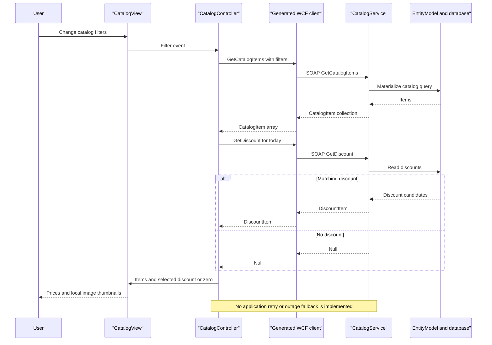

# API & Service Communication Contracts

The scoped application exposes **one SOAP service with ten operation contracts**, not ten REST routes. Its desktop consumer uses synchronous request/reply calls; generated asynchronous wrappers are also present.

## Service Catalog

| Service | Port | Category | Purpose |
|---|---|---|---|
| eShopWCFService | 62314, development only | Business | Catalog, discounts and dated stock; WCF service library, EF package (`src\eShopWCFService\eShopWCFService.csproj:11,15,45-49,121-123`) |
| eShopWinForms | No listening port | API consumer / presentation | Desktop client, not an API gateway; WCF proxy (`src\eShopWinForms\Program.cs:22-27`; `src\eShopWinForms\App.config:26-28`) |

No other independently deployable source service or container definition was found inside the requested workspace. Production host and port are unknown.

## API Endpoints Inventory

All operation rows use **POST `/CatalogService.svc`** with a SOAP envelope. The SOAP action is `http://tempuri.org/ICatalogService/<Operation>`; operations are not separate URL paths. Evidence: `src\eShopWinForms\Connected Services\eShopServiceReference\CatalogService.wsdl:114-208`. The authoritative source signatures are `src\eShopWCFService\ICatalogService.cs:15-34`.

| Service | Method | Path | Request Type | Response Type |
|---|---|---|---|---|
| CatalogService | POST | `/CatalogService.svc`, FindCatalogItem | `int id` | `CatalogItem`, null if absent (`src\eShopWCFService\CatalogService.svc.cs:33-44`) |
| CatalogService | POST | same, GetCatalogBrands | No arguments | `List<CatalogBrand>` |
| CatalogService | POST | same, GetCatalogItems | `int brandIdFilter, int typeIdFilter` | `List<CatalogItem>` |
| CatalogService | POST | same, GetCatalogTypes | No arguments | `List<CatalogType>` |
| CatalogService | POST | same, GetAvailableStock | `DateTime date, int catalogItemId` | `int`, zero if no record |
| CatalogService | POST | same, CreateAvailableStock | `CatalogItemsStock` | Void SOAP reply |
| CatalogService | POST | same, CreateCatalogItem | `CatalogItem` | Void SOAP reply |
| CatalogService | POST | same, UpdateCatalogItem | `CatalogItem` | Void SOAP reply |
| CatalogService | POST | same, RemoveCatalogItem | `CatalogItem` | Void SOAP reply |
| CatalogService | POST | same, GetDiscount | `DateTime day` | `DiscountItem`, null if no match |

There are no explicit application status-code mappings, typed `FaultContract`s, REST versioning or validation-to-400 behavior in the source contract. SOAP success/fault handling is framework-driven; exact deployed HTTP responses were not exercised (`src\eShopWCFService\ICatalogService.cs:12-34`; `src\eShopWCFService\CatalogService.svc.cs:28-117`).

## Management & Observability Endpoints

| Service | Endpoint | Custom Metrics (if any) |
|---|---|---|
| CatalogService | `/CatalogService.svc?wsdl`, metadata GET enabled | None evidenced |
| CatalogService | `/CatalogService.svc/mex`, WCF metadata exchange | None evidenced |
| Desktop | None | None evidenced |

Metadata evidence: `src\eShopWCFService\Web.config:27,38-40`. Metadata availability is not a database-readiness check. No health-check, Swagger or metrics endpoint is declared in the scoped service configuration/contract.

## DTOs & Contracts

`CatalogItem`, `CatalogBrand`, `CatalogType`, `CatalogItemsStock` and `DiscountItem` are mutable domain models decorated with `DataContract`/`DataMember`; catalog and stock models are also request contracts. There are no immutable DTOs or gateway composition DTOs (`src\eShopWCFService\Models\CatalogItem.cs:10-35`; `src\eShopWCFService\Models\CatalogBrand.cs:10-19`; `src\eShopWCFService\Models\CatalogType.cs:10-19`; `src\eShopWCFService\Models\CatalogItemsStock.cs:10-25`; `src\eShopWCFService\Models\DiscountItem.cs:11-31`). See `data-architecture.md` for fields.

SOAP XML data-contract serialization is evidenced by these annotations and checked-in WSDL/XSD; no OpenAPI, protobuf or GraphQL contract was found. Generated desktop contracts return arrays instead of server `List<T>` and accept nullable filter IDs, although source service filter arguments are non-nullable (`src\eShopWinForms\Connected Services\eShopServiceReference\Reference.cs:505-523,605-606`; `src\eShopWCFService\ICatalogService.cs:18-22`). This checked-in contract drift requires validation before regeneration; it is not evidence that null filters are handled by current service code.

## Communication Patterns

- **Synchronous:** desktop controller calls generated WCF channel; service calls EF directly (`src\eShopWinForms\Controllers\CatalogController.cs:35-54,75-84`; `src\eShopWCFService\CatalogService.svc.cs:56-82`).
- **Asynchronous:** generated `Task` wrappers exist, but the inspected controller uses synchronous methods. No queue/event transport is evidenced (`src\eShopWinForms\Connected Services\eShopServiceReference\Reference.cs:519-559`).
- **Composition:** desktop separately retrieves items and today's discount, then renders discounted prices. This is client-side composition, not gateway aggregation (`src\eShopWinForms\Controllers\CatalogController.cs:75-84`).
- **Resilience:** no explicit retry, circuit breaker, fallback, bulkhead or timeout override appears in active client binding/controller. Framework timeout defaults are not declared values and are not asserted here (`src\eShopWinForms\App.config:21-28`). Service/DB failure is not translated into a business fallback.
- **Discovery:** a fixed development URI is used; no service registry or load-balancer client (`src\eShopWinForms\App.config:26-28`).
- **Startup:** service and database must be available before initial view loading; see `configuration-inventory.md`.
- **Security posture:** the active endpoint/client use HTTP basicHttpBinding with no explicit client credentials, authorization or application role checks in the inspected configuration and service implementation. An HTTPS scheme mapping and HTTPS metadata flag exist, but do not establish an active TLS listener or enforce TLS on the explicit HTTP endpoint (`src\eShopWCFService\Web.config:27-40`; `src\eShopWinForms\App.config:21-28`). External IIS authentication/firewall policy is unknown.

## Service Technology Matrix

| Service | Web | Data Access | Discovery | Gateway | Actuator | Cache | Metrics |
|---|---|---|---|---|---|---|---|
| eShopWCFService | WCF / IIS | EF6 | None evidenced | No | None | None evidenced | None evidenced |
| eShopWinForms | Desktop WCF consumer | Remote service | Fixed URI | No | None | None evidenced | None evidenced |

Evidence: `src\eShopWCFService\CatalogService.svc:1`; `src\eShopWCFService\EntityModel.cs:10-22`; `src\eShopWinForms\Program.cs:22-27`; active configuration cited above.

## Service Communication Sequence

Sequence evidence: `src\eShopWinForms\Controllers\CatalogController.cs:27-29,75-84`; `src\eShopWCFService\CatalogService.svc.cs:28-30,56-62`; `src\eShopWinForms\Views\CatalogView.cs:48-61`. Static documentation only; endpoint reachability was not tested.
