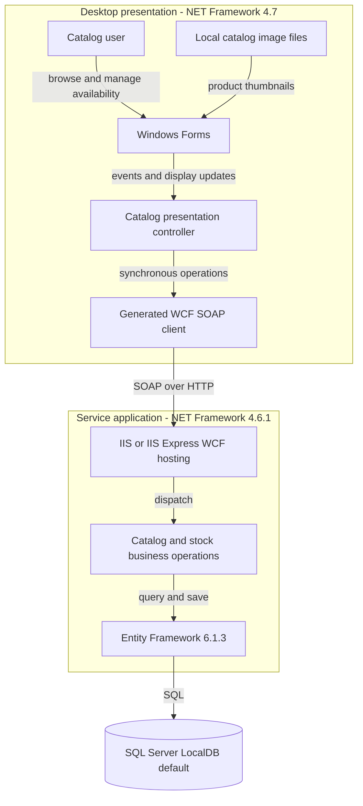
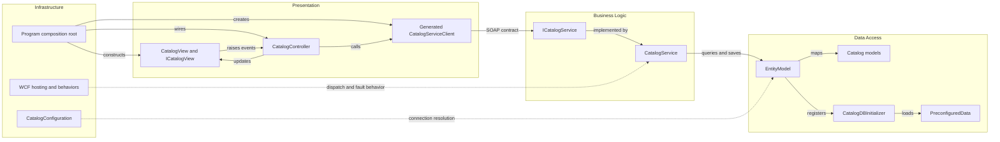

# Architecture Diagram

Static assessment of **eShopLegacyNTier only**. All evidence paths are relative to that workspace; deployed infrastructure and runtime behavior were not inspected.

## Application Architecture

Evidence: two projects are declared in `eShopLegacyNTier.sln:6-9`; target frameworks in `src\eShopWinForms\eShopWinForms.csproj:11` and `src\eShopWCFService\eShopWCFService.csproj:15`. Startup explicitly wires the view, generated proxy and controller (`src\eShopWinForms\Program.cs:22-27`). The transport is configured in `src\eShopWinForms\App.config:19-29`; EF context and default database connection are in `src\eShopWCFService\EntityModel.cs:10-22` and `src\eShopWCFService\Web.config:52-64`. Images are loaded from local disk, not a remote image service (`src\eShopWinForms\Views\CatalogView.cs:55-61`).

### Technology Stack Summary

| Layer | Technology | Version | Purpose |
|---|---|---|---|
| Presentation | Windows Forms / .NET Framework | 4.7 | Desktop UI; project references Windows Forms (`src\eShopWinForms\eShopWinForms.csproj:11,85`) |
| Communication | WCF basicHttpBinding | Framework-provided | SOAP request/reply (`src\eShopWinForms\App.config:21-28`) |
| Service | WCF / .NET Framework | 4.6.1 | IIS-hosted business operations (`src\eShopWCFService\eShopWCFService.csproj:15,18`; `src\eShopWCFService\CatalogService.svc:1`) |
| Persistence | Entity Framework | 6.1.3 | DbContext and SQL Server provider (`src\eShopWCFService\packages.config:3`; `src\eShopWCFService\Web.config:59`) |
| Storage | SQL Server LocalDB | Not pinned | Default development store; environment override possible (`src\eShopWCFService\Web.config:53-63`; `src\eShopWCFService\Models\Infrastructure\CatalogConfiguration.cs:10-17`) |

### Data Storage & External Services

One EF context owns catalog, reference data, date-specific stock and discounts. The configured connection defaults to LocalDB; a process environment connection string can replace it. No broker, remote API, distributed cache or cloud service is evidenced in the active startup and service paths. Local image files form a separate desktop deployment dependency. See `data-architecture.md` and `configuration-inventory.md`.

### Key Architectural Decisions

- Presentation logic is separated through `ICatalogView` and an explicitly constructed controller, without a DI container (`src\eShopWinForms\Controllers\CatalogController.cs:11-20`; `src\eShopWinForms\Program.cs:22-24`).
- Business operations access DbContext directly; no separate repository abstraction (`src\eShopWCFService\CatalogService.svc.cs:16-25,56-82`).
- Mutable domain models double as WCF data contracts (`src\eShopWCFService\Models\CatalogItem.cs:10-35`).

## Component Relationships

### Component Inventory

| Component | Layer | Type | Responsibility |
|---|---|---|---|
| Program | Infrastructure | Composition root | Constructs active components (`src\eShopWinForms\Program.cs:17-27`) |
| CatalogView / ICatalogView | Presentation | Form / interface | UI events, thumbnails and availability feedback (`src\eShopWinForms\Views\CatalogView.cs:18-29,48-61,157-195`) |
| CatalogController | Presentation | Controller | Filters, discount display and stock requests (`src\eShopWinForms\Controllers\CatalogController.cs:27-84,150-157`) |
| Generated CatalogServiceClient | Communication | WCF ClientBase | Delegates to service channel (`src\eShopWinForms\Connected Services\eShopServiceReference\Reference.cs:568-606`) |
| ICatalogService / CatalogService | Business | Contract / implementation | Ten operations (`src\eShopWCFService\ICatalogService.cs:12-34`) |
| EntityModel | Data access | DbContext | Five sets and model mappings (`src\eShopWCFService\EntityModel.cs:10-40`) |
| CatalogDBInitializer / PreconfiguredData | Data access | Initializer / seed factory | Create-if-absent seed data (`src\eShopWCFService\Models\Infrastructure\CatalogDBInitializer.cs:11-19`) |
| CatalogConfiguration / WCF behaviors | Infrastructure | Configuration | Connection override, metadata and faults (`src\eShopWCFService\Models\Infrastructure\CatalogConfiguration.cs:10-17`; `src\eShopWCFService\Web.config:23-40`) |

The server-side hand-written `CatalogServiceClient.cs` is not included in the server project's explicit compile list (`src\eShopWCFService\eShopWCFService.csproj:78-93`); it is not the active desktop proxy. `CatalogServiceMock` is compiled but not selected by the service host or desktop startup (`src\eShopWCFService\eShopWCFService.csproj:79`; `src\eShopWCFService\CatalogService.svc:1`; `src\eShopWinForms\Program.cs:23`).
