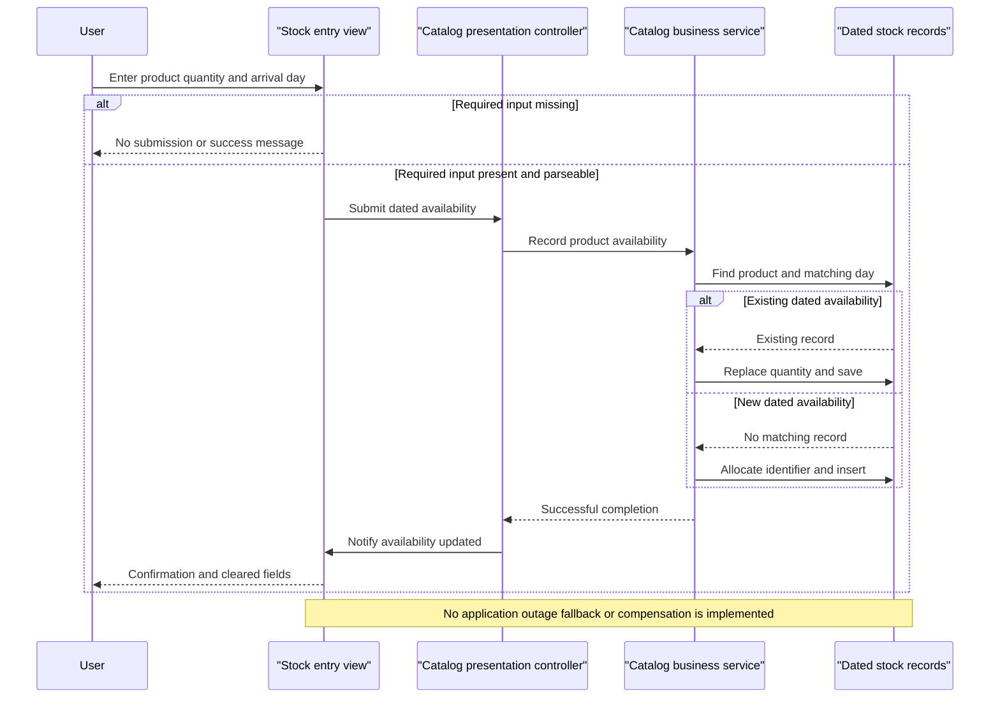

# Core Business Workflows

Users browse a product catalog by brand/type, see time-bounded promotional prices, look up stock for a date and record incoming availability. No checkout, customer-order, payment or fulfillment lifecycle is implemented in the inspected business paths.

## Domain Entities

| Entity | Service / Bounded Context | Description | Key Relationships |
|---|---|---|---|
| CatalogItem | CatalogService / catalog | Product shown to the user | Brand, type; logically referenced by dated stock |
| CatalogBrand | CatalogService / catalog | Product brand classification | Groups catalog items |
| CatalogType | CatalogService / catalog | Product category classification | Groups catalog items |
| CatalogItemsStock | CatalogService / inventory availability | Available quantity for one product on a day | Logical product association |
| DiscountItem | CatalogService / promotions | Global discount interval | Applied to displayed catalog prices; no product-specific association |

Evidence: `src\eShopWCFService\Models\CatalogItem.cs:11-35`; `src\eShopWCFService\Models\CatalogBrand.cs:11-19`; `src\eShopWCFService\Models\CatalogType.cs:11-19`; `src\eShopWCFService\Models\CatalogItemsStock.cs:12-25`; `src\eShopWCFService\Models\DiscountItem.cs:12-31`. Persistence fields and relationship-mapping caveats are in `data-architecture.md`.

## Service-to-Domain Mapping

| Service | Domain Context | Owned Entities | External Dependencies |
|---|---|---|---|
| CatalogService | Catalog, inventory availability, promotions within one service | All five domain models | One service-owned persistence context |
| Desktop CatalogController / CatalogView | Catalog presentation and stock-entry interaction; not an independent domain service | No authoritative persistent entities | CatalogService contracts and local product images |

Evidence: `src\eShopWCFService\EntityModel.cs:18-22`; `src\eShopWinForms\Controllers\CatalogController.cs:11-20,35-84`; `src\eShopWinForms\Views\CatalogView.cs:55-61`. These are functional groupings, not independently isolated DDD services.

## Primary Workflows

### Workflow 1: Initialize and browse discounted catalog

1. Desktop composition creates the view, service proxy and controller; initial loading happens before the dialog is shown (`src\eShopWinForms\Program.cs:22-27`).
2. LoadView checks today's discount, loads items, loads brand/type selectors and populates the shipment product list (`src\eShopWinForms\Controllers\CatalogController.cs:150-157`).
3. Changing either selector raises a filter event. The controller clears the grid, fetches matching products and independently fetches today's discount (`src\eShopWinForms\Views\CatalogView.cs:106-135`; `src\eShopWinForms\Controllers\CatalogController.cs:27-29,75-84`).
4. The service applies the **All-filter rule** and **Active-discount rule** below. The view computes displayed prices and loads local thumbnails (`src\eShopWCFService\CatalogService.svc.cs:28-30,56-62`; `src\eShopWinForms\Views\CatalogView.cs:48-61`).

The discount banner is checked during initial loading; price data is refreshed on subsequent catalog reloads. No polling timer or discount-change event is evidenced (`src\eShopWinForms\Controllers\CatalogController.cs:60-84,150-157`).

### Workflow 2: Record or replace dated stock availability

1. User chooses a product, quantity and arrival date. The **Shipment-input rule** gates submission (`src\eShopWinForms\Views\CatalogView.cs:157-167`).
2. Controller constructs a stock contract and submits it (`src\eShopWinForms\Controllers\CatalogController.cs:35-43`).
3. Service finds the first matching product/day. Under the **Stock-replacement rule**, an existing record is overwritten; otherwise a new record is assigned an ID and added (`src\eShopWCFService\CatalogService.svc.cs:99-117`).
4. Only after the call returns does the view show success and clear entry controls (`src\eShopWinForms\Controllers\CatalogController.cs:42-43`; `src\eShopWinForms\Views\CatalogView.cs:189-195`).

Despite the UI's shipment wording, this is a dated availability upsert, not an additive shipment ledger or a stock reservation.

### Workflow 3: Check dated availability

The UI derives the selected product and calendar day, invokes the controller, and the service returns matching quantity or zero. The result is appended to the displayed availability list (`src\eShopWinForms\Views\CatalogView.cs:142-151,173-182`; `src\eShopWinForms\Controllers\CatalogController.cs:50-54`; `src\eShopWCFService\CatalogService.svc.cs:90-96`). Zero does not distinguish an absent row from a stored zero quantity.

### Other workflows

The service contract also exposes product create/update/remove and single-product lookup, but the active desktop controller has no corresponding UI workflow. Database first-use initialization seeds demonstration business data, including historical promotions (`src\eShopWCFService\ICatalogService.cs:15-34`; `src\eShopWCFService\Models\Infrastructure\CatalogDBInitializer.cs:11-19`; `src\eShopWCFService\Models\Infrastructure\PreconfiguredData.cs:41-50`). No scheduled job or event-driven business workflow was found in the scoped active source.

## Cross-Service Data Flows

There is one business service and one desktop consumer, not a multi-service gateway. The desktop combines product results with one global discount response; product IDs link UI selection to stock operations. There is no remote domain-data fan-out, message choreography or degraded-response fallback. A missing discount yields undiscounted prices; a missing stock record yields zero. These are normal business absence cases, not service-outage handling (`src\eShopWinForms\Controllers\CatalogController.cs:75-84`; `src\eShopWCFService\CatalogService.svc.cs:28-30,90-96`).

## Business Workflow Sequence

Sequence evidence: `src\eShopWinForms\Views\CatalogView.cs:157-167,189-195`; `src\eShopWinForms\Controllers\CatalogController.cs:35-43`; `src\eShopWCFService\CatalogService.svc.cs:99-117`.

## Business Rules & Decision Logic

| Rule / concern | Actual behavior and evidence |
|---|---|
| All-filter rule | Filter ID zero means All; otherwise item brand/type must match. Both conditions are combined (`src\eShopWCFService\CatalogService.svc.cs:56-62`). |
| Active-discount rule | Start and end are inclusive calendar dates; first matching discount is selected without ordering or overlap resolution (`src\eShopWCFService\CatalogService.svc.cs:28-30`). |
| Display-price calculation | Display uses price multiplied by one minus discount fraction, converted to double and formatted; persisted product price is not changed. Banner rounds fraction times 100 (`src\eShopWinForms\Views\CatalogView.cs:48-61`; `src\eShopWinForms\Controllers\CatalogController.cs:60-68`). |
| Shipment-input rule | Returns early if product is unselected or quantity/date text is empty. Otherwise int.Parse and Convert.ToDateTime are called; no TryParse, nonnegative-quantity check or allowed date window is evidenced (`src\eShopWinForms\Views\CatalogView.cs:157-167`). |
| Stock-replacement rule | First row matching product and calendar day is overwritten, not incremented; otherwise insert. No explicit product/day uniqueness declaration or server-side quantity validation is present (`src\eShopWCFService\CatalogService.svc.cs:99-117`; `src\eShopWCFService\Models\CatalogItemsStock.cs:10-25`). |
| Missing data | Missing item returns null; missing stock returns zero; missing discount returns null (`src\eShopWCFService\CatalogService.svc.cs:28-44,90-96`). |
| Identifier allocation | Product and stock insertion use current maximum plus one; no empty-set fallback or concurrency reservation is implemented (`src\eShopWCFService\CatalogService.svc.cs:65-70,113-116`). |
| Declared model constraints | Brand and type strings declare maximum length 50. No explicit discount fraction bounds or temporal ordering validation is declared (`src\eShopWCFService\Models\CatalogBrand.cs:17-19`; `src\eShopWCFService\Models\CatalogType.cs:17-19`; `src\eShopWCFService\Models\DiscountItem.cs:18-31`). |
| State transitions | Stock record creation/replacement and product mutation only; no order/shipment status state machine evidenced (`src\eShopWCFService\CatalogService.svc.cs:65-82,99-117`). |
| Transactions and integrity | Separate SaveChanges per mutation; no explicit multi-operation transaction, saga, concurrency token or compensation. Brand/type lookups populate returned single-product navigation objects (`src\eShopWCFService\CatalogService.svc.cs:33-39,65-82,99-117`). |
| Errors and audit | No business exception translation, catch/retry path, audit trail or business-event logging in the active workflow. Parsing, image-loading and persistence failures have no application fallback here (`src\eShopWinForms\Views\CatalogView.cs:55-59,162-167`; `src\eShopWCFService\CatalogService.svc.cs:99-117`). |
| Authorization | No user/resource/role checks in the service methods or desktop controller. Hosting access controls outside source are unknown (`src\eShopWCFService\CatalogService.svc.cs:14-117`; `src\eShopWinForms\Controllers\CatalogController.cs:14-157`). |

Limitations: workflow conclusions reflect inspected static source, not executed UI behavior or a live database. No tests/builds were run; demonstration data and UI messages do not prove production business requirements.
